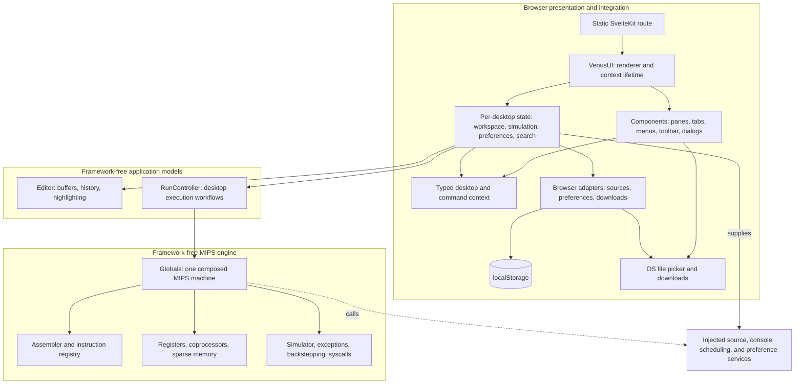
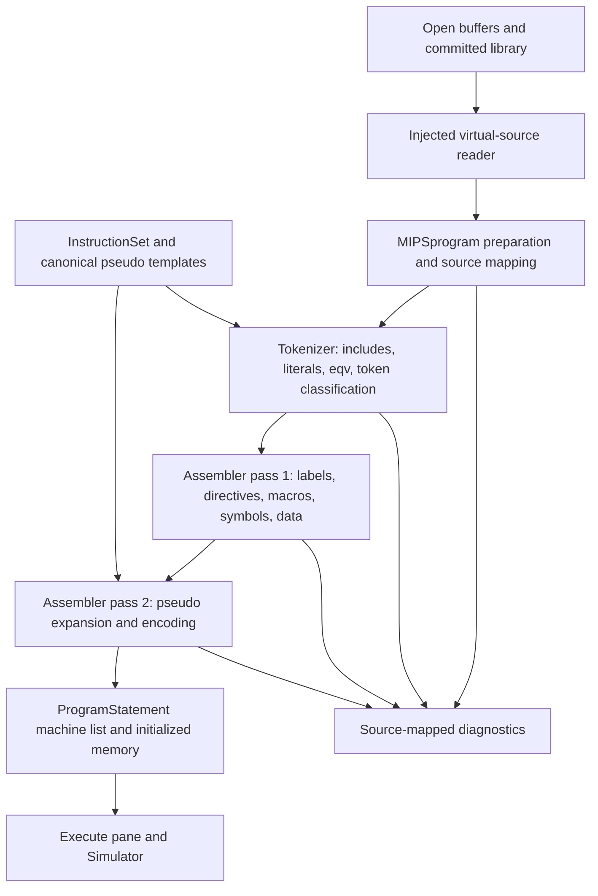
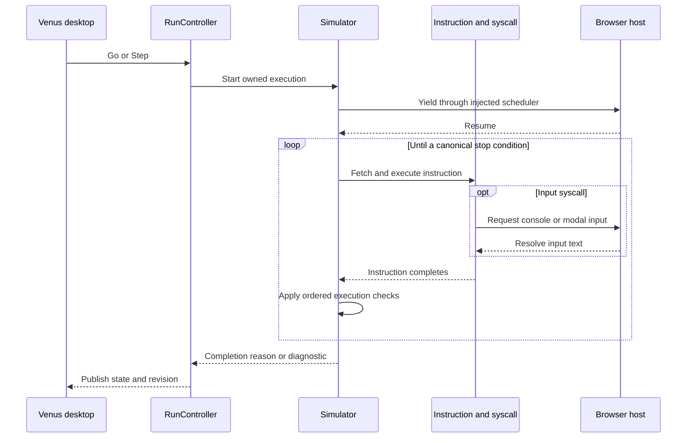
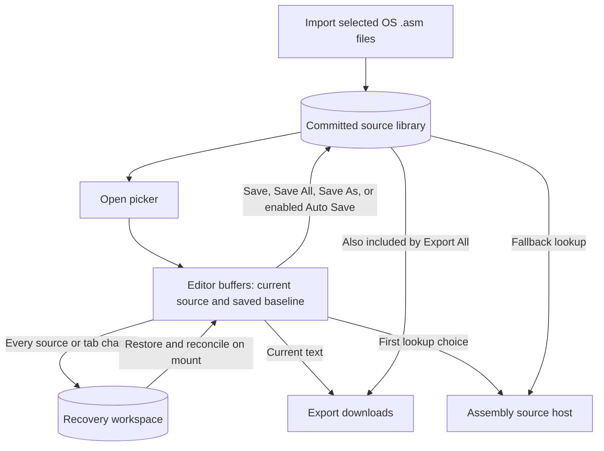
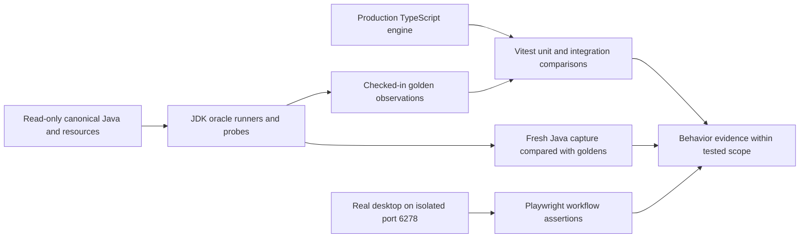

# MARS-ts implementation guide

MARS-ts is a browser-hosted interpretation of MARS, the educational MIPS Assembler and Runtime Simulator. It translates the checked-in Java implementation into TypeScript and replaces Swing with a Svelte desktop interface. Its target release is **MARS-ts 1.0**. The original Java algorithms, instruction definitions, class responsibilities, and observable machine behavior remain the reference; browser storage, event handling, and scheduling provide the new environment in which they operate.

This document describes the **current implemented system**, including its established boundaries and limitations. It is not a declaration that every legacy feature has been ported or that the target release is complete. Core assembly, execution, and debugging are implemented and exercised against Java captures and browser scenarios. Platform-dependent syscalls, several configuration dialogs, Tools, and memory export remain unfinished. The [port plan](docs/adrs/0000-port-plan.md) governs intended scope; the [decision records](docs/README.md) explain consequential choices; module READMEs describe local contracts in greater detail.

Update this guide in the same change that adds a feature, ports a subsystem, changes persistence or ownership, or resolves a limitation described here. Keep the [README](README.md) as the short entry point, and keep test results tied to reproducible evidence rather than treating a historical passing run as a permanent guarantee.

## Guide map

The chapters below follow the system from browser entry through machine behavior, source persistence, and verification. The architecture chapter establishes ownership; the workflow chapters explain the observable contracts that those owners preserve.

| To understand                                           | Start with                                                                                                                                                                                                         |
| ------------------------------------------------------- | ------------------------------------------------------------------------------------------------------------------------------------------------------------------------------------------------------------------ |
| How the familiar desktop becomes a browser application  | [Desktop interpretation](#the-desktop-to-browser-interpretation), including startup, native-operation adaptations, and Help                                                                                        |
| Which module owns state and behavior                    | [Architecture and module ownership](#architecture-and-module-ownership), including session lifetimes, numeric semantics, and memory                                                                                |
| How source becomes an executable program                | [Assembly](#assembly-source-text-to-machine-statements), then [execution, debugging, and host services](#execution-debugging-and-host-services)                                                                    |
| How source work survives edits, transfers, and reloads  | [Browser working filesystem](#the-browser-working-filesystem), including commit rules, renaming, recovery, and failure behavior                                                                                    |
| How the UI exposes commands and stores preferences      | [Editor and desktop presentation](#editor-and-desktop-presentation), then [configuration and persistence](#configuration-and-persistence)                                                                          |
| How to assess, build, and extend the implemented system | [Evidence and validation](#evidence-and-validation), [build and delivery](#build-development-and-delivery), [remaining scope](#remaining-scope-and-extension-rules), and [provenance](#provenance-and-attribution) |

## The desktop-to-browser interpretation

### Workspace and startup

The application opens directly into the main MARS desktop. Source editing and execution share the central workspace, Messages and Run I/O occupy the lower pane, and registers occupy the adjustable right pane. Familiar menus, toolbar actions, symbol inspection, memory inspection, and stepping remain the organizing model. The port preserves the useful desktop workflow while changing operations whose meaning depended on a native Java process.

During initialization, an accessible, continuously rotating loading spinner appears while saved sources, preferences, and the engine are restored. The desktop stays hidden until its restored pane layout has been measured, then appears automatically in its initialized form.

Engine startup builds and tokenizes the canonical instruction registry. Register lookup and token classification share a conservative integer-prefix check, avoiding repeated caught numeric-parsing exceptions for ordinary register names, operators, and directives. Numeric candidates still pass through the original full parser, including its Unicode and legacy fallback behavior; registry ordering and initialization remain unchanged.

### Native-to-browser adaptations

| Legacy responsibility                       | Current browser interpretation                                                                                |
| ------------------------------------------- | ------------------------------------------------------------------------------------------------------------- |
| Java static machine globals                 | One `Globals` instance per mounted IDE, with independent registers, memory, settings, programs, and simulator |
| Swing windows and modal dialogs             | Svelte components and same-tab native HTML dialogs; no splash or intermediary launcher                        |
| Native source files and Save                | A localStorage source library containing complete source text; Save commits to that library                   |
| Unsaved editor buffers                      | A separate persistent recovery workspace, including full text and saved baselines                             |
| Native Open                                 | A same-tab picker over the local source library                                                               |
| Moving source between the IDE and OS        | Explicit Import of `.asm` files and Export downloads; no retained OS file handles                             |
| Assemble a directory                        | Assemble the active source and its explicit includes through the virtual source host                          |
| SwingWorker and blocking input              | Cooperative asynchronous simulation through injected scheduling and input services                            |
| Editor/Highlighting configuration dialogs   | Bundled JSON presets selected by the application's editors; user display toggles remain available             |
| Command-line launcher and program arguments | Excluded from the web application; Java command-line execution remains development-only oracle infrastructure |
| Application Print and Exit                  | Printing uses the browser; Exit closes documents through the dirty-buffer workflow and leaves the IDE open    |
| Raster toolbar imagery                      | SVG icons with retained attribution; the favicon remains the original MARS ICO                                |

### Help and source examples

The Help dropdown opens individual articles for Introduction, Debugging, Settings, Syscalls, Exception Handlers, Macros, Tools, Limitations, Release History, and Acknowledgements, alongside the F1 overview and About MARS. The [Help module](src/lib/help/README.md) owns their catalog and content. Menu metadata, the overview, and About are available immediately; each longer article loads as a separate hashed asset when opened, with loading and failure feedback inside the dismissible dialog. Current-use articles describe implemented browser behavior; historical acknowledgements, release history, and Java extension instructions retain original credits and dates with explicit legacy context. The syscall reference marks each service’s availability and uses a bounded, independently scrollable table with fixed column headers. Long articles scroll inside the shared dialog, keeping its title and dismissal control visible. Code snippets offer clipboard copying with feedback and an action to open the exact snippet in a new editor source without replacing existing buffers; opening code is disabled during execution. Shared Clipboard variants own copy feedback and transfer controls; the Help attachment mounts and releases them while the workspace remains responsible for creating the new source.

These adaptations are specified in [ADR 0002](docs/adrs/0002-port-fidelity.md), [ADR 0003](docs/adrs/0003-browser-file-workflows.md), and [ADR 0004](docs/adrs/0004-cooperative-simulation.md). They do not authorize replacement assembly or simulation algorithms in the GUI.

## Architecture and module ownership

### Runtime composition

The shipped application is static HTML, CSS, JavaScript, and assets. SvelteKit prerenders the route; browser mounting creates the live desktop and machine. There is no application server storing source files or executing MIPS programs. Java is a development dependency for behavioral comparisons, not a browser runtime dependency.

Arrows describe use or ownership relationships, not a complete import graph. In particular, the engine calls host interfaces; it does not import the browser implementations shown above it.

The [library architecture guide](src/lib/README.md) expands these relationships and their dependency boundaries. The [Venus guide](src/lib/venus/README.md) details UI composition, state ownership, command flow, and component lifetimes.

### Module responsibilities

| Module boundary                                                                                              | Responsibility and principal relationships                                                                                                                                                                                                                 |
| ------------------------------------------------------------------------------------------------------------ | ---------------------------------------------------------------------------------------------------------------------------------------------------------------------------------------------------------------------------------------------------------- |
| [Routes](src/routes/)                                                                                        | Prerender the application shell and mount the main desktop directly                                                                                                                                                                                        |
| [Venus](src/lib/venus/README.md)                                                                             | The top-level `VenusUI.svelte` renders the layout and provides one desktop context; it mounts and releases the composed state lifetime                                                                                                                     |
| [Venus components](src/lib/venus/components/README.md)                                                       | Group presentation by shell, controls, layout, editor, debugger, feedback, transfers, and dialogs; compose generic pane/tab shells, grouped commands, and snippets; retain element-local interaction state and cleanup while state owners retain workflows |
| [Venus state](src/lib/venus/state/README.md) and [keyboard hooks](src/lib/venus/hooks/README.md)             | Separate workspace/file workflows, simulation/input/scheduling, preferences/layout, and source search; coordinate explicit keyboard commands with component-lifetime cleanup                                                                               |
| [Venus context](src/lib/venus/context/README.md) and [presentation utilities](src/lib/venus/utils/README.md) | Share root-owned command capabilities and stateless presentation rules across menus, toolbars, shortcuts, and numeric tables                                                                                                                               |
| [Help](src/lib/help/README.md)                                                                               | Own the Help menu catalog, overview/About content, and attributed articles adapted to current browser workflows; Venus opens them in the shared modal                                                                                                      |
| [Editor](src/lib/editor/README.md)                                                                           | Own source buffers, names, selected tab, dirty state, saved baselines, and per-buffer undo/redo                                                                                                                                                            |
| [Editor highlighting](src/lib/editor/highlighting/README.md)                                                 | Translate the legacy lexical token marker and paint source; consume instruction/directive metadata for presentation without assembling code                                                                                                                |
| [Browser](src/lib/browser/README.md)                                                                         | Validate and persist sources/preferences, normalize virtual filenames, and initiate downloads with resource cleanup                                                                                                                                        |
| [Engine composition](src/lib/engine/README.md)                                                               | Compose `Globals` and settings, wire the actual translated collaborators, and replace Java global dependencies with session ownership                                                                                                                      |
| [Assembler](src/lib/engine/assembler/README.md)                                                              | Own source preparation, tokenization, includes, equivalences, macros, symbol tables, directives, pseudo expansion, and statement encoding                                                                                                                  |
| [Instructions](src/lib/engine/instructions/README.md)                                                        | Own basic and extended instruction definitions, decoding, ordered lookup, expansion templates, and basic execution callbacks                                                                                                                               |
| [Hardware](src/lib/engine/hardware/README.md)                                                                | Own registers, coprocessors, memory layouts, sparse storage, access notices, and recording hooks                                                                                                                                                           |
| [Simulator](src/lib/engine/simulator/README.md)                                                              | Own execution ordering, delayed branches, stop/breakpoint checks, exceptions, and grouped machine undo                                                                                                                                                     |
| [Syscalls](src/lib/engine/syscalls/README.md) and [I/O](src/lib/engine/io/README.md)                         | Own translated runtime service algorithms and the injected console boundary; the host supplies platform interactions                                                                                                                                       |
| [Formatting](src/lib/engine/formatting/README.md)                                                            | Preserve Java-compatible integer/binary/ASCII conversions and floating-point parsing/printing                                                                                                                                                              |
| [Diagnostics](src/lib/engine/diagnostics/README.md)                                                          | Preserve source locations, macro/include history, diagnostic ordering, messages, and processing exceptions                                                                                                                                                 |

`RunController` is framework-free even though it belongs to Venus: it translates the desktop Run action responsibilities and can be exercised by integration tests without rendering Svelte. It publishes state records and revisions; the machine remains the sole owner of registers and memory. Views read those objects rather than maintaining a second simulated state.

### Session and lifetime rules

Each desktop mounts one editor, one machine, and one run controller. Machine state is not a module singleton and is not created as shared SSR state. Immutable metadata may be shared, but mutable register banks, memory tables, symbol tables, instruction collaborators, and execution history belong to their session.

Hardware access notices are synchronous and preserve the observable Java ordering. Consumers receive unsubscribe functions. Inspection uses nonnotifying reads where appropriate so painting a register does not masquerade as executing an instruction. An explicit access origin replaces dependence on Java thread identity.

A simulation retains ownership until its promise settles, including while it waits for input. Svelte teardown releases subscriptions and initiates controller disposal without blocking DOM removal. Disposal requests Stop and releases pending input and scheduler waits; the controller retains the old machine until its run settles asynchronously, then releases its resources. Reset and replacement assembly cannot race an active simulation. These rules are part of correctness, not merely UI cleanup.

[ADR 0006](docs/adrs/0006-object-lifetime-management.md) records the ownership and lifetime audit, including browser resource release, operation-specific validity checks, and the distinction between isolated runtime objects and origin-wide persistence. Its browser regressions exercise superseded imports, delayed clipboard mutations, source creation, pending work across unmount, and repeated mounting.

### Java behavior on JavaScript numbers

MIPS words use signed 32-bit `number` values with explicit wrapping. Addresses may therefore be negative as stored Java integers; unsigned ordering and display conversions are applied where the canonical behavior requires them. Exact 64-bit arithmetic and bit patterns use `bigint`, including multiplication/HI-LO operations and floating-register pairs. Floating registers retain integer bits, with instance-owned conversion scratch space.

The translation preserves integer overflow, shift masking, signed versus unsigned comparisons, single-precision rounding, floating cast saturation, raw-bit operations, and observable register-write order. Java floating text conversion requires its own compatibility implementation: JavaScript's ordinary parsing and printing are not substituted for the Java contracts. The formatting module uses exact arithmetic and nearest-even rounding, including direct rounding to float precision. JDK-generated character metadata preserves the character classifications consumed by assembly and highlighting. These semantics are checked with focused oracle probes rather than inferred from the similarity of the two languages.

### Machine storage and address spaces

The hardware module models the general registers, HI/LO, PC, exception coprocessor, floating coprocessor, and its condition flags. Register zero retains its architectural write restriction. Floating doubles use paired registers with the canonical low/high-word arrangement and access order. Exception handling updates CP0 cause, EPC, status, and bad-address state through the translated exception collaborator.

Memory uses sparse block tables rather than allocating a browser array for the entire address space. User/kernel data, descending stack, memory-mapped I/O, and user/kernel instruction storage retain their distinct legacy responsibilities. Text storage holds real statement references; self-modifying-code paths obtain decoded statements through the session's actual instruction decoder. Default byte order is little-endian. Alignment, address-range failures, heap allocation, and observable access notices belong to memory, not the Data Segment view.

The hardware boundary groups [register banks](src/lib/engine/hardware/registers/README.md), [memory and layouts](src/lib/engine/hardware/memory/README.md), and [access notices](src/lib/engine/hardware/notices/README.md) by their ownership. State publishers retain their distinct subscription algorithms; immutable notice records do not introduce a common event bus. Configuration selection stays with memory metadata while the session callback applies its register-reset effects.

The engine retains the Default, CompactDataAtZero, and CompactTextAtZero configurations. In the default layout, user text begins at `0x00400000`, static `.data` at `0x10010000`, and the heap at `0x10040000`; `$gp` initializes to `0x10008000` and `$sp` to `0x7fffeffc`. Configuration changes clear storage and reset the relevant register defaults through the session owner. The configuration dialog remains unfinished. Having an MMIO address region likewise does not mean the deferred device Tools have been implemented.

## Assembly: source text to machine statements

### Source selection and includes

Assemble reads the current source text, including unsaved edits. It assembles the active source and its explicit `.include` directives. Other open tabs are not automatically assembled; the assemble-all UI has been removed and its saved preference is reset on desktop initialization. Source resolution prefers open buffers and then committed local-library records. A library source can satisfy an include without being an open tab. There is no native directory scan or network source discovery.

### Preparation and assembly pipeline

The assembler follows the original multi-pass algorithms. Tokenization retains original and expanded positions, include processing, character literal handling, and recursive `.eqv` substitution. Program-owned macro pools retain overloads, parameter conventions, expansion counters, recursion detection, and local-label treatment. Local and session-global symbol tables remain distinct. Directives allocate and initialize data, enforce their canonical range checks, transfer global symbols, and resolve forward references.

The assembler root retains pass orchestration and operand matching, with [tokenization](src/lib/engine/assembler/tokenization/README.md), [directive metadata](src/lib/engine/assembler/directives/README.md), [symbols](src/lib/engine/assembler/symbols/README.md), [macros](src/lib/engine/assembler/macros/README.md), and [program/statement representations](src/lib/engine/assembler/programs/README.md) grouped by responsibility. Consumers import their owners directly. The character-table capture runner targets the tokenization group's generated data; oracle formats and expected values remain unchanged.

### Instruction and statement contracts

The instruction registry contains the translated **155 basic registrations and 388 pseudo definitions** in canonical order. Basic instruction descriptors supply syntax, masks, formats, and simulation callbacks. Extended instructions use the original ordered template substitutions and compact/delayed-branch alternatives. The bundled pseudo-operation data is tested against the unchanged `_legacy-app/PseudoOps.txt`; it is not a second manually maintained instruction language.

`ProgramStatement` owns source/basic/machine representations, operand resolution, encoding, and decoding. Diagnostics retain source filenames, positions, include mappings, macro history, warning policy, and canonical text. The UI displays those diagnostics rather than generating its own interpretation of an assembly error. Failures retain the engine's tested mutation and lifecycle behavior; callers must not assume assembly is a transactional operation that leaves memory untouched on error.

### Invalidation, reset, and evidence

A successful assembly initializes the execution view and undo history. Editing source invalidates the executable program until another assembly. Reset reassembles the retained tokenized programs under the previous assembly policy, restoring initialized memory and registers; it is distinct from assembling newly edited text.

The [complete assembly corpus](tests/oracle/assembler-programs/README.md) compares 603 assemblies, including instruction examples and focused success/error cases. Smaller probes separately isolate tokenizer, operand selection, statement encoding, macros, diagnostics, and program lifecycle. Catalog coverage does not imply every possible combination of operands and directives has been tested.

## Execution, debugging, and host services

### Cooperative execution and input

`Simulator` runs the translated instruction loop against the session's real memory and register banks. It preserves fetch and dispatch behavior, exceptions, delayed-branch transitions, stop reasons, breakpoint checks, and instruction limits in the canonical order. The GUI issues commands through `RunController`; it does not execute an approximation of MIPS itself.

The current browser implementation runs cooperatively on the main thread. The injected scheduler yields initially, between bounded batches at unlimited speed, and for the selected delay at limited speeds. This lets the browser process input, redraw, and request Pause or Stop. No Web Worker is currently used. The legacy speed control retains its 41 positions, with positions 36–40 treated as unlimited.

Input does not allow a subsequent instruction to overtake the pending syscall. Pause/Stop can release a pending read; the syscall still completes and the simulator performs its canonical checks. The current input text is returned on cancellation, preserving numeric parse errors when that text is invalid rather than silently converting cancellation into a valid value.

### Debugger behavior

| Action or view          | Current behavior                                                                                                                  |
| ----------------------- | --------------------------------------------------------------------------------------------------------------------------------- |
| Go / Step               | Run from the current PC, or execute one machine instruction                                                                       |
| Pause / Stop            | Request interruption through the simulator's owned operation and release pending input                                            |
| Backstep                | Restore the latest grouped instruction changes through the program's `BackStepper`                                                |
| Reset                   | Reassemble retained program representations and reset initialized machine state                                                   |
| Breakpoints             | Address-based selections in the Text Segment; suspend all without losing addresses, or clear all                                  |
| Registers               | Inspect integer, CP0, CP1, and condition state; permitted edits affect the actual machine while stopped                           |
| Floating register edits | Accept decimal input through Java-compatible conversion or exact hexadecimal bits                                                 |
| Text Segment            | Show encoded/basic/source statements, current execution location, and source navigation                                           |
| Data Segment            | Show 16 address rows per page, navigation/range selection, and decimal/hexadecimal/ASCII views; permit word editing while stopped |
| Labels                  | Filter Data/Text symbols, sort by Label or Address, and navigate to the corresponding segment location                            |

The Text Segment heading stays above its independently scrolling instruction table, matching the other Execute sub-panel titles. As the highlighted instruction changes during execution or stepping, the Text Segment scrolls that row to the top beneath the sticky column headings. Near the end of the program, scrolling clamps at the last page rather than adding blank rows. Tracking scrolls only the instruction pane and preserves horizontal position and keyboard focus.

Backstepping uses bounded history and restores recorded machine changes with recording temporarily disabled. It is machine-state undo, not a persistent session checkpoint or reversal of browser side effects: source editing history is a different subsystem, and already-emitted console text is not an external transaction that the machine can retract.

### Implemented syscall boundary

| Family                                           | Services                    | Implementation                                                                     |
| ------------------------------------------------ | --------------------------- | ---------------------------------------------------------------------------------- |
| Console integer, float, double, string           | 1–8                         | Print/read through session `SystemIO` and injected host callbacks                  |
| Heap allocation                                  | 9                           | Allocate through session memory                                                    |
| Termination                                      | 10, 17                      | Canonical GUI termination; Exit2 does not set a browser/process exit status        |
| Character output/input                           | 11–12                       | Preserve Java character/UTF-16 behavior and memory truncation rules                |
| Integer display formats                          | 34–36                       | Hexadecimal, binary, and unsigned decimal output                                   |
| File, time, sleep, random, MIDI, syscall dialogs | Remaining platform families | Deferred; unavailable services produce the canonical unsupported-service exception |

The optional popup-input preference changes the presentation of the implemented console reads. It does **not** mean the separate MARS dialog syscall family has been implemented. Likewise, the editor's source library is not an implementation of runtime file-descriptor syscalls.

`SyscallLoader` uses explicit per-session factories instead of Java reflection. Service-number overrides and collision checks remain its responsibility. New services must bring their actual algorithm, host contract, and oracle evidence; a browser placeholder does not count as a port.

## The browser working filesystem

### Virtual names and storage boundaries

The working filesystem is a named collection of source texts in localStorage. A virtual filename is an identity and include-resolution path, not an OS file handle. Import and Export are explicit transfers across that boundary. Virtual names are relative, normalize separators and dot segments, and cannot escape the library root.

The Open dialog lists existing sources in case-insensitive lexicographic filename order, with exact spelling as a deterministic tie-breaker. This is a presentation ordering; it does not reorder committed records or existing editor tabs.

Two separate records prevent manual saving from conflicting with recovery:

- **Committed library:** complete saved text under each virtual name. Open and include lookup use these records when there is no corresponding open buffer.
- **Recovery workspace:** complete current text for every open buffer, its last saved text, new-file state, and selected-tab flag. This protects uncommitted and never-saved work without implicitly committing it.

### Commit and transfer semantics

| Operation                | Effect                                                                                                                                                                                                                               |
| ------------------------ | ------------------------------------------------------------------------------------------------------------------------------------------------------------------------------------------------------------------------------------ |
| New                      | Create a uniquely named open buffer, preserving other tabs; recovery includes its source before any explicit Save                                                                                                                    |
| Open                     | Select one or more library sources; an already-open name focuses its existing buffer and preserves edits                                                                                                                             |
| Save                     | Commit the current source; a new file prompts for its name; only successful persistence updates the saved baseline                                                                                                                   |
| Save All                 | Process the open buffers, resolving new filenames as needed; cancellation preserves remaining work                                                                                                                                   |
| Save As                  | Commit current text under another name while retaining the old saved record by default                                                                                                                                               |
| Rename toggle in Save As | Display the old filename, then remove that identity and save the new one in the same library write                                                                                                                                   |
| Inline source-tab rename | Double-click the filename or press F2 on its focused tab; submit through the same rename workflow with Enter or by moving focus, or cancel with Escape                                                                               |
| Auto Save                | Initially off; enabling it commits all changed open buffers, and later source changes commit automatically when text differs                                                                                                         |
| Delete in Open           | Confirm the selected names and any unsaved-buffer loss, then remove records and close matching tabs; cancellation preserves selection and content                                                                                    |
| Import                   | Read one or more `.asm` files with the system picker, commit a batch, and open them; confirm saved-name replacement and refuse to overwrite edited open buffers                                                                      |
| Export                   | Download current buffer text as `.asm`, without changing dirty state or saved baselines                                                                                                                                              |
| Export All               | Enabled when saved sources or open buffers exist; download `mars-asm-src-files.zip` containing the union of library sources and open buffers as flat `.asm` entries, preferring current open text and disambiguating flattened names |
| Close / Exit             | Resolve dirty buffers through Save, Discard, or Cancel; Exit closes documents, not the browser tab                                                                                                                                   |

### Inline rename and name validation

Source-tab renaming delegates to the workspace's existing Save As Rename persistence path. A valid submission commits the current source under the requested identity, updates the tab label immediately, and retains the source buffer and its editing history. The inline input accepts Enter or moving focus as submission; Escape restores the displayed name without submitting.

Renames require a nonempty basename with an `.asm` or `.s` extension and must satisfy the virtual-path rules. An invalid name, malformed extension, or name already owned by another open buffer opens a warning modal and restores the most recent valid filename without changing the current source. A collision with a closed saved source retains the existing Replace confirmation; it is not silently overwritten. Persistence failures remain recoverable errors and do not mark uncommitted work as saved.

### Recovery and reconciliation

Recovery writes occur synchronously after source/tab changes in both manual-save and Auto Save modes. Loading or selecting a restored tab does not commit it. Clean restored buffers reconcile with newer committed text. If an older dirty recovery buffer conflicts with newer saved text, both versions remain intact and Auto Save is disabled with a visible notice.

### Storage failures and recovery limits

Source record validation rejects malformed structures and duplicate identities. Library writes first read the latest collection so unrelated saved sources survive; batch import and rename update their library record in one storage write. This is not a multi-tab transactional database: there is no distributed lock, collaborative editing protocol, or atomic transaction spanning the library and recovery keys.

Quota errors, denied storage, and corrupt source records are surfaced instead of marking unsaved text as saved. A malformed recovery record is preserved rather than overwritten during failed restoration. Preferences can fall back to in-memory behavior, but that does not guarantee source persistence when storage is unavailable. Storage belongs to the browser origin and profile; clearing site data removes it. Export creates a portable copy independent of that storage, and browsers may require permission for multiple downloads.

Undo history, breakpoints, assembled programs, register/memory state, and pending runtime input are not recovered across reloads. Reopening the application restores source work and preferences, not a suspended simulation.

## Editor and desktop presentation

### Messages and console output

The bottom output panel provides Clear for the currently selected output and Clear All, immediately to its right, for both Mars Messages and Run I/O. Clearing output does not reset the machine or discard pending input.

### Source editing, highlighting, and hover help

The editor controller manages buffers and history; it does not parse or assemble MIPS. Its native textarea owns caret, selection, keyboard input, clipboard interaction, and the accessible editing surface. Escaped, noninteractive text spans paint syntax behind it with matching font metrics and scrolling. Forced-colors mode falls back to native visible text. The overlay does not alter source text.

The highlighting module translates the legacy token marker, including keyword boundaries, labels, literals, comments, macro parameters, and invalid tokens. UTF-16 offsets match the source model. Hovering instruction or directive tokens displays syntax examples and descriptions from the actual engine metadata; comments, strings, and labels do not masquerade as opcode help. This hover feature is distinct from the still-unimplemented instruction popup completion workflow.

### Pane geometry, dialogs, and pointer feedback

The source/messages split has a horizontal resize bar; the register sidebar has a vertical width divider; Execute has a horizontal bar between the Text Segment row and the Data Segment, which resizes the Data Segment from above. All support pointer and keyboard adjustment and persist their dimensions. A compressed Data Segment keeps its heading, column headings, and controls visible and scrolls the remaining address rows vertically; expanding it to the full table returns to natural sizing. Menus dismiss on outside click or Escape. Same-tab dialogs contain focus, dismiss through their supported actions or backdrop, and restore focus afterward. Modal renders the shared shell; [dialog variants](src/lib/venus/components/dialogs/README.md) compose workflow-specific content with shared field and action snippets. The desktop dialog coordinator selects workspace variants through a typed registry while state owners retain the workflows. A generic Pane renders sized layout regions; TabbedPane combines it with tab selection, and debugger Text Segment, Labels, and Data Segment use it directly. Registers and Messages compose the same container through TabbedPane, retaining their own table scrolling and domain content. The controls group supplies native Button semantics and optional tooltips to ToolbarButton, menu commands, dialog actions, console Clear/Clear All, transfers, debugger actions, and tab triggers. Its existing generic tab strip handles both pane and source-document variants; layout shells compose it, while source tabs retain rename and focus behavior. Reusable selection controls pair native checkboxes with clickable text across debugger panes, menu dropdowns, and source dialogs; callers retain preference and file-selection state through bindings or callbacks. MultiSelect shares checkbox membership and ordering between the Open dialog and read-only condition flags. Generic Slider and Toggle provide range and binary-switch semantics; the shell's SpeedSlider supplies MARS speed mapping, and ThemeToggle supplies appearance content and browser persistence. Run speed remains bound to desktop preferences; the generic controls have no domain or storage policy. The source Line/Column indicator appears only in Edit with an open source buffer.

The shared application stylesheet gives enabled buttons, tabs, menu options, sliders, selectors, and toggles a pointer cursor. The source editor uses a pointer over parsed instructions and directives with active hover help, retaining the text cursor elsewhere and during selection dragging. Disabled controls retain a distinct unavailable cursor, and pane dividers keep directional resize cursors.

### Command groups and display controls

The toolbar groups file workflows, editing, execution/debugging, and display toggles. Debugging uses recognizable play, step, backstep, pause, stop, reset, and filled-hammer assembly shapes. Toggle all breakpoints precedes Clear all breakpoints immediately after Reset. The line-number toggle ends the editing group. The display group before Help orders label visibility, hexadecimal addresses, hexadecimal values, ASCII, and popup syscall input. Active toggles show a pressed background and expose their labels as hover text. Settings also exposes label visibility, popup syscall input, hexadecimal addresses, and hexadecimal values, in that order at the top of the dropdown. These checkboxes share state, callbacks, and enablement with their toolbar counterparts.

### Memory navigation and label groups

Data Segment navigation, address-range selection, hexadecimal controls, and ASCII share one row with a separator between groups. Previous/next memory-page buttons render fixed-size, theme-aware inline SVG arrows, avoiding a separate image request for these controls. Fixed ranges use address-first captions such as `0x10040000 (heap)`; the dynamic stack/global-pointer choices retain `current $sp` and `current $gp`. Reopening the range selector and choosing the current range returns to that range's first page instead of doing nothing. The ASCII toolbar button and Data Segment checkbox control the same persisted state. Labels filters and sort direction persist independently of assembled program data.

The Labels pane separates symbol-table ownership with centered, full-width heading rows: `(global)` first, then each assembled file's local symbols under its dynamically resolved filename. Sorting and Data/Text filtering apply within each group. Tables with no symbols are omitted; existing group headings remain when filters hide their entries. Group membership comes from the engine's global and program-local symbol tables rather than inferred label names or addresses.

### Keyboard delivery and browser reservations

Keyboard commands route to the same actions as menus and buttons. New uses Alt+N / Option+N, matching the physical N key for dead-key layouts. Browser- or OS-reserved combinations can still be intercepted before the page receives them; toolbar/menu actions remain the reliable alternative. The application does not attempt to override browser window creation through Ctrl+N.

## Configuration and persistence

### Engine settings and presentation policy

Engine settings and presentation preferences have separate owners. Settings such as extended assembly, warning-as-error policy, delayed branching, start-at-main, self-modifying code, and assemble-on-open are wired into the real engine. Changes that invalidate assembly require reassembly through the controller. The Settings menu has separators immediately after Values displayed in hexadecimal, Initialize Program Counter, and Self-modifying code. Popup input selects the host presentation of console reads. Display-base preferences also inform engine statement rendering without changing stored machine bits.

### Persistence records and schema boundaries

| Persistence record                 | Owner and contents                                                 | Restore/write behavior                                                                              |
| ---------------------------------- | ------------------------------------------------------------------ | --------------------------------------------------------------------------------------------------- |
| `mars-ts:sources:v1`               | Browser source library: JSON array of `{ name, source }`           | Read/validated for source operations; written by successful commits, imports, renames, and deletion |
| `mars-ts:workspace:v1`             | Recovery array: `{ name, source, savedSource, isNew, selected }`   | Restore on mount; synchronous backup after source/tab changes                                       |
| `mars-ts:display-settings:v1`      | Display toggles, label filters/sort, run-speed position, Auto Save | Validated on mount; update after preference changes                                                 |
| `mars-ts:theme:v1`                 | Light/dark appearance choice                                       | Applied before first paint; light is the default for missing, invalid, or inaccessible storage      |
| `mars-ts:panes:v1`                 | Register width, editor/messages split, and Data Segment height     | Restore with viewport bounds; save completed drag or keyboard adjustment                            |
| `mars-ts:engine-settings:v1:<key>` | Browser persistence adapter for engine settings                    | Read/write through the injected preferences interface                                               |

The versioned keys describe the current schema; they are not a promise that arbitrary future schemas can be read without migration. Display settings validate supported field types and ranges and default omitted newer fields. Pane dimensions are clamped so a saved desktop size does not make a smaller viewport unusable.

### Bundled appearance presets

Editorial appearance comes from [editor-preset.json](src/lib/editor/editor-preset.json) and [highlighting-preset.json](src/lib/venus/highlighting-preset.json). These define source typography/syntax styles and execution/register/memory highlighting and are bundled at build time. The corresponding legacy Editor and Highlighting configuration dialogs are intentionally absent. They are not stored as end-user localStorage overrides.

### Theme and repository controls

The menu-bar theme toggle selects the original light palette or a complementary slate-and-blue dark palette in [layout.css](src/routes/layout.css). Dark semantic color tokens cover menus, dialogs, source syntax/caret/selection, registers, memory, and execution highlights while retaining preset typography and light colors. The choice persists independently of source and simulator state; blocked storage still permits switching for the current page. A small initialization script in `src/app.html` applies the saved choice before the UI paints, and the toggle adopts it on mount. Printing retains a white background and black text.

The control displays `Theme:` immediately before an accessible sun/moon slider at the right of the menu bar. Its thumb slides between settings over 300 ms. This small, explicitly requested state transition remains enabled under reduced-motion preferences. Space or Enter toggles the focused switch. The GitHub icon immediately to its right opens the MARS-ts repository in a new tab and uses the same theme-aware tooltip styling.

## Evidence and validation

### Evidence paths and tested scope

There are two different questions: whether translated machine behavior matches Java, and whether the browser adaptation works as intended. Each has its own evidence. A successful render does not prove opcode correctness; an opcode probe does not prove that a dialog preserves unsaved text.

| Evidence family                                                                                                                                                   | Established scope and limits                                                                                                                                                |
| ----------------------------------------------------------------------------------------------------------------------------------------------------------------- | --------------------------------------------------------------------------------------------------------------------------------------------------------------------------- |
| [Original whole-program corpus](tests/oracle/README.md) and [production consumer](tests/session/core-programs.test.ts)                                            | 19 of 21 cases enabled against real `Globals` and `RunController`; compares relevant console, diagnostics, registers, memory, encodings, and termination behavior           |
| [Complete assembler corpus](tests/oracle/assembler-programs/README.md)                                                                                            | 603 assemblies using the production tokenizer, assembler, instruction set, and hardware                                                                                     |
| [Basic instruction execution](tests/oracle/instruction-set/README.md)                                                                                             | 4,960 machine-state/error observations across every basic callback and 1,644 decode observations; not exhaustive opcode input coverage                                      |
| Hardware, numeric, source-model, settings, and diagnostic probes under [tests/oracle](tests/oracle/)                                                              | Isolated Java observations for boundary values, mutation/notification order, errors, and class lifecycle                                                                    |
| [Simulator](tests/oracle/simulator-units/README.md), [backstep](tests/oracle/backstep-units/README.md), and [core syscalls](tests/oracle/core-syscalls/README.md) | Execution sequencing, handler dispatch, restoration, and implemented runtime-service behavior                                                                               |
| [Lexical highlighting](tests/oracle/highlighting/README.md)                                                                                                       | Canonical vocabulary, token spans, character behavior, and default styles; not full editor parity                                                                           |
| [Browser scenarios](tests/browser/)                                                                                                                               | Actual assembly/debugging interaction, console/modal input, editing, source persistence/recovery, save/import/export/delete/rename decisions, controls, and layout behavior |

### Fixture provenance and explicit exclusions

Cross-module TypeScript suites are grouped by [assembler](tests/assembler/README.md), [instruction translation](tests/instructions/README.md), and [machine/controller session](tests/session/README.md) responsibilities. They share [oracle fixture loading and row decoding](tests/oracle/fixtures.ts), while scenario-specific host adapters, capture schemas, and assertions stay with their consumers. Focused tests remain beside their production modules under `src/`; browser interaction remains under `tests/browser/`.

The two skipped whole-program cases are explicit: `program-arguments` is excluded from this web port; `seeded-random` awaits the random-service implementation. The enabled Exit2 comparison follows canonical Swing behavior, not the Java launcher's process exit code. Console output and machine observations are compared without requiring browser presentation to reproduce CLI headings or separators.

Golden files are produced by Java, not handwritten expected implementations in TypeScript. The original runner checks source hashes, declared dependencies, exit behavior, and captured bytes, normalizing only the checkout-root prefix. Unit-probe runners define their own captured contracts. Regeneration is a deliberate operation whose changes need review; passing a capture check alone shows Java reproducibility, while the TypeScript comparison establishes port behavior.

### Reproducing checks

Run these from the repository root in the prepared environment. Commands that regenerate fixtures are documented with their individual oracle suites; ordinary verification should not rewrite expectations.

| Command                             | Purpose                                                                                                 |
| ----------------------------------- | ------------------------------------------------------------------------------------------------------- |
| `run-checks harness`                | Validate agent/configuration relationships and authored Markdown link targets                           |
| `run-checks docs`                   | Validate the ADR index                                                                                  |
| `run-checks legacy`                 | Build/run the Java reference and verify its oracle corpus                                               |
| `MARS_VALIDATION=1 run-checks app`  | Run application checks, lint/format checks, unit tests, and static build with isolated generated output |
| `npm run test:browser`              | Exercise browser workflows on the dedicated test server at 6278                                         |
| `node tests/oracle/run.mjs --check` | Rebuild Java and compare the original deterministic corpus with its goldens                             |

Report the result of the actual run, including skipped tests and unavailable prerequisites. This guide records evidence locations and scope rather than a changing aggregate test count. Browser checks and builds sharing isolated generated output should run sequentially. Port **6277 is reserved for ad hoc developer usage and review**; automated tests must neither attach to nor stop that listener.

## Build, development, and delivery

### Source layout and bundled resources

The root [package manifest](package.json) and lockfile own dependency resolution; [Vite configuration](vite.config.ts) integrates SvelteKit, its static adapter, Tailwind, and Vitest. Application implementation stays under `src/`; browser-ready assets stay under `static/`. The original Java app is isolated under [_legacy-app/](_legacy-app/README.md), with its sources, resources, packaging files, and generated Javadoc. The oracle build reads that directory and copies the shared root license into `__build/legacy/Mars.jar`. Browser runtime assets remain under `static/`, and the TypeScript app does not load files from `_legacy-app/`.

The shipped [llms.txt](static/llms.txt), advertised by the root layout, welcomes agent exploration and browser IDE use. It describes supported desktop workflows, browser-local source persistence, and deferred features without introducing a server-side API or access-control policy. The companion [robots.txt](static/robots.txt) permits crawling of all paths.

The global [route error view](src/routes/+error.svelte) displays a centered pane using the saved light or dark palette, with a button-styled link back to `/`. Unknown paths at any depth return a 404; other route errors use the same view. The static adapter emits `404.html` as a client-router fallback for hosts configured to serve it on missing URLs. Existing static files, including `/llms.txt` and `/robots.txt`, are served directly. The [deployment runbook](docs/runbooks/prod-deployment.md) describes the required host error-page setting; the static fallback needs JavaScript to render the route error view.

### Toolchain and helper commands

| Layer                 | Current stack                                                             |
| --------------------- | ------------------------------------------------------------------------- |
| Development runtime   | Node 24; provisional JDK 21 for oracle work                               |
| UI and routing        | Svelte 5 runes and SvelteKit 3 prerendered routes                         |
| Language and styling  | Strict TypeScript 6 and Tailwind 4, with component styles                 |
| Bundling and delivery | Vite 8 and SvelteKit static adapter                                       |
| Checks and formatting | Svelte check, ESLint 10, Prettier 3                                       |
| Tests                 | Vitest 4 for engine/controller/adapters; Playwright for browser scenarios |

Exact versions belong to executable configuration and the lockfile. The [development-container decision](docs/adrs/0001-local-development-environment.md) and [operations guide](docs/agents/operations.md) explain provisioning and helper behavior, including `build-legacy`, `run-legacy`, `run-app`, `build-app`, and validation tiers. `build-app` performs a clean dependency installation; ordinary `npm run build` uses installed dependencies.

### Local validation isolation

Normal development and preview use port 6277 with strict binding. Browser tests use 6278 with separate SvelteKit output, Vite cache, and static build paths.

### Static delivery and hosting

The application is live and stable at `https://mars-ide.portfolio-projects.dev`. The root page emits an absolute canonical link to `https://mars-ide.portfolio-projects.dev/` in its prerendered head. Its static Coolify deployment follows [ADR 0005](docs/adrs/0005-coolify-deployment.md) through the corresponding GitHub App: Nixpacks builds with Node 24 and Coolify serves `build/` through Nginx on internal port 80. The [deployment runbook](docs/runbooks/prod-deployment.md) maintains that existing service with configuration references, routine release smoke checks, cache-policy updates, and recovery procedures. LocalStorage belongs to that origin, so changing the hosting origin is also a source-persistence boundary. A static build does not by itself provide offline caching, cloud synchronization, or a packaged desktop executable.

## Remaining scope and extension rules

### Current limitations

The core is usable for the supported instruction and console-service workflows, but the entire Java application has not been ported. Unsupported capabilities must remain distinguishable from completed behavior.

| Area                      | Current boundary                                                                                                                                                                           |
| ------------------------- | ------------------------------------------------------------------------------------------------------------------------------------------------------------------------------------------ |
| Runtime platform services | File descriptors/file syscalls, time, sleep, random, MIDI, and dialog syscall families remain deferred                                                                                     |
| Configuration UI          | Exception-handler selection and memory-configuration dialogs remain disabled; underlying engine handler dispatch and layout support do not imply complete GUI workflows                    |
| Tools and memory dumps    | Tools menu implementations and File → Dump Memory remain deferred in favor of core execution/debugging stability                                                                           |
| Editor                    | Hover descriptions and lexical highlighting exist; instruction popup completion and full legacy editor behavior remain incomplete; appearance dialogs are deliberately replaced by presets |
| CLI and OS integration    | Command-line launcher, program arguments, native directory assembly, and native linked-file saving are intentionally excluded                                                              |
| Persistence               | Source and preferences persist locally; machine checkpoints, undo-history recovery, cross-device sync, and collaborative editing are not implemented                                       |
| Delivery                  | Live, stable static hosting on Coolify; offline caching and a packaged desktop executable are not implemented; final legacy offboarding remains governed by the port plan                  |

### Extension contract

When adding a capability, preserve the owning Java class responsibility and algorithm, supply platform behavior through an injected interface, and keep mutable state per session. Add oracle observations for the translated behavior and browser tests for its presentation or storage adaptation. Extend the existing module boundary instead of duplicating engine logic in a component. Changes to observable semantics need a decision record; changes to module contracts need their README updated. Update this guide's architecture, tables, and limitations in the same change so a newly implemented feature does not remain labeled deferred.

## Provenance and attribution

MARS is copyright 2003–2013 Pete Sanderson and Kenneth Vollmar and is distributed under the [MIT license](MARSlicense.txt). Translated modules and copied data retain their notices and identify their Java source. The editor's inherited jEdit syntax package retains the additional Slava Pestov and Mike Dillon notices described in its [module documentation](src/lib/editor/highlighting/README.md). The [static asset documentation](static/README.md) records asset provenance; About MARS opens the unchanged [bundled license](static/MARSlicense.txt) in a new tab.

The checked-in Java implementation is the behavioral authority regardless of its historical release labels. Legacy help under `_legacy-app/help/` and generated Javadoc under [_legacy-app/docs/](_legacy-app/docs/README.md) remain read-only reference material; current product behavior is described here and in authored port documentation under [docs/](docs/README.md). The historical project introduction is retained in the [legacy application README](_legacy-app/README.md#original-mars-readme).
