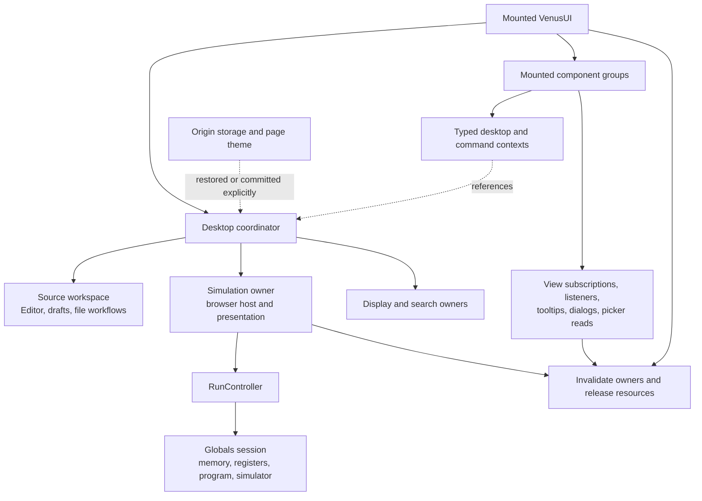
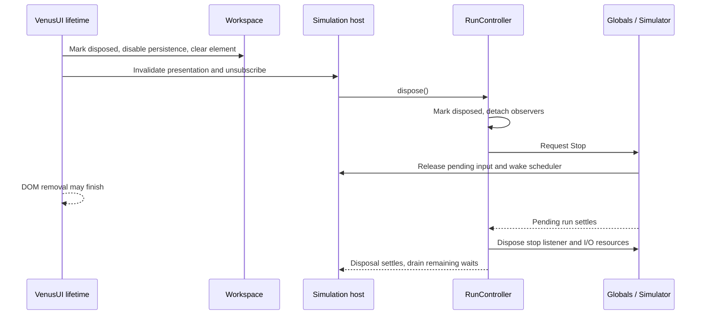

# ADR 0006: Object ownership and runtime lifetimes

- **Status**: Accepted
- **Date**: 2026-10-20

## Context

The Venus refactor separates the desktop renderer from source, simulation, display, and search owners, and groups browser controls by responsibility. Moving methods into classes or components does not by itself preserve their lifetime: a callback can still reference a removed desktop, an older file read can replace a newer import, or an asynchronous clipboard completion can edit a buffer after execution starts. These are observable correctness failures, even when garbage collection eventually releases the objects.

The audit used another reference SvelteKit project's object-lifetime decision as a review framework: distinguish component ownership from process scope, separate cancellation from result validity, and pair resource acquisition with release. Its MathJax runtime, server renderers, caches, and account/document concerns are not part of MARS-ts. This record establishes the applicable MARS contracts from this repository's implementation and tests; it does not adopt another project's guarantees or verification results.

The application prerenders a shell and creates the interactive machine in the browser. Development and prerendering still reuse a server process, so a module-level editor, machine, or reactive desktop would be shared incorrectly. Conversely, the browser's theme and local source library intentionally outlive an individual mounted desktop. Both boundaries must remain explicit.

## Decision

### One mounted desktop owns the state graph

[VenusUI](../../src/lib/venus/VenusUI.svelte) creates one desktop coordinator during component initialization and provides its existing owners through typed context. Construction creates no browser listeners, storage reads, timers, or active simulator. Browser initialization begins through the component's synchronous mount callback, which returns cleanup. Class effects created during initialization remain children of the creating component; classes containing these effects are not standalone process services.

The coordinator connects capabilities and routes commands. The workspace owns editor buffers and persistence policy; simulation owns a machine, its controller, browser host services, and execution presentation; display owns presentation preferences and geometry; search owns find/replace interaction. Child views borrow these objects and own only their local interaction and subscriptions. Selecting Edit, Execute, a register bank, or a source tab does not create another desktop or transfer ownership of the machine.

| Scope                      | What belongs here                                                                                                                            | Boundary                                                                                                                  |
| -------------------------- | -------------------------------------------------------------------------------------------------------------------------------------------- | ------------------------------------------------------------------------------------------------------------------------- |
| Module/process             | Class definitions, context accessors, bundled command/help catalogs, presets, instruction metadata, and pure formatting/classification rules | No current source, machine, input resolver, mounted element, or user-specific reactive state                              |
| Mounted desktop            | Coordinator, source editor, machine/controller, display/search state, breakpoints, output, and command registrations                         | Created per component instance; a replacement desktop receives fresh runtime objects                                      |
| Mounted view or attachment | Register/memory subscriptions, tooltip timers/listeners, modal focus, source hover, pointer capture, and imperative Help controls            | Removed when that view or attachment is removed; never responsible for disposing the parent machine                       |
| Pending operation          | One import selection, clipboard request, guarded focus continuation, or active simulator run                                                 | May finish after its initiating interaction; completion must still belong to the relevant live owner and target           |
| Browser persistence/page   | Saved library, recovery records, display/engine preferences, and root-element theme                                                          | Intentionally survives component removal; shared by the origin or document, not an isolated per-desktop storage namespace |

Context accessors are safe module-level infrastructure because Svelte stores their values in the component tree. They do not retain the current desktop globally. Context passes stable owners and live callbacks; copying a primitive field out of an owner would produce a snapshot rather than a new reactive owner.

### Reads and notifications have separate responsibilities

Render-time getters and derived values remain synchronous and free of persistence, subscription installation, and model mutations. Register and memory tables use the non-notifying read APIs so drawing a view does not generate simulated access events. Source updates publish workspace revisions, and controller updates replace the presentation snapshot with a new revision.

Machine/controller references and replaceable payloads use raw state where deep proxying would add no useful tracking. `RunState` is a read-only presentation record; its referenced programs and statements remain engine-owned objects, not deep immutable copies. The raw-state boundary does not make an in-place engine mutation reactive. Mutating actions must publish their revision or use an explicit hardware subscription, and each view returns the matching unsubscribe.

The engine continues to use injected host interfaces for source lookup, input, output, preferences, and scheduling. It imports neither Svelte nor browser APIs. The browser lifetime policy complements the cooperative execution decision in [ADR 0004](0004-cooperative-simulation.md); it does not change instruction/check ordering or claim new MIPS parity.

### Asynchronous work needs owner and operation checks

Cancellation and result validity are different obligations. Removing a file input does not cancel `File.text()`, and unmounting a control does not undo an already-requested system clipboard write. The application must ignore stale completions even when the external operation cannot be canceled.

| Operation                  | Validity contract                                                                                                                                                                                     |
| -------------------------- | ----------------------------------------------------------------------------------------------------------------------------------------------------------------------------------------------------- |
| Import selection           | Each nonempty selection advances an importer-owned generation. Only the latest generation may stage a successful batch or show its read error. Unmount invalidates every pending read.                |
| Source Cut/Paste           | Capture the selected source snapshot and range before awaiting the Clipboard API. Apply a mutation only if the workspace is alive, the snapshot is still current, and execution still permits edits.  |
| Help transfer to source    | Create the new buffer and record its initial source synchronously through the workspace before awaiting any rendering. A subsequent command cannot redirect that source into another selected buffer. |
| Deferred editor focus      | After rendering, focus only if the workspace is alive, the same buffer is still selected, and Edit is still displayed.                                                                                |
| Clipboard control feedback | An unmounted control cannot publish success/failure or change its busy indicator when the browser operation settles.                                                                                  |
| Run completion             | The initiating run owns its final result. A disposed simulation owner does not append late diagnostics to removed UI; controller disposal still waits for execution to finish.                        |

Use operation generations only where another operation supersedes an earlier one. A single desktop-wide generation would couple unrelated work: opening Help should not cancel an import, and a source-pane focus change should not terminate the simulator. Source snapshot identity is the appropriate additional guard for editor operations; import selection has its own sequence.

Behavior components register file-transfer capabilities with the desktop and keep the returned release callback. Release removes a command only when the registered callback is still the one owned by that component, so cleanup from an older registration cannot erase its replacement. Export operates on a synchronous source snapshot; it does not clear dirty baselines or create a second persistence owner.

### Resource release follows acquisition

| Resource                               | Owner and release                                                                                                                                                                                                                                   |
| -------------------------------------- | --------------------------------------------------------------------------------------------------------------------------------------------------------------------------------------------------------------------------------------------------- |
| Initialization/reveal frames           | Desktop mount callback cancels outstanding animation frames and invalidates its pending `tick()` continuation.                                                                                                                                      |
| Persistence effects and source handles | Svelte releases the coordinator's effects; workspace disposal disables persistence and clears the textarea reference before late clipboard work can apply.                                                                                          |
| Controller-to-view subscription        | Simulation cleanup unsubscribes before initiating controller disposal.                                                                                                                                                                              |
| Active execution and pending input     | RunController marks itself disposed synchronously, removes its simulator observer, clears presentation observers, requests Stop, and awaits the pending execution before disposing Globals. The host releases input once and wakes scheduler waits. |
| Scheduler timers                       | The simulation host owns a timer-to-resolver collection. Wake clears the timers and resolves their waits; final disposal also drains it. No scheduler is stored at module scope.                                                                    |
| Register and memory observers          | Debugger effects return unsubscriptions and release them before rebinding to another hardware object or removing the view.                                                                                                                          |
| Keyboard and unload handlers           | The keyboard hook and desktop binding return `svelte/events` listener cleanup from their mount callbacks. Event enablement reads the current owner.                                                                                                 |
| Tooltip interaction                    | The trigger attachment removes element listeners and pending timers; the visible-only effect releases window listeners. Pointer activation and window blur dismiss presentation instead of retaining a mouse-created focus tooltip.                 |
| Native dialogs and dividers            | Dialog attachment cleanup closes its element and restores a still-connected prior focus target. Divider handlers stay on the mounted handle; native pointer capture and cancellation end its gesture.                                               |
| Imperative Help controls               | The article attachment unmounts both Clipboard variants for each enhanced code block and removes their injected containers before remounting or replacing the article.                                                                              |
| Browser downloads                      | The browser adapter removes its temporary anchor and revokes its object URL in `finally` after initiating the click. It is called from mounted export behavior.                                                                                     |

Svelte does not await the asynchronous disposal promise before removing the DOM or mounting a replacement desktop. The controller retains the old machine until that machine's run settles. A new desktop owns different runtime objects and cannot receive those late results. The public controller's repeated `dispose()` calls return the same promise, and mutation/run methods reject once disposal starts.

Unexpected asynchronous teardown rejection is consumed at the browser host boundary and recorded in browser diagnostics. It must not become an unhandled rejection or be reported as a new message in a removed desktop. Active execution errors retain the normal message path. This policy does not hide an active operation's failure or introduce browser logging into the engine.

### Persistence is not runtime ownership

Local source and recovery records are serialized text, filenames, saved baselines, and selection, not editor objects or machine snapshots. Storage is acquired by explicit browser operations rather than module evaluation or server rendering. Stored records are validated by the browser adapter, and a failed write does not mark an editor buffer saved. Recovering conflicting dirty and committed sources preserves both versions and suspends Auto Save as described in [ADR 0003](0003-browser-file-workflows.md).

The current application presents one desktop. Multiple engine instances are isolated, but browser tabs on the same origin share storage keys, and a page-wide theme changes the document root. There is no claim of independent persistent workspaces, cross-tab transaction serialization, or synchronized theme switches for several simultaneous desktop roots. Adding that product capability would require an explicit storage namespace/concurrency decision, not another context wrapper.

## Audit findings and corrections

The audit confirmed the major ownership boundaries and paired release paths above. It also found completion races that disposal checks alone did not cover:

1. Older import reads could complete after a newer selection and replace the staged batch or display an obsolete error. Both success and failure now check an importer-specific generation.
2. Pending Cut/Paste could resume after Go started. The source mutation happened before assembly invalidation rejected the running operation, and the generic clipboard handler mislabeled the failure as denied permission. Mutating completions now recheck execution before editing.
3. Help created an empty source, awaited rendering, then edited whichever source was selected at completion. Source creation and initial text now occur in one synchronous workspace operation, followed only by guarded focus.
4. Run-error presentation could resume after disposal, and fire-and-forget asynchronous cleanup could reject without a handler. Disposed owners now suppress late UI reports, while unexpected cleanup rejection is handled at the browser host boundary.

The changes retain the existing editor history, Auto Save, import confirmation, normal execution, and diagnostic responsibilities. They do not introduce a shared lifecycle manager, global resource registry, or parallel editor/machine models.

## Verification and limits

The [controller tests](../../tests/session/globals-controller.test.ts) cover separate machine instances, source/controller ownership, observer release, execution exclusivity, immediate disposed guards, and repeated disposal returning one promise. The [simulator tests](../../src/lib/engine/simulator/Simulator.test.ts) cover pending input, Stop before a read is installed, listener removal, and deterministic scheduling. These tests establish the exercised contracts; successful unit tests do not alone prove DOM teardown.

The [browser lifetime regressions](../../tests/browser/lifetime.spec.ts) mount the actual desktop on an isolated test page, control file and clipboard completion, and exercise stale import success/error, edits after execution starts, same-turn Help/source creation, pending operations across removal, and repeated remount keyboard behavior. The [test-only mounting adapter](../../src/lib/venus/mountDesktop.browser-test.ts) is not imported by application entry points and exposes no production debugging hook. Existing [Help](../../tests/browser/help.spec.ts), [control](../../tests/browser/controls.spec.ts), and [execution](../../tests/browser/execution.spec.ts) checks cover additional mounted workflows.

This audit is source inspection plus targeted behavior verification, not a retained-heap measurement or a proof that every future host failure is leak-free. It does not inject failures at every engine constructor or imperative component mount, prove operating-system clipboard/download cancellation, or add server resource/cache management that the application does not use. Future listeners, observers, workers, file handles, or asynchronous operations must name their owner, invalidation condition, release site, and corresponding behavioral check before being made shared.

## Consequences

The renderer can remain small because resource ownership moves with the behavior that acquires it. Stable context references make collaboration between views explicit, while scoped callbacks and result guards prevent stale work from targeting a replacement editor or desktop. Cleanup remains inspectable near acquisition instead of being distributed through a global teardown mechanism.

The cost is an explicit validity check at asynchronous boundaries and a clear distinction between synchronous owner invalidation and eventual machine disposal. This is warranted for an IDE whose editing, imports, modal input, and execution can overlap, and it keeps the framework-free engine independently testable.

## Related architecture

- [Application libraries](../../src/lib/README.md)
- [Venus composition and lifetime guide](../../src/lib/venus/README.md)
- [State owners](../../src/lib/venus/state/README.md) and [typed contexts](../../src/lib/venus/context/README.md)
- [Browser source and preference adapters](../../src/lib/browser/README.md)
- [Browser file workflows](0003-browser-file-workflows.md) and [cooperative simulation](0004-cooperative-simulation.md)
