# MARS application libraries

This directory contains the application's browser presentation, source-editor model, browser adapters, Help content, and framework-free MIPS engine. The libraries collaborate around one desktop-owned session: source buffers belong to an editor, machine state belongs to an engine instance, and browser views present those owners rather than constructing parallel models.

The [root route](../routes/+page.svelte) opens the desktop directly. SvelteKit prerenders the application shell; browser mounting restores local preferences and sources and initializes the live machine. The deployed application is static HTML, CSS, JavaScript, and assets. It has no application server storing sources or executing programs, and the legacy Java application is a development oracle rather than a runtime dependency.

## Architecture overview

### Library relationships

The subgraphs follow library modules and their responsibility-specific submodules. Solid arrows show composition, API use, or data access, not an exhaustive import graph. An arrow to or from a subgraph boundary relates to that module as a whole rather than one of its submodules. The dashed arrow is an engine call through an injected host interface; the engine does not import its Venus implementation. The route and browser APIs sit outside the library modules.

```mermaid
flowchart TB
    Route["SvelteKit route"]
    Platform["Browser APIs<br/>DOM, storage, clipboard, files, timers"]

    subgraph VenusModule["Venus · venus/"]
        Root["VenusUI<br/>desktop renderer and lifetime"]
        Controller["RunController<br/>framework-free run workflows<br/>and checkpoints"]
        subgraph ComponentsModule["components/"]
            subgraph ShellModule["shell/"]
                Shell["Menus, toolbar, footer,<br/>speed and theme controls"]
            end
            subgraph EditorViewsModule["editor/"]
                EditorViews["Edit pane, source editor,<br/>and document tabs"]
            end
            subgraph DebuggerModule["debugger/"]
                Debugger["Execute, register,<br/>and message panes"]
            end
            subgraph DialogsModule["dialogs/"]
                Dialogs["Modal shell and<br/>workflow variants"]
            end
            subgraph TransfersModule["transfers/"]
                Transfers["Clipboard and<br/>file import/export"]
            end
            subgraph LayoutModule["layout/"]
                Layout["Pane shells and dividers"]
            end
            subgraph ControlsModule["controls/"]
                Controls["Buttons, links, selectors,<br/>tabs, sliders, switches"]
            end
            subgraph FeedbackModule["feedback/"]
                Feedback["Loading, tooltips,<br/>keycaps, inline errors"]
            end
            Shell & EditorViews & Debugger & Dialogs & Transfers --> Controls
            Debugger --> Layout
            Layout --> Controls
            Shell & Debugger & Controls --> Feedback
            Controls -->|toolbar glyphs| Shell
        end
        subgraph ContextModule["context/"]
            Context["Typed desktop and command contexts"]
        end
        subgraph HooksModule["hooks/"]
            Hooks["Keyboard and unload bindings"]
        end
        subgraph UtilitiesModule["utils/"]
            Utilities["Stateless presentation rules"]
        end
        subgraph StateModule["state/"]
            State["Desktop state owners<br/>workspace, simulation, preferences,<br/>search, recovery"]
            Host["Simulation host callbacks<br/>source lookup, console, input,<br/>scheduling, preferences"]
            State --> Host
        end
        Root --> ComponentsModule
        Root --> Context
        Root --> Hooks
        Root --> State
        Shell -->|command capability| Context
        EditorViews & Debugger & Dialogs & Transfers --> Context
        EditorViews --> Hooks
        Hooks --> Context
        ComponentsModule --> Utilities
        Hooks --> Utilities
        State --> Utilities
        Context -->|references existing owners| State
        State --> Controller
        Controller -->|write-observation rule| Utilities
    end

    subgraph EditorModule["Editor · editor/"]
        Editor["Editor<br/>buffers and history"]
        subgraph HighlightingModule["highlighting/"]
            Highlighting["Lexical highlighting"]
        end
    end

    subgraph BrowserModule["Browser · browser/"]
        Browser["Browser adapters<br/>source library, preferences,<br/>recovery records, downloads"]
    end

    subgraph EngineModule["Engine · engine/"]
        Globals["Globals and Settings<br/>session-local machine composition"]
        subgraph AssemblerModule["assembler/"]
            Assembly["Source preparation, tokens,<br/>directives, symbols, macros, assembly"]
        end
        subgraph InstructionsModule["instructions/"]
            Instructions["Instruction registry<br/>definitions, decoding, execution callbacks"]
        end
        subgraph HardwareModule["hardware/"]
            Hardware["Registers, coprocessors, memory,<br/>layouts, access notices"]
        end
        subgraph SimulatorModule["simulator/"]
            Simulation["Simulator and backstepping"]
        end
        subgraph SyscallsModule["syscalls/"]
            Syscalls["Runtime service algorithms and registry"]
        end
        subgraph IOModule["io/"]
            IO["Console conversion and I/O interfaces"]
        end
        subgraph FormattingModule["formatting/"]
            Formatting["Numeric compatibility and conversion"]
        end
        subgraph DiagnosticsModule["diagnostics/"]
            Diagnostics["Source-mapped warnings and errors"]
        end
        Globals --> Assembly
        Globals --> Instructions
        Globals --> Hardware
        Globals --> Simulation
        Globals --> Syscalls
        Globals --> IO
        Assembly --> Instructions
        Assembly --> Hardware
        Assembly --> Diagnostics
        Assembly --> Formatting
        Simulation --> Instructions
        Simulation --> Hardware
        Simulation --> Diagnostics
        Instructions --> Hardware
        Instructions --> Syscalls
        Syscalls --> Hardware
        Syscalls --> IO
        IO --> Formatting
    end

    Route --> Root
    State --> Editor
    State --> Browser
    EditorViews --> Highlighting
    EditorViews -->|instruction hover metadata| Instructions
    EditorViews -->|directive hover metadata| Assembly
    Shell -->|theme storage| Browser
    Debugger -->|stored vocabularies and limits| Browser
    Transfers -->|extension rules and downloads| Browser
    Transfers -->|file and clipboard interactions| Platform
    State -->|editor clipboard actions| Platform
    Browser --> Platform
    Browser -->|recovery checkpoint validation| Controller
    Host --> Platform
    Host -->|source resolution through workspace| Editor
    Host -->|committed sources through workspace,<br/>engine preference storage| Browser
    State -->|constructs machine with host| Globals
    Controller --> Globals
    Debugger -->|public inspection and edit APIs| Hardware
    Debugger -->|Java-compatible numeric conversion| Formatting
    Highlighting -->|directive and token metadata| Assembly
    Highlighting -->|register names| Hardware
    Globals -.->|calls supplied interfaces| Host
```

Venus composes the browser desktop and owns its session lifecycle. Editor and RunController remain framework-free models even though Venus uses them in the browser. Engine remains a separate portable module with an injected host boundary; the deployed application executes it in the browser too. Host callbacks belong to Venus simulation state and resolve source through the existing workspace, whose editor buffers take precedence over committed browser-library sources.

Help is composed into Venus dialogs and uses the reusable clipboard/transfer controls for code examples. Its source-transfer callback delegates to the existing workspace; Help owns neither a machine nor an editor. Within components, the feature groups (shell, editor, debugger, dialogs, and transfers) compose the generic controls, layout, and feedback groups, which read no desktop context; controls borrow only the shell's leaf toolbar glyphs.

### Module responsibilities

| Module                       | Owns                                                                                                                                    | Principal boundary                                                                                                |
| ---------------------------- | --------------------------------------------------------------------------------------------------------------------------------------- | ----------------------------------------------------------------------------------------------------------------- |
| [Venus](venus/README.md)     | Desktop composition, context, cross-view state, source/run workflows, debugging presentation, keyboard coordination, and UI lifetimes   | Adapts the desktop to browser views while using editor, engine, and browser APIs                                  |
| [Editor](editor/README.md)   | Source buffers, names, selection, saved baselines, dirty state, per-buffer undo/redo, and lexical highlighting                          | Does not assemble programs or own browser persistence; callers resolve unsaved changes before closing             |
| [Browser](browser/README.md) | Source and preference storage validation, virtual filenames, recovery serialization, and downloadable source resources                  | Implements browser mechanics outside the engine; state owners decide when and why to persist                      |
| [Help](help/README.md)       | Help catalog, overview/About content, attributed articles, and article rendering                                                        | Receives selected content and source-transfer callbacks; reuses the application's modal and transfer presentation |
| [Engine](engine/README.md)   | Canonical assembly, hardware, instruction execution, simulator sequencing, diagnostics, numeric compatibility, and implemented syscalls | Framework-free TypeScript with per-session state and injected host services                                       |

The [system implementation guide](../../IMPLEMENTATION.md) describes current feature coverage, supported assembly and debugging behavior, persistence policy, and validation evidence. This guide explains library relationships; the individual module guides own their detailed contracts.

## Presentation and coordination

### The desktop is a composition boundary

[VenusUI](venus/VenusUI.svelte) creates a per-component desktop state graph, installs typed contexts, mounts the browser lifecycle, and arranges the views. It remains at the Venus root because it coordinates that module. UI components are grouped by responsibility under [Venus components](venus/components/README.md); component-local interactions stay with their elements, while source workflows, pending input, shared preferences, and execution ownership live in [state](venus/state/README.md).

| Presentation boundary     | Responsibility                                                                                                          |
| ------------------------- | ----------------------------------------------------------------------------------------------------------------------- |
| Shell and layout          | Application commands and appearance; reusable pane geometry and resize interactions                                     |
| Controls                  | Native buttons, new-tab resource links, checkbox selections, tab strips, sliders, and switches with caller-owned values |
| Editor and debugger views | Source editing and inspection of actual machine statements, registers, memory, labels, and output                       |
| Feedback and transfers    | Loading, tooltips/keycaps, clipboard feedback, native file selection, and single/all export mechanics                   |
| Dialogs                   | Shared native modal rendering and focused workflow variants composed through snippets                                   |

The generic controls, pane, tab, menu, and toolbar contracts use records, callbacks, and snippets. Controls own native input semantics and presentation; shell specializations supply toolbar styling, run-speed conversion, and browser theme selection. Pane renders a sized region, while TabbedPane composes it with the control group's tab strip. These reusable controls and layout components have no desktop context dependency. A workflow-specific dialog, file-transfer behavior, debugger view, or editor view can read its nearest owner through context without passing unrelated state through every ancestor. The modal shell remains independent of workflow names; the dialog coordinator selects focused variants.

### Commands and shared rules

Menus, toolbar controls, and keyboard bindings share command metadata and live availability. A narrow context capability exposes dispatch, enablement, pressed state, and the live setting toggles to the menus and toolbar, which never read the owners themselves. The full desktop context references the same source, simulation, search, and preference owners for adapters that need their workflows. Neither context creates a process-wide session.

Presentation utilities, grouped by responsibility, centralize rules with multiple callers, such as command and Settings catalogs, run-speed conversion, and integer table formatting. They contain no mutable machine, storage writer, or alternate controller. The framework-free [RunController](venus/RunController.ts) remains a separate boundary within Venus: it coordinates assembly and simulation through engine APIs, publishes snapshots and revisions, and retains ownership of an active run until it settles.

## Engine and host separation

### Platform-independent behavior

The engine does not import Svelte, SvelteKit, DOM APIs, browser storage, timers, or platform I/O. `Globals` composes one machine's translated collaborators; `MIPSprogram` carries source/program representations and assembly or execution history. The assembler, instruction registry, hardware, simulator, syscalls, formatting, and diagnostics retain their corresponding Java responsibilities.

Machine words use explicitly normalized signed 32-bit numbers, with unsigned interpretation where address ordering or display requires it. Exact 64-bit arithmetic and bit patterns use `bigint`; floating registers retain raw integer bits. Java-compatible conversion and access ordering are engine contracts, not UI formatting choices. The [engine guide](engine/README.md) and its responsibility-specific submodules document these details.

### Injected browser services

The simulation owner supplies source lookup, console output, asynchronous input, cooperative scheduling, and preference callbacks. The engine invokes those interfaces without knowing whether the host is a browser or a test. Browser source lookup prefers current open buffers and then committed local-library sources. Console reads can use inline input or a same-tab dialog while retaining the same pending engine request.

Browser adapters own storage formats and download-resource cleanup. Native file pickers and Clipboard API interactions belong to mounted transfer components, which pass exact text into the existing workspace workflow. Editor Import/Export is separate from runtime file-descriptor syscalls; the presence of browser file transfer does not mean deferred MIPS platform services have been implemented.

## State, reactivity, and resource lifetimes

### Authoritative owners

| Data or resource                              | Owner                                                   | How consumers observe or use it                                            |
| --------------------------------------------- | ------------------------------------------------------- | -------------------------------------------------------------------------- |
| Source buffers, saved baselines, undo/redo    | Per-desktop Editor, coordinated by the source workspace | Explicit mutations followed by reactive workspace snapshots                |
| Registers, memory, symbols, execution history | Per-session engine and program instances                | Public APIs, synchronous access notices, and controller revisions          |
| Active simulation and run-state transitions   | RunController, composed by simulation state             | Published snapshots and awaited execution ownership                        |
| Cross-view browser workflows and preferences  | Desktop state owners                                    | Live Svelte fields, props, callbacks, and typed context references         |
| Committed sources and recovery records        | Browser adapters under workspace policy                 | Validated localStorage records; successful commits update editor baselines |
| Native elements, hover, focus, gestures       | Mounted presentation components                         | Element-local events and component-owned cleanup                           |

There are no process-wide mutable editor or simulator singletons. Constructing another desktop creates another owner graph; SSR does not read browser storage or start an engine. Appearance changes and pane selection reuse the existing session. Framework-free mutable objects are not duplicated into an independent simulated UI state: revisions and subscriptions make their changes visible to Svelte.

Runtime isolation does not create separate browser libraries: localStorage records remain shared by the origin, and the theme applies to the document. Multiple desktops have independent machines and buffers but use the existing persistence keys and page appearance. The application does not claim independent recovery storage or conflict-free concurrent editing across tabs.

### Mounting, cancellation, and teardown

Browser mounting restores sources and preferences, initializes the machine and host services, and reveals the measured desktop after the loading indicator has painted. Teardown cancels initialization/reveal frames, disables workspace persistence, releases view and controller subscriptions, and removes keyboard and browser-action registrations.

A run waiting for input is still active. Svelte teardown initiates controller disposal without blocking DOM removal: it requests Stop and releases pending input and scheduled waits. The controller retains the old machine until its pending run settles asynchronously, then releases that machine's resources. File reads, export hand-offs, and clipboard feedback ignore completion after their component is disposed, and a disposed simulation owner ignores late error reports. Modal focus, tooltip timers/listeners, pointer gestures, save-picker streams, temporary download anchors, and object URLs remain with the component or adapter that acquired them. Engine observers are released by their returned teardown functions, which leave no inactive memory records behind for a remounted view to accumulate.

[ADR 0006](../../docs/adrs/0006-object-lifetime-management.md) records the ownership audit, asynchronous result-validity rules, resource-release paths, and targeted regression coverage. It distinguishes runtime isolation from shared browser persistence and synchronous owner invalidation from eventual machine disposal.

## Legacy mapping, evidence, and extension

### Mapping responsibilities

| Legacy responsibility                                                                   | Current library boundary                                               |
| --------------------------------------------------------------------------------------- | ---------------------------------------------------------------------- |
| Venus windows, actions, editor panels, Help presentation                                | Venus composition/state/components, Editor model, and Help content     |
| Static global machine and settings dependencies                                         | Per-session engine composition and injected preferences                |
| Assembler, MIPS instruction definitions, registers, memory, simulator, runtime services | Corresponding engine modules with public contracts and oracle evidence |
| Desktop file selection, saving, execution scheduling, and dialog presentation           | Browser adapters and Venus host/transfer/dialog coordination           |

The Java sources under `_legacy-app/` are read-only behavioral references. Browser adaptations follow [ADR 0002](../../docs/adrs/0002-port-fidelity.md), source-file workflows follow [ADR 0003](../../docs/adrs/0003-browser-file-workflows.md), and cooperative execution follows [ADR 0004](../../docs/adrs/0004-cooperative-simulation.md). Derived modules and assets retain MARS attribution to Pete Sanderson and Kenneth Vollmar under the [MIT license](../../MARSlicense.txt).

### Validation and remaining scope

[Oracle fixtures](../../tests/oracle/README.md) and engine tests compare translated behavior with Java. [Browser scenarios](../../tests/browser/) exercise the adaptation: unsaved-source preservation, persistence failures, command availability, dialog focus/cancellation, execution and input, imports/exports, clipboard controls, and appearance. Type checking, lint, formatting, unit/parity tests, and the static build complement those checks; compilation alone establishes neither Java parity nor correct browser workflows.

Core assembly, simulation, deterministic console syscalls, and desktop debugging are implemented. Remaining platform syscalls, Tools, several configuration dialogs, and memory dump formats remain unfinished. The [port plan](../../docs/adrs/0000-port-plan.md) and [implementation guide](../../IMPLEMENTATION.md) distinguish intended scope from implemented behavior.

### Choosing an extension boundary

Place translated algorithms and machine semantics in the responsible engine module. Add browser mechanics to the browser adapter or mounted interaction that owns their resources. Put cross-view workflow state in its existing Venus owner, and presentation in the corresponding component group. Share logic that consumers repeat through a stateless utility, including general-purpose helpers where warranted. Keep Help content separate from editor and machine ownership.

Import the responsible module directly; this directory is an architectural entry point, not a barrel that combines unrelated libraries. A relocation updates its consumers and documentation together. New interactions must define their owner, input/output contract, and cleanup without adding process-global state or making the engine depend on presentation.
