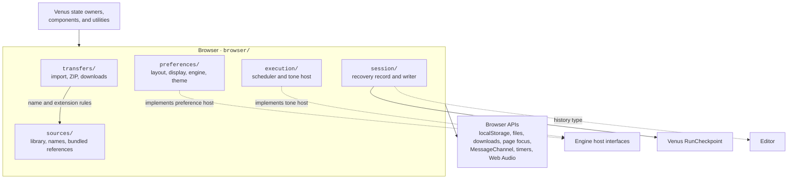

# Browser host

This module owns browser platform integrations used by the IDE: localStorage records for sources, preferences, and desktop recovery; file transfer across the operating-system boundary; and the per-machine scheduling and audio services that the engine reaches through injected host interfaces. Each adapter implements one browser mechanic and owns the storage format, validation, limits, and platform resources that mechanic needs. The [Venus state owners](../venus/state/README.md) and mounted components decide when and why to persist, transfer, or schedule; adapters hold no editor buffers, machine state, or workflow policy.

Browser adapters must remain outside the framework-free engine. Add host implementations here when their engine interfaces exist: scheduling and MIDI audio have theirs in [execution](execution/README.md), while assembly, runtime console/file I/O, and simulator dialogs are not implemented by this module. No adapter is a process-wide mutable singleton. Storage is acquired only when an operation runs, never during module evaluation or SSR, and an instance that holds a timer, port, listener, or audio context belongs to the desktop, machine, or mounted component that constructs and disposes it. The two page-scoped exceptions, a handed-off download's object-URL revocation timer and the page-focus listeners, are described in the [transfer guide](transfers/README.md).

## Submodules

Adapters are grouped by the responsibility and browser resource they own, and each group carries its own guide with the record formats, storage keys, limits, failure behavior, and lifecycle rules of its adapters. Import an adapter from its own file; there is no barrel at the module or submodule level.

| Submodule                            | Responsibility                                                                                                                                                                       | Records and resources it owns                                                                                                |
| ------------------------------------ | ------------------------------------------------------------------------------------------------------------------------------------------------------------------------------------ | ---------------------------------------------------------------------------------------------------------------------------- |
| [sources](sources/README.md)         | The browser working filesystem: the committed source library, open-buffer backups, virtual filename and assembly-extension rules, and immutable bundled references                   | `mars-ts:sources:v1` and `mars-ts:workspace:v1`; the compile-time bundled-source catalog                                     |
| [transfers](transfers/README.md)     | Files crossing the operating-system boundary: import planning, the ZIP codec, download bodies, the save picker and download link, the page-focus wait, and the shared save lifecycle | File and archive reads, writable save streams, temporary anchors and object URLs, focus listeners, and the late-prompt guard |
| [preferences](preferences/README.md) | Preference records for pane layout, working display settings, engine settings, and theme, over shared fail-silent JSON mechanics                                                     | `mars-ts:panes:v1`, `mars-ts:display-settings:v1`, the `mars-ts:engine-settings:v1:` prefix, and `mars-ts:theme:v1`          |
| [session](session/README.md)         | The desktop recovery record: its stored view, tab, and memory-range vocabularies, validation, atomic writes, and the per-desktop coalescing writer                                   | `mars-ts:desktop-session:v1`; one writer timer and serialization cache per desktop                                           |
| [execution](execution/README.md)     | Per-machine services behind engine host interfaces: cooperative scheduling and Web Audio MIDI tones                                                                                  | MessageChannel ports, yield and wait timers, and one audio context with its voices per machine                               |

[errorMessage.ts](errorMessage.ts) converts an unknown thrown value to displayed text: an `Error` contributes its message, and any other value uses string conversion. Import planning, memory dumping, workspace, simulation, recovery, and debugger presentation share it without making browser adapters depend on Venus. It decides only text conversion; translated `ProcessingException` reports, surrounding wording, retries, and reporting channels stay with their owners. It is the one helper at the module root: the import planner here and the Venus owners both use it, so it belongs to no single submodule.

## Module relationships

The diagram shows API use rather than an exhaustive import graph. Solid arrows are runtime use; dashed arrows are type-only imports of a contract this module implements or stores. The engine never imports this module: it calls the interfaces that simulation state supplies.

### Application consumers

Venus is the only library that consumes these adapters. State owners hold the workflows; components and utilities import constants, types, and stateless rules so the value a view enforces and the value a record validates come from one definition.

| Consumer                                                       | Submodules                                          | What it uses                                                                                                                                                                                                                                                                                                                                                 |
| -------------------------------------------------------------- | --------------------------------------------------- | ------------------------------------------------------------------------------------------------------------------------------------------------------------------------------------------------------------------------------------------------------------------------------------------------------------------------------------------------------------ |
| [Venus state owners](../venus/state/README.md)                 | sources, transfers, preferences, session, execution | The workspace reads and commits the library, backs up open buffers, resolves bundled identities, and receives import plans; display preferences load and save pane layout and display settings; simulation constructs the scheduler and tone host and supplies the engine preference host; desktop persistence loads the recovery record and owns its writer |
| [Desktop root](../venus/README.md)                             | session, preferences                                | The primary-view vocabulary for the Edit/Execute tabs and the register-width minimum for the sidebar divider                                                                                                                                                                                                                                                 |
| [Shell](../venus/components/shell/README.md)                   | preferences                                         | ThemeToggle saves the theme; the speed slider reads the maximum run-speed position                                                                                                                                                                                                                                                                           |
| [Editor views](../venus/components/editor/README.md)           | sources                                             | The extension label for the empty-editor hint and the bundled reference's label for the read-only banner                                                                                                                                                                                                                                                     |
| [Debugger views](../venus/components/debugger/README.md)       | session, preferences, sources                       | The stored register-bank and message-console vocabularies, the enforced register-width and Data Segment height minimums, and the basename rule for Labels group headings                                                                                                                                                                                     |
| [Dialogs](../venus/components/dialogs/README.md)               | sources, transfers                                  | The extension label for empty-library hints, the bundled SPIM handler, imported-source records for the import summary, and the save lifecycle and filename stem for memory dumps                                                                                                                                                                             |
| [Transfer components](../venus/components/transfers/README.md) | transfers                                           | The import picker filter, import planner, and page-focus wait; download bodies, the Export All filename, and the save lifecycle                                                                                                                                                                                                                              |
| [Venus utilities](../venus/utils/README.md)                    | sources, session                                    | Extension and basename rules for export filenames; vocabulary types for the Data Segment readers and the run-outcome rule                                                                                                                                                                                                                                    |

Simulation and workspace state, desktop persistence, the Execute view model, and the memory-dump dialog also share the root error-text helper.

### Dependencies

The module's own dependencies are narrow. Each submodule uses browser platform APIs directly: localStorage (sources, preferences, and session, whose writer also holds a coalescing timer); `File`, `Blob`, text encoding and decoding, `DecompressionStream`, the File System Access save picker, object URLs with a temporary anchor, and page focus and visibility events (transfers); and MessageChannel, timers, and Web Audio (execution). Two adapters implement engine host interfaces and import only their types: [EnginePreferences](preferences/EnginePreferences.ts) implements the preference read/write members of `SettingsHost`, and [WebAudioToneHost](execution/WebAudioToneHost.ts) implements `ToneGeneratorHost`. The recovery record imports the [editor](../editor/README.md)'s history-capture type and, as the module's only runtime import from another library, the checkpoint validator of the framework-free [Venus RunCheckpoint](../venus/RunCheckpoint.ts). The bundled-source catalog reads a compile-time constant that Vite defines from [static/sources](../../../static/sources/README.md). Within the module, only transfers depends on another submodule: import planning applies the source library's name and extension rules.

## Extending the module

Add an adapter to the submodule whose responsibility and browser resource it extends, and add a submodule only for a responsibility none of these names, with its own guide. Keep a storage format, its validation, and its limits with the adapter that enforces them, so presenters import the same constants; keep workflow decisions, dirty-state tracking, and reporting channels with the Venus owner, buffers and history in the [editor](../editor/README.md), and translated algorithms and machine semantics in the [engine](../engine/README.md). A resource-holding adapter states which owner constructs and disposes it. The [library guide](../README.md) places this module beside the editor, engine, and Venus; [ADR 0003](../../../docs/adrs/0003-browser-file-workflows.md), [ADR 0006](../../../docs/adrs/0006-object-lifetime-management.md), [ADR 0007](../../../docs/adrs/0007-desktop-session-recovery.md), and [ADR 0015](../../../docs/adrs/0015-midi-web-audio-tones.md) record the file-workflow, lifetime, recovery, and tone decisions these adapters implement.
