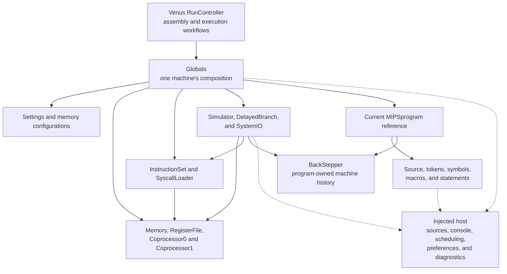
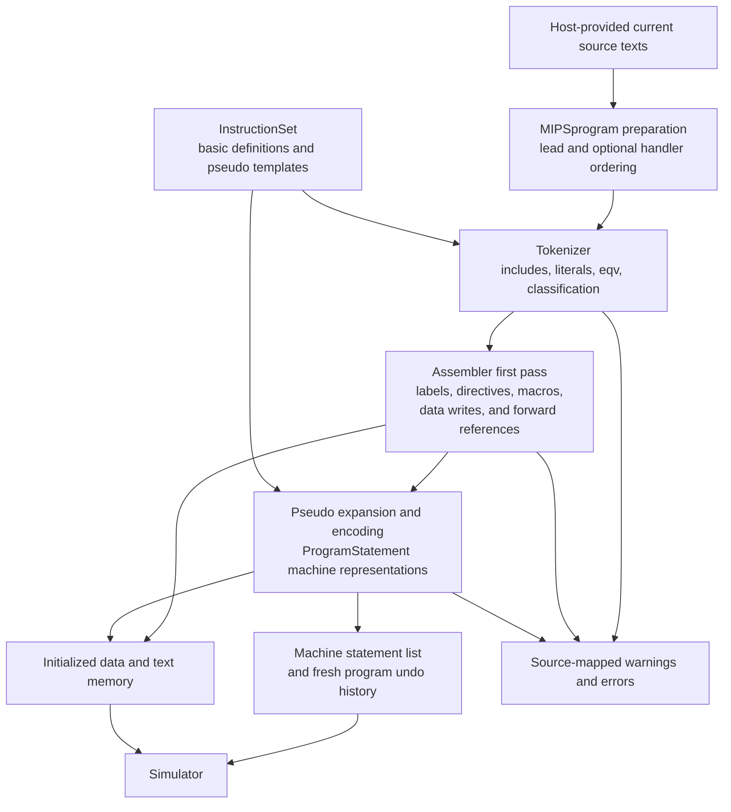
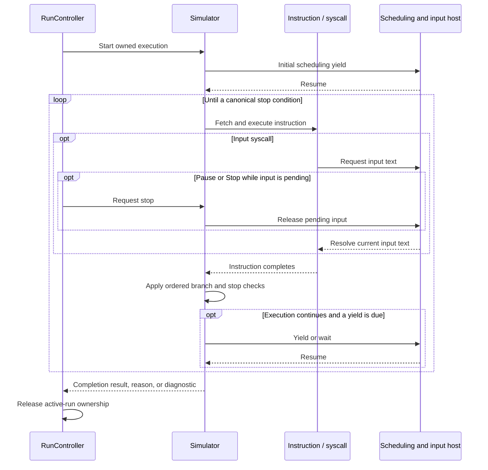

# MIPS engine

The engine owns framework-free, session-local MIPS behavior: source preparation, tokenization, assembly, instruction definitions and execution, hardware state, runtime services, numeric conversion, and diagnostics. It translates the corresponding algorithms and class responsibilities from the canonical [Java MARS application](../../../_legacy-app/README.md). The browser supplies presentation and host services; the engine imports neither Svelte nor the DOM and performs no platform I/O directly.

[Globals](Globals.ts) composes one independent machine. [MIPSprogram](assembler/programs/MIPSprogram.ts) carries source, tokens, assembly results, and undo history. The framework-free [Venus RunController](../venus/RunController.ts) coordinates desktop assembly and execution workflows over those owners. Views inspect the actual machine rather than maintaining a parallel register or memory model.

Core assembly, simulation, console/random/dialog/MIDI syscalls, exception handling, and machine debugging are implemented. The [six enabled memory dump formats](dump/README.md) are implemented with byte-for-byte oracle comparisons. File/time/sleep syscall families and device Tools remain unfinished. The [system implementation guide](../../../IMPLEMENTATION.md) describes the complete application; the [library guide](../README.md) places this engine beside the editor, browser adapters, and Venus. The [port plan](../../../docs/adrs/0000-port-plan.md) owns intended scope, while this guide describes the current engine boundary.

## Composition and ownership

### One machine per session

Java's static machine dependencies become collaborators owned by a `Globals` instance. Constructing a second machine gives it separate registers, memory, settings, global symbols, instruction collaborators, delayed-branch state, and service registry. Immutable metadata may be shared; mutable machine state is never a module-level singleton.

The diagram shows ownership and service use, not an exhaustive import graph. Dashed arrows represent calls through injected interfaces. `RunController` belongs to Venus because it owns desktop Run workflows; its implementation does not require Svelte.



`Globals` constructs the real translated classes and wires their host interfaces together. Hardware callbacks resolve the current program's undo history, statement decoding uses the actual instruction registry, and syscall dispatch uses the same session's registers and memory. These are shared collaborators within a machine, not substitute implementations inside each subsystem.

### Initialization and program lifetime

The constructor calls `initialize()`. Initialization loads the session's syscall factories, populates its instruction definitions, applies the saved memory configuration when recognized, and clears memory. Repeated `initialize()` calls are inert; they do not duplicate instruction registrations or reset an already initialized session.

`createProgram()` binds a new program to the existing machine's source, assembler, simulator, and history services. It does not select that program as `Globals.program`, read a source file, or assemble it. The controller assigns the current program when beginning assembly. Several source programs can participate in one assembly while sharing the machine's memory and global symbol table; each retains its own local symbols and source representation.

| Owner           | Mutable responsibility                                                                               | Lifetime rule                                                                                           |
| --------------- | ---------------------------------------------------------------------------------------------------- | ------------------------------------------------------------------------------------------------------- |
| `Globals`       | Hardware, current program reference, settings, instruction/service collaborators, and access context | One machine per session; dispose after active execution settles                                         |
| `MIPSprogram`   | Source/tokens, local symbols/macros, parsed and machine statements, and backstep history             | Successful assembly creates fresh history; preparation and failure retain the translated Java lifecycle |
| `Simulator`     | One active execution, stop state, observers, and pending external interrupt                          | Execution remains owned until its promise settles, including input waits                                |
| `RunController` | Assembly policy, retained programs, active run promise, presentation state, and revision             | Reject overlapping machine-changing operations; stop and await before releasing the machine             |
| Host and views  | Pending input, scheduler resources, output, persistence, and inspection subscriptions                | Release resources where acquired; a borrowed hardware reference does not transfer ownership             |

## Subsystem boundaries and legacy mapping

The engine root owns composition and settings. Responsibility-specific modules retain the translated class contracts even when their Java package location differs. In particular, `MIPSprogram` and `ProgramStatement` live with assembly and source representations, diagnostics form their own boundary, and numeric conversion is separated from platform I/O.

| Boundary                                               | Current responsibility                                                                                                            | Canonical Java source responsibility                                                                         |
| ------------------------------------------------------ | --------------------------------------------------------------------------------------------------------------------------------- | ------------------------------------------------------------------------------------------------------------ |
| [Composition](Globals.ts) and [settings](Settings.ts)  | Construct a machine, inject collaborators, load boolean/engine string preferences, and expose canonical limits                    | `mars/Globals.java` and the implemented portions of `mars/Settings.java`                                     |
| [Assembler](assembler/README.md)                       | Source preparation, mapping, tokens, includes, equivalences, macros, symbols, directives, passes, and statement encoding/decoding | `mars/assembler/`, `mars/MIPSprogram.java`, and `mars/ProgramStatement.java`                                 |
| [Instructions](instructions/README.md)                 | Ordered basic/pseudo definitions, lookup, masks, decoding, expansion templates, and basic simulation callbacks                    | `mars/mips/instructions/` and `PseudoOps.txt`                                                                |
| [Hardware](hardware/README.md)                         | Registers, coprocessors, sparse memory, address layouts, access notices, and recording hooks                                      | `mars/mips/hardware/`                                                                                        |
| [Simulator](simulator/README.md)                       | Execution ordering, delayed branches, exceptions, stop reasons, breakpoints, step limits, and grouped undo                        | `mars/simulator/`                                                                                            |
| [Syscalls](syscalls/README.md) and [I/O](io/README.md) | Service algorithms, explicit registration/overrides, console conversion, and injected input/output                                | `mars/mips/instructions/syscalls/`, `SyscallLoader.java`, and GUI console paths of `mars/util/SystemIO.java` |
| [Formatting](formatting/README.md)                     | Integer/binary/hexadecimal/ASCII conversion, Java character rules, floating text/casts, and canonical float bits                  | `Binary.java`, `NumberDisplayBaseChooser.java` address display, ASCII resources/padding, and JDK contracts   |
| [Diagnostics](diagnostics/README.md)                   | Source locations, include/macro history, warning/error reports, and processing exceptions                                         | `mars/ErrorMessage.java`, `mars/ErrorList.java`, and `mars/ProcessingException.java`                         |

The module guides own local API details, retained quirks, and focused evidence. Source modules name their Java origins and retain Pete Sanderson and Kenneth Vollmar's copyright and [MIT attribution](../../../MARSlicense.txt). The legacy tree is the behavioral reference; it is not a runtime dependency of the shipped application.

Within hardware, [register banks](hardware/registers/README.md), [memory/layouts](hardware/memory/README.md), and [access notices](hardware/notices/README.md) separate state owners from published records. Within assembly, pass and operand coordination remain at the root while [tokenization](assembler/tokenization/README.md), [directives](assembler/directives/README.md), [symbols](assembler/symbols/README.md), [macros](assembler/macros/README.md), and [program representations](assembler/programs/README.md) own their existing contracts. These groups preserve the translated classes and use direct imports without forwarding files.

## Host services and portability

[GlobalsHost](Globals.ts) is the composition-level contract for browser or test services. Subsystems receive narrower interfaces containing the collaborators they consume. Hosts provide platform mechanics; translated engine classes retain source-language, numeric, and MIPS behavior.

| Host service                                    | Engine use                                                                         | Host responsibility                                                                                               |
| ----------------------------------------------- | ---------------------------------------------------------------------------------- | ----------------------------------------------------------------------------------------------------------------- |
| Current source text and path operations         | `MIPSprogram` and `Tokenizer` resolve explicitly named programs and includes       | Make source text available synchronously and define virtual path rules; no engine directory discovery or fetching |
| Input and exact output dispatch                 | `SystemIO` and implemented console syscalls                                        | Supply text or a promise, append output, and own pending input controls                                           |
| Cooperative scheduling                          | `Simulator` requests yields or limited-speed waits                                 | Implement event-loop scheduling and release outstanding waits during owner teardown                               |
| Stop-triggered input release                    | Composition connects the simulator's stop listener to the host                     | Resolve pending input and handle a stop that precedes input installation                                          |
| Preference reads/writes                         | Session `Settings` loads defaults and applies persistence-aware setters            | Own storage and persistence failures; no browser storage enters the engine                                        |
| Refresh and diagnostics                         | Timed execution requests a view refresh; configuration/debug paths emit text       | Publish presentation revisions or route messages without constructing alternate machine state                     |
| Optional file cleanup and service registrations | Reset existing host handles; construct explicitly supplied syscall implementations | Supply complete services when available; cleanup hooks alone do not implement runtime file I/O                    |

`Settings` ports boolean and engine string preferences; GUI font, color, and syntax-style objects remain presentation responsibilities. Its persistent boolean setter writes and notifies only on a real value change. The nonpersistent setter changes session state without persistence or notification. `Settings.BOOLEAN_COUNT` and `Settings.STRING_COUNT` expose the number of boolean and string preferences in a captured state, so the Venus checkpoint validator checks stored settings against the key lists rather than hard-coded lengths. Canonical limits include 200 assembler errors, 2,000 backstep records, and a 1,000,000-character message-buffer setting; the output host still owns its actual console buffer.

The browser runs this engine cooperatively on the main thread. Tests supply deterministic hosts. Framework-free interfaces also permit other execution environments, but a Web Worker transport is not implemented. A Node host used for oracle comparison does not create a TypeScript command-line launcher.

## Assembly: source text to machine state

### Preparation, passes, and outputs

`MIPSprogram` prepares exactly the supplied source list, preserves lead-program identity, and can place an optional exception handler first. Source reads use the current host-provided text. Tokenization expands includes and `.eqv` definitions while retaining original source positions for diagnostics. Programs share session-global symbols and keep local symbol tables and macro pools.



The registry contains 155 basic registrations and 388 pseudo definitions in canonical order. Basic descriptors supply formats, masks, syntax, and execution callbacks. Extended instructions apply the original template substitutions, including compact and delayed-branch alternatives. The bundled pseudo-operation resource is compared byte-for-byte with the unchanged legacy data.

`ProgramStatement` retains source, basic, and machine representations, resolves operands, and encodes/decodes actual instructions. Memory stores statement references for text; self-modifying-code paths decode words through the session's real instruction registry. Token classification, operand matching, pseudo expansion, and execution each retain their own responsibility.

### Mutation and failure contracts

Assembly is not transactional. First-pass directives can write memory before a later error, and callers must not assume failure restores the previous machine. `MIPSprogram.assemble()` clears its previous history before delegating; successful assembly replaces the machine list and creates a new `BackStepper`. If assembly throws, the prior machine-list reference can remain while history is cleared. The controller reports failure and removes executable statements from its presentation state.

Diagnostics preserve filenames, source locations, include mappings, macro expansion history, warning policy, and canonical report text. `ProcessingException` can carry an `ErrorList`; normal termination also uses a processing-exception sentinel without an error list. Consumers must distinguish these contracts instead of treating every thrown processing exception as a reportable runtime failure.

At the desktop boundary, source edits invalidate executable state until another assembly. Reset uses the retained tokenized programs and previous assembly policy to restore initialized state; it does not reread newly edited buffers. The engine can assemble an explicit multi-program list, while the current desktop assembles its active source and includes. Those source-selection choices belong to the controller and workspace.

## Execution, input, and undo

### Cooperative execution

`Simulator` executes the translated fetch/dispatch loop over session memory and register banks. It preserves PC updates, exception dispatch, delayed-branch transitions, breakpoints, instruction limits, and stop checks in their canonical order. A session permits one active simulation; its asynchronous entry points return `Promise<boolean>` with the completion result.

The loop requests an initial host yield, bounded yields during unlimited execution, and the canonical delay at limited speeds. `SimulationCode` returns `void | Promise<void>`: ordinary instructions stay synchronous, and a pending syscall completes before execution continues through the remaining instruction checks. [ADR 0004](../../../docs/adrs/0004-cooperative-simulation.md) records this adaptation from Java's SwingWorker and blocking input.



Pause and Stop are requests, not immediate release of the machine. Pending input still belongs to the current syscall, and the simulator remains running until the operation settles. Releasing a read returns the current text; invalid numeric text can therefore retain its canonical input error. The host must also handle a stop requested before a read has been installed.

Stop reasons distinguish breakpoints, maximum steps, normal termination, falling off text, unhandled exceptions, and Pause/Stop. A single step runs one machine instruction, which may be only part of a source pseudo-instruction. `SimulatorAction` preserves the named completion callbacks needed by the controller without importing Swing actions.

### Access notices and grouped history

Register, memory, and simulator subscriptions return teardown functions. Hardware access notices are synchronous and preserve Java's observable ordering, including reverse observer registration order where applicable. A UI refresh must use the available non-notifying inspection APIs so painting a value does not create a simulated read.

Access origin is explicit rather than inferred from a Java thread. `Globals.withGuiAccess()` marks synchronous inspection/edit operations as GUI access even while execution awaits input. Its callback must remain synchronous; the scoped access context ends when it returns, not when a returned promise settles.

Hardware recording hooks resolve the current program's enabled `BackStepper`. The history stores bounded restore records, groups changes by their statement references, and retains delay-slot context. Backstep temporarily disables recording while restoring state. It reverses recorded machine changes, not source editing or already-emitted console output, and remains separate from the desktop’s persistent session checkpoint.

### Reset and disposal

| Operation                                | Required boundary                                                                                                                                        |
| ---------------------------------------- | -------------------------------------------------------------------------------------------------------------------------------------------------------- |
| Run or Step                              | Use an assembled program and retain ownership until the returned promise settles                                                                         |
| Pause or Stop                            | Request interruption and release pending input; await the run before changing machine ownership                                                          |
| Assemble, Reset, invalidate, or Backstep | Require idle execution; retained source/statement references still belong to their program                                                               |
| Change memory configuration              | Clear memory and update/reset `$gp`, `$sp`, and PC through the session's configuration callback; prior executable state must be reconciled by the owner  |
| Dispose the controller                   | Reject new commands, unsubscribe presentation observers, request Stop, await the pending run, then dispose the machine                                   |
| Dispose `Globals` directly               | Stop and await execution first; `Globals.dispose()` removes composition-owned subscriptions and resets host files but does not stop the simulator itself |

The host owns its scheduling resources and input UI; views own their hardware subscriptions. Controller disposal does not release subscriptions installed by unrelated consumers. [ADR 0006](../../../docs/adrs/0006-object-lifetime-management.md) describes the application-level ownership and teardown that surround these engine contracts.

## Hardware and numeric conventions

| Representation                         | Engine convention                                                         | Consequence for callers                                                                                        |
| -------------------------------------- | ------------------------------------------------------------------------- | -------------------------------------------------------------------------------------------------------------- |
| Words, addresses, PC, and opcode masks | Signed 32-bit `number` with explicit Java wrapping                        | High addresses can be negative; unsigned ordering/display must interpret the same bits appropriately           |
| Long arithmetic and word pairs         | Signed 64-bit `bigint`                                                    | Products, HI/LO accumulation, and paired bit patterns must not pass through an imprecise `number`              |
| Floating registers                     | Raw integer bits owned by `Coprocessor1`                                  | Numeric conversion is explicit; the even register holds a double's low word and the odd register its high word |
| Single-precision operations            | Round through binary32 where the translated algorithm requires it         | JavaScript binary64 arithmetic alone is insufficient                                                           |
| Numeric text and UTF-16 characters     | Java-compatible parsing, printing, and consumed character classifications | Native JavaScript coercion, Unicode rules, or shortest-number printing can change observable behavior          |

Memory uses sparse block tables for user/kernel data, descending stack, MMIO, and user/kernel text. It owns alignment and address validation, heap allocation, byte order, statement storage, and access notifications. Default byte order is little-endian. The Default, CompactDataAtZero, and CompactTextAtZero layouts are implemented; having MMIO addresses does not implement a device Tool.

The [hardware guide](hardware/README.md) explains register access, storage, and configuration contracts. The [formatting guide](formatting/README.md) explains Java-compatible numeric and character conversions. Numeric quirks, raw-bit behavior, and write order remain engine semantics even when their most visible consumer is a debugger view.

## Implemented runtime services and remaining scope

| Service family                             | Numbers                     | Current behavior                                                                             |
| ------------------------------------------ | --------------------------- | -------------------------------------------------------------------------------------------- |
| Console integer, float, double, and string | 1–8                         | Read/write through `SystemIO`; floating conversions use the exact Java runtime adapter       |
| Heap allocation                            | 9                           | Allocate through the session's memory                                                        |
| Termination                                | 10 and 17                   | Canonical GUI exit; Exit2 does not set a browser/process exit status                         |
| Character output/input                     | 11–12                       | Preserve Java UTF-16/code-unit and byte-truncation behavior                                  |
| Integer display formats                    | 34–36                       | Hexadecimal, binary, and unsigned decimal output                                             |
| Random streams                             | 40–44                       | Exact Java 48-bit seeded sequences, bounded draws, and injected entropy for unseeded streams |
| MIDI tones                                 | 31 and 33                   | Canonical defaults through an injected tone host; 33 suspends until the host ends its wait   |
| Syscall dialogs                            | 50–59                       | Asynchronous confirmation, numeric/string input, typed messages, and canonical statuses      |
| File, time, and sleep                      | Remaining platform families | Deferred; an unavailable service raises the canonical unsupported-service exception          |

`SyscallLoader` uses explicit factories instead of Java classpath reflection. It constructs session-owned services and preserves override matching, number reassignment, and collision checks. New services enter through this registry with their real algorithms and host contracts.

Console popup input is separate from the implemented dialog syscall family. `DialogIO` injects presentation and awaits host completion, while the engine preserves memory/register/status/error effects. `RandomStreams` owns independent signed stream IDs and exact 48-bit seeds; explicit seeds do not consult entropy. Assembly, Reset, and Backstep leave streams alone, while desktop checkpoint restoration resumes them. [ADR 0014](../../../docs/adrs/0014-random-and-dialog-syscalls.md) records browser entropy, same-tab presentation, explicit Stop, and recovery. Each machine's `ToneGenerator` validates MIDI arguments and passes the tone to an optional `ToneGeneratorHost`; without a host, tones are silent and MidiOutSync returns at once, as Java does without a MIDI device. The stop listener's host release ends a pending MidiOutSync wait, and [ADR 0015](../../../docs/adrs/0015-midi-web-audio-tones.md) records the browser's sine-tone output and timing. Browser source import/export and the local source library likewise do not implement runtime file descriptors. Remaining GUI settings and device Tools need their own implementations and evidence. Memory dump encoders and their current oracle coverage are documented in the [dump module](dump/README.md). The web port excludes `MarsLaunch` and a TypeScript CLI; GUI program arguments and their engine setup are implemented under [ADR 0009](../../../docs/adrs/0009-program-arguments.md). The Java command line remains oracle infrastructure only. The [deviation catalog](../../../docs/deviations.md#engine-subset) separates implemented engine differences from host adaptations and pending work.

## Evidence and integration entry points

The [oracle directory](../../../tests/oracle/README.md) owns deterministic Java captures and their provenance. Focused probes compare classes or operations; complete-program tests exercise composition through production engine APIs. These boundaries provide different evidence and should remain explicit.

| Evidence                                                                                                                                                                                           | Covered contract                                                                                                                 | Limit                                                                                                     |
| -------------------------------------------------------------------------------------------------------------------------------------------------------------------------------------------------- | -------------------------------------------------------------------------------------------------------------------------------- | --------------------------------------------------------------------------------------------------------- |
| [Assembler comparisons](../../../tests/assembler/README.md) and [complete assembly corpus](../../../tests/oracle/assembler-programs/README.md)                                                     | Source processing, macros, symbols, operand selection, diagnostics, and 603 complete assemblies                                  | Catalog and focused-case coverage do not enumerate every operand/directive combination                    |
| [Instruction-set probe](../../../tests/oracle/instruction-set/README.md) and [translation comparisons](../../../tests/instructions/README.md)                                                      | Every basic callback, decoding, pseudo metadata, and expansion behavior                                                          | Direct callback evidence is distinct from complete program execution                                      |
| [Foundation](../../../tests/oracle/units/README.md), [memory](../../../tests/oracle/memory-units/README.md), and [floating](../../../tests/oracle/floating-units/README.md) probes                 | Numeric boundaries, register/memory behavior, access order, raw bits, and Java runtime conversion                                | Deterministic boundary and seeded coverage is not exhaustive input enumeration                            |
| [Simulator](../../../tests/oracle/simulator-units/README.md), [backstep](../../../tests/oracle/backstep-units/README.md), and [core syscall](../../../tests/oracle/core-syscalls/README.md) probes | Execution ordering, exception dispatch, grouped restoration, deterministic input/output, and runtime failures                    | Deferred platform services and browser interaction need separate evidence                                 |
| [Session integration](../../../tests/session/README.md) and [original core corpus](../../../tests/session/core-programs.test.ts)                                                                   | Production `Globals`/`RunController`, machine isolation, execution transitions, disposal, and all 21 enabled whole-program cases | GUI program arguments and seeded randomness are supported; Java launcher formatting is not browser output |

The core-program consumer preserves console bytes and compares the applicable diagnostics, registers, memory, and encodings from captured Java output. GUI `Exit2` behavior is interpreted explicitly rather than copying the launcher's process exit status. Passing covered comparisons does not establish unimplemented syscall, Tool, or browser behavior.

For an existing host setup and lifecycle examples, see [machine/controller integration scenarios](../../../tests/session/globals-controller.test.ts). Typical application coordination uses the same production objects:

```ts
const machine = new Globals(host);
const controller = new RunController(machine);

try {
  controller.assemble(['main.asm'], 'main.asm');
  await controller.run();
} finally {
  await controller.dispose();
}
```

Here `host` implements `GlobalsHost`, including source lookup and scheduling. Import each class from its owning module; the engine directory is an architectural boundary, not a barrel export. A caller using `MIPSprogram` and `Simulator` directly assumes the assembly-selection, execution-ownership, reset, and teardown obligations that `RunController` coordinates above.

## Extending the engine

Keep translated machine behavior in its responsible subsystem and platform mechanics behind an injected host. Add mutable state to the appropriate session or program owner. Preserve the Java class/algorithm mapping, numeric conventions, access ordering, and failure-time mutations; a convenient UI representation must not become a second machine model.

New behavior needs evidence at the relevant boundary: a focused Java probe for the translated unit, composition coverage where collaborators interact, and browser scenarios for the platform adaptation. [ADR 0002](../../../docs/adrs/0002-port-fidelity.md) records fidelity and browser adaptations; deliberate semantic divergences need their own decision and fixture. The [port plan](../../../docs/adrs/0000-port-plan.md) distinguishes unfinished work from excluded features, and the subsystem guides own the detailed extension contracts.

Portable desktop recovery captures settings, sparse memory, raw register banks, delayed-branch/interrupt state, stepped mode, and bounded Backstep history through framework-free per-instance APIs. The Venus controller rebuilds captured source metadata before applying validated idle hardware; browser adapters own JSON and localStorage. [ADR 0007](../../../docs/adrs/0007-desktop-session-recovery.md) defines this added browser workflow without changing the translated MIPS algorithms.

The [random, Swing dialog, and MIDI probes](../../../tests/oracle/platform-syscalls/README.md) compare services 40–44, 50–59, 31, and 33, including exact memory, register/CP0, numeric formatting, status, message-type, diagnostic, tone-argument, and synchronous-return effects. The browser supplies the required host capabilities; missing dialog/entropy capabilities fail explicitly when invoked, a missing tone host leaves MIDI services silent, and console-only hosts remain valid.
