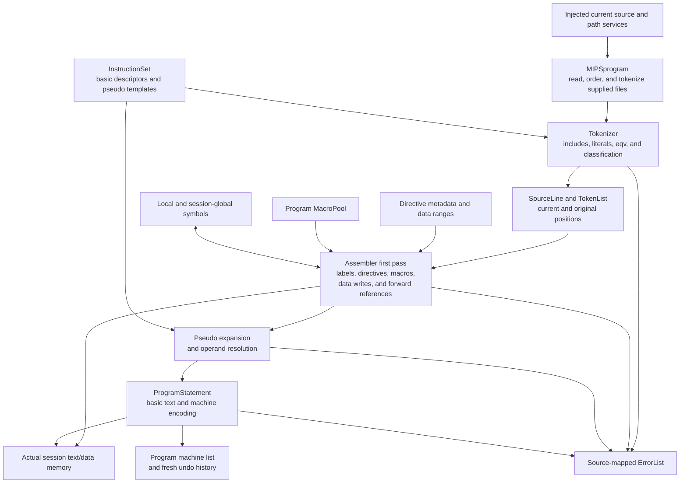
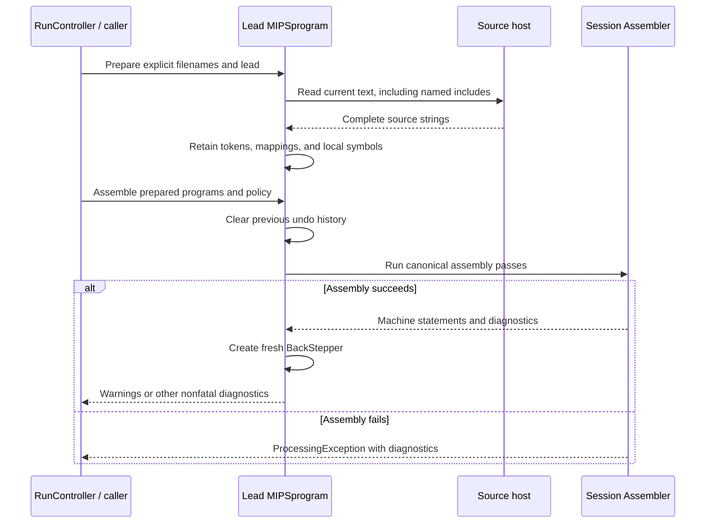

# Assembly front end

This module owns source preparation, lexical analysis, directives, macros, symbols, operand validation, and the canonical assembly passes. It also owns the program and statement representations that connect source text to machine words. The translated algorithms retain their [Java assembler](../../../../_legacy-app/mars/assembler/) responsibilities; `MIPSprogram` and `ProgramStatement` retain the contracts of their original `mars/` root classes.

[Globals](../Globals.ts) supplies the session's actual instruction registry, hardware, settings, global symbols, and source services. [RunController](../../venus/RunController.ts) selects assembly inputs and coordinates execution. This module performs no browser storage access, filesystem discovery, network fetching, instruction execution, or UI rendering. The [engine guide](../README.md) explains those surrounding boundaries.

## Responsibility groups and legacy mapping

| Boundary                               | Owns                                                                                                                                            | Behavioral source                                                                                    |
| -------------------------------------- | ----------------------------------------------------------------------------------------------------------------------------------------------- | ---------------------------------------------------------------------------------------------------- |
| Root assembly orchestration            | Multi-file passes, directive application, forward references, pseudo expansion, encoding, operand compatibility, and ordered overload selection | `mars/assembler/Assembler.java` and `OperandFormat.java`                                             |
| [Tokenization](tokenization/README.md) | Source mapping, tokens/lists/types, character scanning, include expansion, equivalences, and JDK character classification                       | `SourceLine`, `Token`, `TokenList`, `TokenTypes`, and `Tokenizer`; consumed JDK character operations |
| [Directives](directives/README.md)     | Canonical directive identities/help, storage widths, numeric limits, and range predicates                                                       | `Directives.java` and `DataTypes.java`                                                               |
| [Symbols](symbols/README.md)           | Ordered local/global label records, lookup, address queries, and relocation                                                                     | `Symbol.java` and `SymbolTable.java`                                                                 |
| [Macros](macros/README.md)             | Program-owned definitions, parameter substitution, overloads, counters, local labels, and recursion history                                     | `Macro.java` and `MacroPool.java`                                                                    |
| [Programs](programs/README.md)         | Source/token/assembly lifecycle, statements, operands, encoding/decoding, and program-owned undo history                                        | `mars/MIPSprogram.java` and `mars/ProgramStatement.java`                                             |

The root keeps `Assembler` and `OperandFormat` because they coordinate these representations and instruction candidates. `Assembler`'s private address-space and forward-reference helpers stay with their owning algorithm. Grouping does not replace the original passes or split a cohesive class by line count. Programs remain inside the assembler boundary because source and machine representations are their responsibility, even though the original classes lived at the Java package root.

Import directly from the owning group; retired flat paths have no wrappers or barrel exports. Colocated program/statement tests follow their owners, while cross-module [assembler comparisons](../../../../tests/assembler/README.md) remain under `tests/assembler/`.

## Source-to-machine pipeline

Arrows describe the data flow and collaborators, not every import. Token classification receives lookup services from the real register banks and instruction set. Complete assembly uses actual `ProgramStatement` and memory instances; no group maintains a second instruction vocabulary or substitute decoder.

### Preparation and lexical processing

`MIPSprogram.prepareFilesForAssembly()` reads exactly the supplied filenames, preserves the lead program's identity, and can insert an exception handler first. Source text comes from a synchronous injected host, using Java line-boundary behavior. The browser's active-source/include policy is separate from the engine's ability to prepare an explicit multi-program list.

`Tokenizer` performs the original include prepass, character scanning, character-literal conversion, and recursive `.eqv` processing. Include lookup uses supplied virtual paths and fresh source programs, preserving filename spelling and source mappings. Repeated include paths remain errors. Missing sources become mapped diagnostics rather than directory scans or fetch requests.

The source program retains a mutable `SourceLine` list while separately snapshotting plain source strings. Tokens retain current and original program/line positions. `TokenList.clone()` owns a new sequence sharing the same token objects. These aliasing contracts matter when substitutions and diagnostics observe the same source representations.

### Pass ownership and mutation

| Stage                       | Principal changes                                                                                            | Failure/ownership consequence                                                                 |
| --------------------------- | ------------------------------------------------------------------------------------------------------------ | --------------------------------------------------------------------------------------------- |
| Preparation/tokenization    | Read source, expand includes/equivalences, retain mappings/tokens, and create local symbols                  | Program getters retain their nullable lifecycle; tokenizer diagnostics belong to its instance |
| First pass                  | Parse source, define labels/macros, apply directives, write data, transfer globals, and backpatch references | Memory and symbol changes can occur before a later failure                                    |
| Expansion and encoding      | Expand canonical pseudo templates, resolve operands, build statements, and detect address conflicts          | Statements retain mutable operand and representation contracts                                |
| Successful program assembly | Replace machine results and construct a new `BackStepper`                                                    | History belongs to the assembled program, not the assembler or UI                             |
| Failed program assembly     | Propagate canonical diagnostics after the translated mutations                                               | Previous history is cleared; a previous machine-list reference can remain                     |

Assembly is not transactional. The caller must not infer that an error leaves memory untouched or restores a previously executable program. `RunController` reports failure and invalidates executable presentation; it requires idle execution before assembly or reset.

## Language responsibilities

| Feature                                 | Owning rule                                                                                                                                             |
| --------------------------------------- | ------------------------------------------------------------------------------------------------------------------------------------------------------- |
| Instruction names and overloads         | Real `InstructionSet` candidates in canonical order; `OperandFormat` checks count/category compatibility and preserves candidate token reclassification |
| Integer operands and directive values   | Java/MARS numeric syntax from `Binary`, with range and truncation policy applied by the consuming algorithm                                             |
| Floating data                           | Java-compatible literal parsing and translated range/cast/storage rules; no native JavaScript parsing substitute                                        |
| Strings and character literals          | Tokenizer and directive algorithms retain Java UTF-16, escape, and byte-write behavior                                                                  |
| `.include` and `.eqv`                   | Tokenizer source prepass and equivalence processing, preserving source maps and diagnostics                                                             |
| `.macro` definitions/calls              | Program `MacroPool` and `Macro` handle definitions, percent/SPIM parameters, overloads, local labels, and expansion history                             |
| Labels and `.globl`/`.extern`           | Local/global symbol tables and assembler address spaces retain their separate scopes and transfers                                                      |
| Alignment, continuation, and repetition | Directive application remains in `Assembler`; metadata alone does not allocate or write memory                                                          |

The instruction registry's 155 basic registrations and 388 pseudo definitions remain [instruction-module](../instructions/README.md) responsibilities. The assembler consumes those definitions, including compact and delayed-branch alternatives, without duplicating template expansion rules in tokenization or macros.

`OperandFormat` receives the live bare-machine setting. Its compatibility checks and ordered best-match search retain observable mutations from operator tokens to identifiers. Package-visible Java operations become public static TypeScript methods for the real assembler caller; this visibility adaptation does not change selection order or diagnostic text.

## Ownership, numbers, and diagnostics

| State                                                       | Owner                   | Important contract                                                                                               |
| ----------------------------------------------------------- | ----------------------- | ---------------------------------------------------------------------------------------------------------------- |
| Source, tokens, local symbols/macros, parsed/machine lists  | Each `MIPSprogram`      | Mutable references and nullable initialization states follow Java                                                |
| Global symbol table and instruction/register services       | The session             | Shared by its assembly programs, isolated from other sessions                                                    |
| Diagnostics and equivalence dictionary                      | Each `Tokenizer`        | Whole-program tokenization initializes equivalences; diagnostics retain the original persistent routing behavior |
| Pass addresses, forward references, output list, and errors | Each `Assembler`        | A fresh production assembler is constructed through the session factory for program assembly                     |
| Operands and source/basic/machine forms                     | Each `ProgramStatement` | Setters do not recompute unrelated forms; source rebuilding can append printable elements                        |

Addresses, operands, counters, and machine words use signed 32-bit `number` conventions with explicit Java wrapping where required. Macro substitution counters use signed 64-bit `bigint`, while the pool expansion counter wraps as a Java `int`. Raw double data and exact numeric conversions use their existing bit/fraction helpers; complete 64-bit patterns do not pass through imprecise integer `number` arithmetic.

`ProgramStatement` keeps its fixed operand array, mask insertion, branch offset arithmetic, jump-region checks and operand mutation, invalid-word representation, and independently settable forms. Its printable elements distinguish addresses from values and read current display preferences when rendered. Decoding a word creates a representation; executing it belongs to the simulator and instruction callbacks.

Diagnostics preserve source filenames, original/expanded locations, include mappings, macro call history, warning policy, and report ordering. [Diagnostics](../diagnostics/README.md) owns `ErrorMessage`, `ErrorList`, and `ProcessingException`; the UI consumes these results without reconstructing assembly messages. Java collection failures become TypeScript `RangeError` with the covered legacy messages.

## Host contracts and lifecycle

The session supplies actual memory, global symbols, register/instruction lookup, current settings, statement construction collaborators, file-descriptor reset, and optional debug output through `AssemblerHost` and the program/statement hosts. Narrow interfaces such as `TokenizerProgram`, `SourceLineProgram`, `StatementProgram`, and `MacroProgram` describe consumed methods; they do not substitute for production programs.

A tokenizer is not a stateless line-coloring helper. Its public line overloads retain the original diagnostic/equivalence lifecycle; instruction examples use the dedicated entry point and fresh instances where production composition requires them. [Editor highlighting](../../editor/highlighting/README.md) has its own translated lexical model and shares only the metadata/rules it consumes.

Source edits invalidate desktop execution. Reset reassembles retained tokenized programs under the prior policy rather than rereading newly edited text. Async simulation entry points on `MIPSprogram` forward to the session simulator; program ownership does not grant permission to overlap assembly, execution, reset, or disposal.

## Oracle evidence and extension

| Evidence                                                                                                                                   | Covered contract                                                                                                                |
| ------------------------------------------------------------------------------------------------------------------------------------------ | ------------------------------------------------------------------------------------------------------------------------------- |
| [Assembler units](../../../../tests/oracle/assembler-units/README.md)                                                                      | Directive metadata, source/token mapping, list aliasing, symbols, classification, and macro operations                          |
| [Tokenizer](../../../../tests/oracle/tokenizer-units/README.md) and [character capture](../../../../tests/oracle/highlighting/README.md)   | Whole-source/includes/equivalences, lexical failures, persistent diagnostics, and JDK BMP character categories                  |
| [Operand format](../../../../tests/oracle/operand-format-units/README.md)                                                                  | Category matrix, integer boundaries, real specifications, and overload-selection mutations                                      |
| [Program lifecycle](../../../../tests/oracle/program-units/README.md) and [statements](../../../../tests/oracle/statement-units/README.md) | Source/list identity, preparation, failure retention, encoding/decoding, operands, and display combinations                     |
| [Complete assembler corpus](../../../../tests/oracle/assembler-programs/README.md)                                                         | 603 assemblies using real engine collaborators, with machine words, memory, symbols, mapped diagnostics, and failure-time state |
| [Session comparisons](../../../../tests/session/README.md)                                                                                 | Assembly through production composition, reset/invalidation, and subsequent execution ownership                                 |

Complete assembly evidence does not execute resulting instructions; direct statement probes also isolate their decoder dependencies deliberately. The linked guides distinguish those boundaries from instruction and whole-program execution comparisons. Captured goldens and generated character data remain oracle-produced, and this organization does not regenerate their expected values.

Extend the group that owns the relevant rule. Preserve token/source identity, canonical instruction order, exact numeric semantics, and failure-time mutation. Share a helper when callers repeat the same logic, but not when similar-looking code encodes different contracts; keep source discovery with the host, and record deliberate behavior divergences through [ADR 0002's fidelity policy](../../../../docs/adrs/0002-port-fidelity.md) and a fixture. Translated code retains Pete Sanderson and Kenneth Vollmar's [MIT attribution](../../../../MARSlicense.txt), including original macro contributor notices. No semantic divergence is intended.
