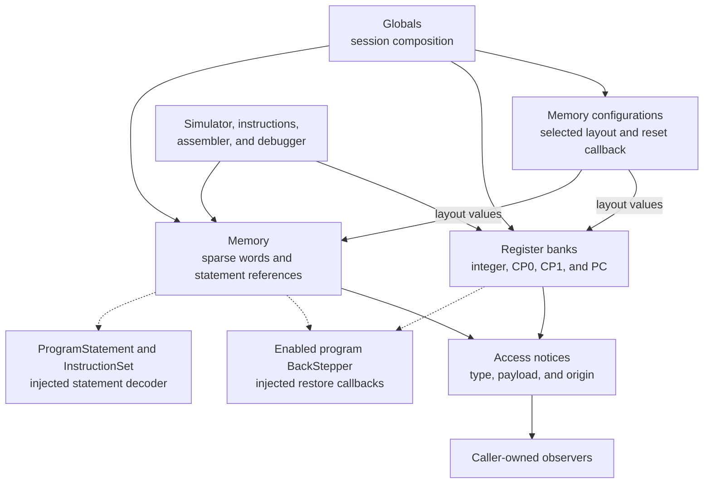
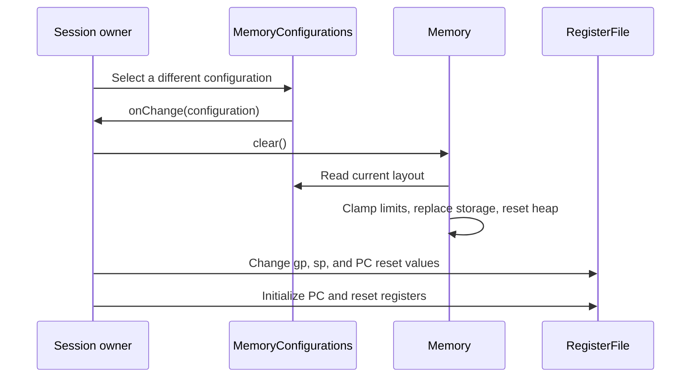

# Hardware state

This module owns one session's MIPS registers, coprocessors, sparse memory, memory layouts, and hardware access notices. It translates the corresponding classes in [mars/mips/hardware](../../../../_legacy-app/mars/mips/hardware/) while replacing Java static storage with session-owned instances. [Globals](../Globals.ts) composes these objects and connects settings, instruction decoding, execution context, and undo recording. Hardware has no browser, framework, scheduler, or platform I/O dependency.

The [engine guide](../README.md) describes machine composition and execution. This guide explains how hardware responsibilities fit together; group guides own their detailed contracts.

## Responsibility groups and legacy mapping

| Group                            | Owns                                                                                                                        | Legacy classes                                                                                   |
| -------------------------------- | --------------------------------------------------------------------------------------------------------------------------- | ------------------------------------------------------------------------------------------------ |
| [Registers](registers/README.md) | General registers, HI/LO, PC, exception registers, floating registers, condition flags, and register subscriptions          | `Register`, `RegisterFile`, `Coprocessor0`, `Coprocessor1`, and `InvalidRegisterAccessException` |
| [Memory](memory/README.md)       | Sparse storage, address validation, heap allocation, statement references, layout descriptions, and configuration selection | `Memory`, `MemoryConfiguration`, `MemoryConfigurations`, and `AddressErrorException`             |
| [Notices](notices/README.md)     | Immutable access descriptions and explicit GUI/MIPS origin                                                                  | `AccessNotice`, `RegisterAccessNotice`, and `MemoryAccessNotice`                                 |

The groups separate state owners from the event records they publish. Memory configuration stays with the address-space responsibility even though register initialization also consumes it. Exceptions live beside the operation they describe. Classes and algorithms retain their Java identities; grouping changes their import locations without introducing another hardware abstraction.

Import directly from the responsible group. This directory provides no barrel exports or forwarding files at retired paths. The root [foundation comparison](foundation.test.ts) spans all three groups as well as numeric and diagnostic foundations; the [memory comparison](memory/Memory.test.ts) stays with its storage owner.

Solid arrows show ownership or use, not every import. Dashed arrows are injected collaborations: hardware records a change or requests decoding without importing the controller or owning program history.

## Numeric and storage conventions

| Value                                            | Representation                        | Contract                                                                                      |
| ------------------------------------------------ | ------------------------------------- | --------------------------------------------------------------------------------------------- |
| Register values, addresses, PC, and stored words | Signed 32-bit `number`                | Writes and address arithmetic retain Java wrapping; high addresses may be negative            |
| Floating-register pairs and double bit patterns  | Signed 64-bit `bigint`                | Exact halves are composed without passing the complete bit pattern through `number`           |
| Single/double numeric values                     | Binary32-rounded or binary64 `number` | Instance-local `DataView` buffers reinterpret bits; raw storage remains integer state         |
| Address-layout entries                           | Signed 32-bit `number`                | Segment bounds retain their individual Java inclusive/exclusive rules                         |
| Access records                                   | Immutable type, origin, and payload   | Register notices identify a name; memory notices include signed address/value and byte length |

The even floating register stores a double's low word and the odd register its high word. Pair reads and writes access the odd high register first, preserving notice order. That arrangement is independent of memory byte order. Numeric text parsing and Java float/double printing belong to [formatting](../formatting/README.md), not register storage.

## Register banks and reset behavior

`RegisterFile`, `Coprocessor0`, and `Coprocessor1` construct their own `Register` objects. A register normalizes writes with `| 0`, retains its reset value separately, and offers notifying and nonnotifying reads. General-register update methods protect register zero. HI/LO and PC retain their distinct access and recording paths.

General-register lookup tries numeric dollar-prefixed aliases before exact mnemonic matching. It uses the conservative integer-prefix check to skip guaranteed parse failures for ordinary names while retaining the complete `Binary` parser for candidates. Unicode digits, overflow behavior, and the legacy bare-`$` alias for register zero remain observable.

CP0 owns bad-address, status, cause, and EPC registers. [Simulator exceptions](../simulator/Exceptions.ts) update them through the session's real bank. CP1 owns 32 floating registers and its condition word; raw-bit access preserves payloads where the original operation does, while conversion to a numeric value can have JavaScript NaN consequences.

Reset is not uniformly silent. Individual `Register.resetValue()` calls do not notify, but `RegisterFile.resetRegisters()` writes PC, and CP1 reset writes the condition word. Aggregate register observers exclude PC from the general bank and exclude the condition word from the floating bank, as in Java. Consumers needing these values use dedicated APIs or controller refreshes.

## Sparse memory and layouts

Memory keeps distinct tables for address regions rather than allocating a dense representation of the MIPS address space. Blocks are allocated when storage is needed; text tables retain real statement references. The original descending-stack correction, byte operations, table capacities, and configuration-limit clamping remain in `Memory`.

| Region               | Storage organization                                | Important boundary                                                                    |
| -------------------- | --------------------------------------------------- | ------------------------------------------------------------------------------------- |
| User and kernel data | Separate 1,024-block tables of 1,024-word blocks    | Each table's capacity participates in effective address-limit clamping                |
| Stack                | A separate table with the same block dimensions     | Relative addresses descend from the configured stack base                             |
| MMIO                 | 16 blocks of 1,024 words                            | An address region exists; device Tools are separate unfinished work                   |
| User and kernel text | Separate 1,024-block tables of statement references | Instruction decoding is injected; storage does not implement a second instruction set |

Ordinary reads from unallocated data storage return zero; null-block and text inspection APIs preserve their separate contracts. Alignment, range failures, partial boundary accesses, heap overflow, and self-modifying-code permissions follow their translated methods. Do not infer one universal range rule from the public layout fields.

The three layouts are constructed for each `MemoryConfigurations` collection. Selected values below are hexadecimal bit patterns for orientation, not a complete boundary specification:

| Layout            | User text base | Static data base | Initial `$gp` | Initial `$sp` |
| ----------------- | -------------- | ---------------- | ------------- | ------------- |
| Default           | `0x00400000`   | `0x10010000`     | `0x10008000`  | `0x7fffeffc`  |
| CompactDataAtZero | `0x00003000`   | `0x00000000`     | `0x00001800`  | `0x00002ffc`  |
| CompactTextAtZero | `0x00000000`   | `0x00002000`     | `0x00001800`  | `0x00003ffc`  |

Selection changes by object identity. Null or the already selected configuration produces no callback. A real change invokes the session owner, which clears memory and updates register defaults in canonical order. The same configuration collection must be supplied to machine memory and used when initializing its register file.

`Memory.clear()` preserves observer registrations and byte order while replacing storage and resetting the heap. It applies the selected layout; `setConfiguration()` alone copies layout values and clamps limits without being a complete reset. Layout changes must occur under the owner's idle-machine policy, with prior executable state reconciled afterward.

## Observation and access context

Java `Observable` becomes synchronous subscriptions, but register and memory dispatch retain different algorithms. A common notice base does not imply one shared event bus.

| Behavior                    | Registers                                                     | Memory                                                                                   |
| --------------------------- | ------------------------------------------------------------- | ---------------------------------------------------------------------------------------- |
| Dispatch                    | Reverse registration order over a callback snapshot           | Registration-order traversal of range records                                            |
| Read/write timing           | Read notifies before returning; write stores before notifying | Access methods retain their method-specific suppression and partial-access behavior      |
| Duplicate callback identity | A register's observer set deduplicates it                     | Separate registrations remain separate range records                                     |
| Unsubscribe                 | Remove callback identity from the register                    | Null the callback while retaining the range record                                       |
| Count after removal         | No inactive register subscription remains                     | `countObservers()` still counts inactive records until `deleteObservers()` discards them |

Every subscriber owns the returned teardown. The [notice guide](notices/README.md) explains payload and origin; the [memory guide](memory/README.md) explains signed ranges and dispatch edge cases. Rendering should use nonnotifying APIs where available. `getStatementNoNotify()` can still generate data-read notices when self-modifying-code execution fetches from data; its name does not promise silence on every path.

An injected `AccessOrigin` callback replaces Java thread identity. `Globals` distinguishes executing MIPS access from GUI access, and its synchronous `withGuiAccess()` scope can mark inspection while a run awaits input. Notices capture that origin at access time without storing a DOM object, thread, or component reference.

## Injected collaborators and lifecycle

| Collaboration              | Hardware obligation                                                                     | Session-owner obligation                                                                                 |
| -------------------------- | --------------------------------------------------------------------------------------- | -------------------------------------------------------------------------------------------------------- |
| Undo recording             | Pass previous register, memory, PC, or flag state through the translated recording path | Gate recording on current enabled program history; value-returning callbacks must return the prior value |
| Start label                | Ask for a validated text/kernel-text start address when requested                       | Resolve current `main` and return null when unavailable or invalid                                       |
| Statement decoding         | Supply exact binary word and address when decoding is required                          | Construct a real `ProgramStatement` using the session's instruction registry                             |
| Settings and notifications | Query self-modification and notification predicates at the relevant operation           | Supply current settings; suppress GUI memory notices when no program exists                              |
| Configuration changes      | Publish a real selection change through `onChange`                                      | Clear storage and update/reset register defaults; metadata does not own registers                        |
| Debug output               | Emit through an optional injected sink                                                  | Route output without introducing platform I/O into hardware                                              |

Hardware owns no timers or asynchronous execution. Consumers stop and await the simulator before replacing machine state and release their subscriptions before abandoning instances. Clearing memory is distinct from disposing observers. [ADR 0004](../../../../docs/adrs/0004-cooperative-simulation.md) and [ADR 0006](../../../../docs/adrs/0006-object-lifetime-management.md) describe the execution and application lifetime surrounding these synchronous objects.

## Evidence and extension

| Evidence                                                                                                                                 | Covered hardware contract                                                                                                                             |
| ---------------------------------------------------------------------------------------------------------------------------------------- | ----------------------------------------------------------------------------------------------------------------------------------------------------- |
| [Foundation probe](../../../../tests/oracle/units/README.md) and [comparison](foundation.test.ts)                                        | Register storage/reset, aliases, access notices/order, PC wrap, CP0 defaults, CP1 raw bits/pairs/flags, exception-register updates, and layout tables |
| [Memory probe](../../../../tests/oracle/memory-units/README.md) and [comparison](memory/Memory.test.ts)                                  | Sparse storage, byte orders, boundaries, heap, statements, notification ranges, removal, and legacy edge cases                                        |
| [Instruction-set probe](../../../../tests/oracle/instruction-set/README.md)                                                              | Hardware effects and errors from every basic instruction callback, distinct from direct storage tests                                                 |
| [Backstep](../../../../tests/oracle/backstep-units/README.md) and [simulator](../../../../tests/oracle/simulator-units/README.md) probes | Recorded restoration, execution sequencing, exception dispatch, and handler behavior                                                                  |
| [Session integration](../../../../tests/session/README.md)                                                                               | Production composition, independent machines, configuration resets, execution ownership, and disposal                                                 |

These fixtures establish their represented operations, not exhaustive inputs or unfinished device behavior. Local tests also cover subscription teardown, isolation, notification suppression, callback receiver preservation, and decoder arguments. No hardware semantic divergence is intended; [ADR 0002](../../../../docs/adrs/0002-port-fidelity.md) records the fidelity policy. Translated source retains Pete Sanderson and Kenneth Vollmar's [MIT attribution](../../../../MARSlicense.txt).

Extend the group that owns the state or record being changed. Keep memory algorithms cohesive, register-pair and access ordering explicit, and undo policy with the program owner. Add a group only for a distinct responsibility with its own contract; do not extract helpers merely to shorten a class. A behavior change needs focused oracle evidence, and any deliberate divergence needs an ADR and fixture.

Desktop checkpoint recovery uses Memory's portable sparse-block capture/restore APIs. Capture preserves allocated zeros, raw text words, heap position, and byte order; restore validates table bounds and words before replacing storage, retains matching assembled statement objects, and preserves subscriptions. Register banks are captured through silent raw reads and restored before publication. This browser recovery extension does not change memory access algorithms; [ADR 0007](../../../../docs/adrs/0007-desktop-session-recovery.md) defines its idle-machine contract.
