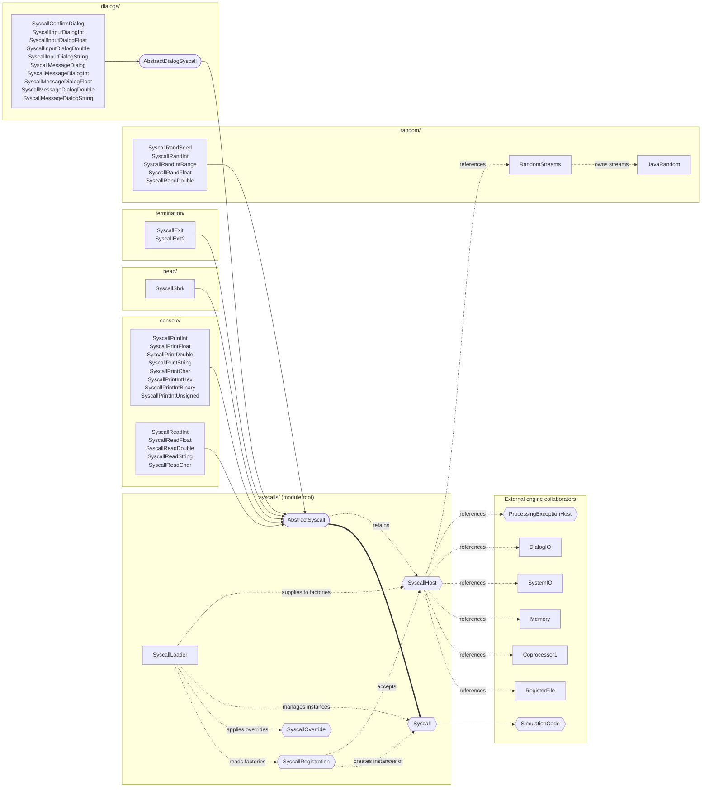

# Runtime services

This module owns the service abstraction, service-number registry, and individual system-call algorithms from `_legacy-app/mars/mips/instructions/syscalls/` and `_legacy-app/mars/mips/instructions/SyscallLoader.java`. Each syscall remains a separate class with its canonical name, default number, register/memory effects, and diagnostic behavior. A session injects its own general and floating registers, memory, exception updates, and `SystemIO` adapter; no process-wide state or browser UI is retained here.

## Organization

Each class and interface lives in its own source file. The module root owns the shared service abstraction and registry. The [host contract](SyscallHost.ts) separates session dependencies from the translated `AbstractSyscall` base, while the [registration contract](SyscallRegistration.ts) and [number override contract](SyscallOverride.ts) separate configuration from the translated `SyscallLoader`. These TypeScript contracts make the replacements for Java globals and classpath discovery explicit; consumers import each contract directly from its own module.

| Boundary                     | Responsibility                                                                                                                                       |
| ---------------------------- | ---------------------------------------------------------------------------------------------------------------------------------------------------- |
| Module root                  | Shared service metadata/execution contract, abstract syscall base, injected session host, registration/override contracts, and service-number loader |
| [console/](console/)         | Console input/output services, including floating text conversion callbacks and integer display formats                                              |
| [heap/](heap/)               | Heap allocation through the session's memory model                                                                                                   |
| [termination/](termination/) | Normal simulation termination and GUI exit-status handling                                                                                           |
| [random/](random/)           | Random syscall algorithms, session-owned stream collection, and the Java-compatible generator                                                        |
| [dialogs/](dialogs/)         | Dialog syscall algorithms and their shared abstract base, using the injected dialog adapter                                                          |

The folders partition the legacy syscall package by service responsibility; translated class names, service numbers, and algorithms remain unchanged. Random state and its generator stay with the random services, and the shared dialog base stays with its subclasses. Add a service to its semantic family and register its factory in the root loader. The root tests cover interactions across these families; this README documents the entire module.

## Class and interface relationships

Subgraphs follow the source-folder boundaries, with external engine collaborators grouped separately. Hexagons denote interfaces, rounded boxes denote abstract classes, and rectangles denote concrete classes. Rectangles listing several names group independent syscall classes by family; each relationship applies to every listed class. Solid arrows mean **extends**, thick arrows mean **implements**, and dotted arrows show labeled dependencies or references. Inheritance and implementation arrows point toward the base class or interface. Host references remain session-owned; they do not imply ownership by a syscall.

## Runtime behavior and evidence

The implemented core families are console reads and writes (services 1–8, 11–12, and 34–36), heap allocation (9), and normal termination (10 and 17). Floating services require exact Java numeric runtime callbacks from `SystemIO`; there is no JavaScript decimal-printing fallback. Services 40–44 provide seeded/unseeded random streams, and 50–59 provide confirmation, numeric/string input, and message dialogs. GUI `Exit2` ignores the `$a0` exit status, as the original Swing application does. No command-line integration or process exit is ported.

`SyscallLoader` replaces Java classpath reflection with explicit factories that construct fresh session-owned services. It retains duplicate-class filtering, initial duplicate-number detection, case-sensitive override matching, applying every number override before the final collision check, lazy initialization, and last matching service lookup. The default registry contains all implemented services; absent file, time, MIDI, and sleep services return null so `InstructionSet` raises the canonical unsupported-service exception. Register an additional translated class through this registry when its complete host contract and oracle tests exist. Configuration failures retain their diagnostic text and throw to the owning browser session instead of terminating the application process.

Input syscalls return promises; `SimulationCode` and the `InstructionSet` syscall callback propagate completion so the simulator waits before executing another instruction. Normal exit retains the original `ProcessingException` with no error list. Invalid input and address exceptions retain their original service-specific messages and CP0 updates. Single/double reads store raw floating bits, string reads preserve Java UTF-16-to-byte writes and newline/NUL rules, and integer arithmetic/addresses wrap to signed 32-bit words.

The [core service oracle](../../../../tests/oracle/core-syscalls/README.md) captures all implemented core services across deterministic input, output, allocation, raw-bit, memory, error, and exit cases. Additional focused tests exercise registry overrides, instance isolation, GUI input prompts, and suspension through the actual basic syscall instruction. File, time, sleep, and MIDI families remain unimplemented.

`RandomStreams` ports the legacy static map as session-owned state, with the specified `java.util.Random` algorithm in `JavaRandom`. Each signed stream ID has an independent 48-bit `bigint` seed. Explicit service-40 seeds sign-extend the signed register value; unseeded streams consult host entropy only on first use. Bounded ints retain rejection sampling and the zero/negative-bound syscall exception. Float/double draws use the canonical 24-bit and 26+27-bit paths. Assembly, Reset, and Backstep do not rewind streams, matching Java; portable checkpoints retain internal seeds as exact JSON-safe numbers.

Each dialog service keeps its Java class name. `AbstractDialogSyscall` extracts the repeated byte-message and numeric-input algorithms from the ten legacy classes; the injected `DialogIO` replaces their direct `JOptionPane` calls. Integer input does not trim; floating input uses the exact Java numeric runtime. Cancel, empty input, parse failure, and string truncation retain distinct statuses. Strings retain low-byte UTF-16 writes, newline/NUL placement (including tiny/negative bounds), partial writes, and address exceptions through the existing CP0/handler path. Confirmation close returns -1. Message types use the actual 0–3 Java constants, with other values plain.

The [random and Swing dialog captures](../../../../tests/oracle/platform-syscalls/README.md) compare register/memory effects, exact diagnostics, displayed messages, and message types. Browser modal presentation, explicit Stop, and entropy sourcing follow [ADR 0014](../../../../docs/adrs/0014-random-and-dialog-syscalls.md); no Swing visual parity is claimed.
