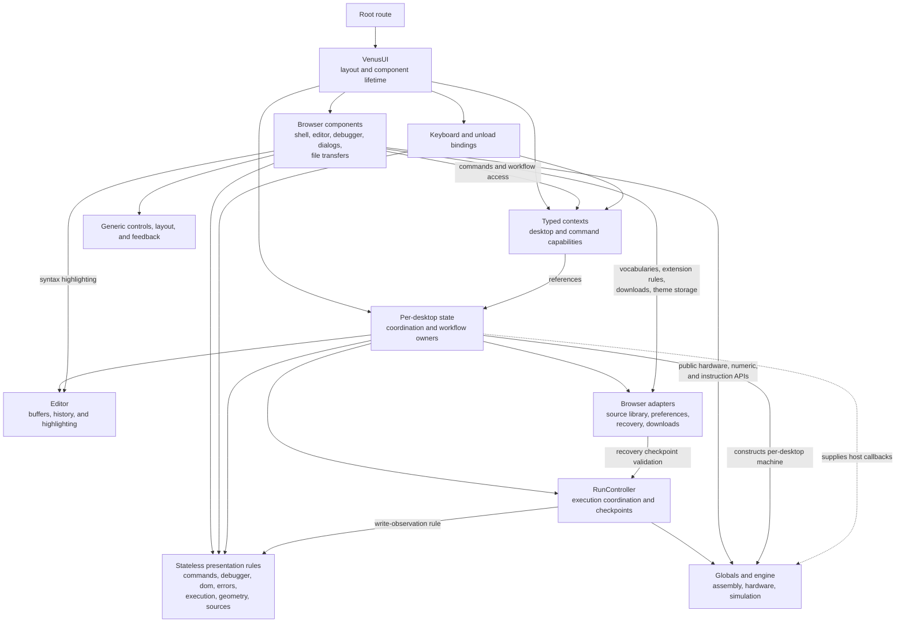
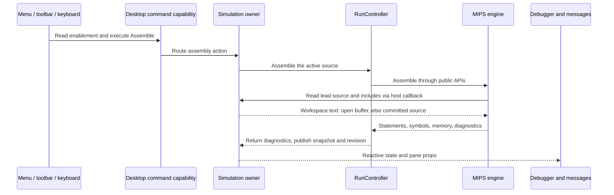

# Venus desktop interface

This module presents the MARS desktop arrangement in Svelte: menus and toolbar, Edit/Execute panes above Messages/Run I/O, and the persistent register sidebar. It adapts `_legacy-app/mars/venus/VenusUI.java`, `MainPane.java`, `MessagesPane.java`, `ExecutePane.java`, the Text Segment, Data Segment, and Labels windows, `RunSpeedPanel.java`, and the register-window classes. The root route mounts the desktop directly without a launch screen.

## Composition and module boundaries

[VenusUI.svelte](VenusUI.svelte) is the top-level renderer and component-lifetime owner. It creates one context-owned desktop coordinator, mounts its browser lifecycle, and composes the layout. The [state module](state/README.md) separates source workspaces and file workflows, simulation and pending input, display preferences and pane geometry, and source search. Those owners retain their resources and cleanup; the root contains no file workflow or machine-host implementation. Browser rendering lives in [components](components/README.md): reusable pane shells and nested tab strips accept snippets, menu dropdowns render grouped choices, and toolbar groups render shared command definitions through reusable buttons and icon components that reference bundled SVG files. Source-editor scrolling and hover state, menu dismissal, and divider gestures stay with their components. This split follows browser composition and lifecycle needs rather than treating each Swing class as a required component boundary.

The [desktop context](context/README.md) shares those per-instance owners with dialog and file-transfer adapters. Its narrower command capability exposes dispatch, enablement, pressed state, and the live setting toggles to menus and toolbars through typed Svelte accessors. It contains no global session state. Components that coordinate with a desktop owner, such as the dialogs, transfer behaviors, debugger views, and editor views, read the desktop context for the display, simulation, and workspace owners they use; the shell reads only the command capability. Explicit props and callbacks carry what remains view-owned or generic: the Edit/Execute and editor-height tabs and dividers, the execution handles of the Execute and register panes, the shell's two bound preferences and its line-number and speed values, and the footer's content. [Presentation utilities](utils/README.md) are grouped by responsibility and share command and Settings catalogs with shortcut notation, debugger table and Data Segment rules, DOM helpers, displayed error text, run-speed and run-outcome rules, range clamping and pane geometry constants, and unsaved-source labels, source-commit eligibility, and export filenames; the browser persistence adapters own the constants that validate stored records, such as the selectable views, tabs, and memory ranges, and Venus imports them; the framework-free [RunController](RunController.ts), editor model, browser persistence adapters, and engine retain their own responsibilities.

### Desktop architecture

The root constructs the owners once during component initialization and publishes references through context. A view changing tabs, opening Help, or switching appearance does not create another editor or machine. The diagram shows composition and collaboration; the engine's use of injected host callbacks is distinct from importing browser code.

| Boundary                           | Owns                                                                                                                                                                                                                     | Collaboration contract                                                                                             |
| ---------------------------------- | ------------------------------------------------------------------------------------------------------------------------------------------------------------------------------------------------------------------------ | ------------------------------------------------------------------------------------------------------------------ |
| [Desktop root](VenusUI.svelte)     | Layout composition, context installation, mounting and releasing one desktop                                                                                                                                             | Supplies the few view-owned props and the machine handles; does not implement source workflows or machine hosting  |
| [State](state/README.md)           | Cross-view reactive state, source and execution workflows, preferences, search, and session resources                                                                                                                    | Operates on editor, browser, and engine APIs; publishes live state and owner methods                               |
| [Context](context/README.md)       | Typed access to the existing desktop and its narrow command capability                                                                                                                                                   | Shares references within the component tree; creates no global session or duplicate model                          |
| [Components](components/README.md) | Presentation, native element interactions, local UI state, and component-scoped resources                                                                                                                                | Compose snippets and callbacks; coordinating views read workflow owners through context, generic components do not |
| [Hooks](hooks/README.md)           | Explicit keyboard delivery and the dirty-source unload binding                                                                                                                                                           | Register during component initialization, read live owner state, and release listeners on unmount                  |
| [Utilities](utils/README.md)       | Command and Settings catalogs, shortcut notation, debugger table and Data Segment rules, DOM helpers, error text, run-speed and run-outcome rules, geometry, and source labels, commit eligibility, and export filenames | Pure rules shared by actual consumers; no machine, storage writer, or reactive singleton                           |
| [RunController](RunController.ts)  | Framework-free assembly/run/debug coordination and published execution snapshots                                                                                                                                         | Calls engine public APIs and owns an active run until it settles                                                   |

### State ownership and reactivity

The desktop coordinator connects capabilities; it does not absorb the individual workflows. Source operations receive explicit invalidation, reporting, running-state, and assemble-on-open callbacks. Simulation resolves source through the workspace's read contract. This keeps the workspace independent of machine construction while allowing source edits, assembly, diagnostics, and view navigation to cooperate.

| State responsibility | Authoritative data and behavior                                                                                              | Principal consumers                                                             |
| -------------------- | ---------------------------------------------------------------------------------------------------------------------------- | ------------------------------------------------------------------------------- |
| Desktop coordination | Command routing and availability, shared display toggles, Help selection, transfer registrations, initialization             | Root, shell, keyboard bindings, Help and transfer adapters                      |
| Source workspace     | Editor instance, source snapshots, selection, save/close queues, import confirmation, Auto Save, recovery, file errors       | Source views, source dialogs, transfer adapters, search, assembly source lookup |
| Simulation           | Machine and controller, execution snapshots, breakpoints, output, pending syscall input, host scheduling, engine preferences | Debugger, console, run actions, prompted-input dialogs                          |
| Display preferences  | Pane selection, label filters/sorting, display bases, run speed, measured and persisted geometry                             | Root layout, shell controls, editor and debugger panes                          |
| Source search        | Query, replacement, case sensitivity, result status, selection and replacement through the workspace                         | Find/Replace presentation and the active source buffer                          |

Svelte rune state belongs to these per-component class instances. Mutable framework-free objects are not turned into competing UI models: workspace revisions publish editor snapshots, and controller revisions plus hardware subscriptions refresh machine presentation. Whole machine/snapshot payloads use raw reactive references where appropriate. Consumers retain the owner and read its live fields; they do not cache primitive copies of preferences or execution status.

Context has two scopes. Menus and toolbars read the narrow command capability: dispatch, current enablement and pressed state, and the live display and engine-setting toggles, so they never reach the owners themselves. Components that coordinate with a desktop owner read the full desktop context: dialogs, browser transfer behaviors, and desktop keyboard coordination, and also the debugger views (messages, the Execute pane and its three panes, and the register banks) and the editor views (source tabs and the source editor), which follow the policy the dialogs and transfers already use instead of receiving each persisted value, callback, and preference as a prop. Generic pane shells, tab strips, dropdowns, buttons, and feedback remain usable through props and snippets without a desktop provider, because reuse outside the desktop and independent testing are the reason they are generic; only components tied to the desktop's owners read the context. Context lookup during component initialization always selects the nearest desktop, including when more than one tree is constructed.

## Browser component composition

### Responsibility groups

The [component guide](components/README.md) defines these boundaries in detail. Grouping follows MARS presentation responsibilities and resource ownership, rather than component size or a one-to-one translation of Swing classes.

| Group                                       | Presentation boundary                                                                 | State and dependencies                                                                                     |
| ------------------------------------------- | ------------------------------------------------------------------------------------- | ---------------------------------------------------------------------------------------------------------- |
| [Shell](components/shell/README.md)         | Menus, grouped toolbar commands, footer, embedded preferences, repository navigation  | Command capability, local menu dismissal, speed mapping, and theme persistence through the browser adapter |
| [Controls](components/controls/README.md)   | Native buttons, new-tab links, single/grouped selections, tabs, sliders, and switches | Caller-owned values and callbacks; no domain, storage, engine, or desktop context                          |
| [Layout](components/layout/README.md)       | Pane geometry, content shells, dividers                                               | Props, snippets, selected values, and gesture callbacks; no machine or desktop context                     |
| [Editor](components/editor/README.md)       | Edit view composition, source text, document tabs, syntax painting, instruction hover | Workspace-owned buffers and selection; local textarea and scroll/hover state                               |
| [Debugger](components/debugger/README.md)   | Statements, memory, labels, register banks, messages, console input                   | Public hardware APIs and simulation snapshots; component-scoped subscriptions                              |
| [Feedback](components/feedback/README.md)   | Loading status, descriptions, keyboard hints                                          | Caller labels and trigger snippets; owned timers/listeners and themed presentation                         |
| [Transfers](components/transfers/README.md) | Clipboard copying, new-source transfer, file picking, single/all downloads            | Exact caller text or workspace snapshots; mounted command registrations and browser-resource cleanup       |
| [Icons](components/icons/README.md)         | Theme-aware glyphs, icon-source selection, current-color masks                        | Bundled static SVG files; no state, interaction, or desktop context                                        |
| [Dialogs](components/dialogs/README.md)     | Modal shell, shared fields/actions, focused workflow views                            | Native dialog lifetime in the shell; workflow state remains with its existing owner                        |

### Snippets, records, and focused variants

Pane renders a sized section or sidebar from a content snippet. Execution segments use it through SegmentPane, the shared frame that adds their heading band and optional trailing actions; TabbedPane combines it with the generic tab strip, body snippet, and optional tab-strip actions. Tab strips render keyed records for both top-level panes and nested source documents; document-specific close actions are supplied as snippets. The caller controls selection and whether a body remains mounted, so selecting a pane never implicitly transfers ownership of its source or machine state. CSS custom properties carry geometry across scoped styling boundaries.

Menus and toolbars render ordered command groups from shared definitions. Reusable dropdowns distinguish actions from checkbox records, and toolbar actions render through IconButton, the square icon-only specialization of the generic native Button, which close affordances and compact pane controls reuse. The same Button, with its `plain`, `bordered`, and `outlined` variants, supports menu commands, dialog actions, console Clear/Clear All and input actions, transfers, debugger navigation, and tab triggers, preserving caller-owned state and optional tooltips. Icon artwork lives in bundled SVG files; the [icon components](components/icons/README.md) reference theme-dependent glyphs so their colors follow the active theme and pressed state, and pass theme-independent images through unchanged. These rendering contracts avoid repeating file/run command enumerations across separate menu, toolbar, and keyboard implementations.

Modal is a renderer for the native dialog shell, heading, content snippet, focus containment, Escape/backdrop dismissal, and focus restoration. It does not branch on source operations or Help content. A typed registry selects the workspace's dialog variant; Help and prompted syscall input observe their separate owners. Each variant renders one workflow, using shared field and action snippets while retaining native labels, input bindings, and form submission. A save-target change remounts the save shell so queued Save All prompts receive the expected initial focus.

Open source tabs can be dragged before or after another tab, or moved with Alt+Shift+Left/Right, without changing the selected buffer or invalidating loaded execution. Their order survives reload through workspace recovery. Source tabs use the generic tab strip's control snippet for inline filename editing. Double-click or F2 begins editing, Enter or moving focus submits, and Escape cancels. The workspace applies the same Save As Rename rules and publishes the new tab label immediately after a successful write. Renames require a nonempty basename with a `.asm` or `.s` extension; invalid names and names owned by another open tab display a warning while retaining the latest valid filename and source. Replacing a closed-library name still requires confirmation, and storage errors preserve the original record and draft. The component owns only temporary input and focus behavior; the workspace owns validation, persistence, and recovery. Rename and reorder share one availability, the coordinator's `canEditTabs`, which is false while a program runs or a dialog owns interaction. The source editor publishes its textarea to the workspace while mounted and clears it on removal, and the workspace stores the scroll offsets directly.

### Feedback and text transfer

Theme-aware tooltips replace native title hints on toolbar, execution, appearance, and code-transfer controls. They appear on hover or keyboard focus, remain hoverable, clamp to the viewport, and dismiss on Escape, activation, scrolling, resizing, or loss of window focus. Mouse activation does not keep the tooltip open after the pointer leaves. Tooltips and the source editor's instruction help share one themed floating surface from the application stylesheet. The GitHub icon beside the theme toggle opens the repository in a new tab.

Clipboard controls own exact-text copying and inline feedback, or delegate code transfer to the workspace. FileImporter owns native file selection and reads of sources and ZIP archives; FileExporter registers single/all download behaviors. Both hold the coordinator's blocking transfer status while they work. The workspace owns the import summary, collision checks, committed-source snapshots, and dirty-buffer safeguards.

## Command and keyboard flow

### One command capability, several input surfaces

Menus and toolbar buttons read current availability from the same command capability used by the desktop keyboard binding. The coordinator dismisses menus and routes an accepted command to the workspace, simulation owner, Help selection, or a registered browser-transfer behavior. Enablement remains a live query: a running machine, missing source, empty undo history, or absent breakpoints immediately changes the relevant controls. Workflow owners retain their own consistency checks, such as import protection for dirty buffers.

The following assembly path illustrates the division. The input surface chooses a command; source preparation, execution ownership, and translated engine work remain below the renderer.

Command metadata also supplies labels, icons, and shortcut hints, and the Settings catalog supplies the labels, hover descriptions, toolbar glyphs, and invalidation behavior of the engine options and shared toggles. They describe presentation and matching; they do not execute a machine. The utilities therefore have no mutable desktop state, and adding a hint alone does not implement a command.

### Keyboard policy

The lifecycle-owned [keyboard hooks](hooks/README.md) resolve explicit commands from the same shortcut metadata displayed as menu and tooltip keycaps. Alt/Option+T toggles all breakpoints, leaving Ctrl+T to the browser's new-tab command, and Ctrl+K clears them, using the same execution restrictions as the toolbar; Meta is accepted as the platform equivalent of Ctrl. Browser-reserved combinations work only when the browser delivers them to the page. All defined shortcuts are captured throughout the app, including other text-entry fields and the page body. Browser defaults are canceled even when a command is disabled; active dialogs retain command ownership and block desktop actions.

Alt+N (Option+N on macOS) creates a new file from focused controls, including register inputs, and focuses its source editor while preserving existing buffers. Key repeats and active dialogs do not create additional files.

The generic useKeyboard hook filters already-handled events, composition, AltGraph, and repeats according to its options, then delegates matching and cancellation. The desktop binding owns editable-surface and modal policy. Every defined shortcut uses capture to cancel browser defaults before focused controls handle the event. The Alt/Option+letter shortcuts (New, Close, and Clear All) also match the physical key to cancel macOS dead-key composition; that match is derived from the displayed shortcut text, and a command declares in the same catalog that a held key must not repeat it (New and Close), so the keyboard binding keeps no command list of its own. Menu and tooltip keycaps use the same shortcut strings rather than maintaining separate labels.

## Initialization, resource lifetimes, and isolation

### Browser startup

An accessible, continuously rotating loading spinner covers initialization. The desktop is hidden while storage and engine state initialize and its restored layout is measured, then appears automatically. Teardown cancels pending reveal frames.

Component initialization constructs the state graph and context without reading browser storage or starting a machine. On mount, the coordinator allows the loading indicator to paint, restores preferences and source recovery, creates the simulation host and controller, enables workspace persistence, and then reveals the measured layout. Browser transfer components register their actions within this same component tree. The root keeps controls unavailable until initialization and reveal complete.

### Teardown follows the owner

Changing a child view does not dispose the desktop; removing the desktop does. Every listener, timer, engine subscription, pending input resolver, and browser registration has an owner with corresponding cleanup. Asynchronous reads and clipboard feedback check disposal before updating their former owner. Svelte's synchronous unmount initiates controller disposal; it does not await that promise before removing the DOM. The controller retains the old machine until its run settles and completes resource release asynchronously.

| Owner                     | Resources or retained interaction                                                         | Release behavior                                                                                                                                                                                                                                                      |
| ------------------------- | ----------------------------------------------------------------------------------------- | --------------------------------------------------------------------------------------------------------------------------------------------------------------------------------------------------------------------------------------------------------------------- |
| Desktop coordinator       | Initialization/reveal animation frames and component-owned effects                        | Cancel queued frames; stop workspace persistence; invoke simulation teardown; Svelte releases effects                                                                                                                                                                 |
| Simulation                | Controller subscription, active run, pending syscall input, scheduler waits               | Unsubscribe, request Stop, release input and timed waits; controller awaits its run asynchronously before releasing the old machine; later error reports are ignored                                                                                                  |
| Workspace                 | Persistence readiness, source textarea reference, pending clipboard reads                 | Disable persistence, clear the element reference, ignore late clipboard completion                                                                                                                                                                                    |
| Keyboard bindings         | Window key handlers and dirty-source beforeunload handler                                 | Return listener cleanup from the component's mount lifetime                                                                                                                                                                                                           |
| Debugger and editor views | Hardware subscriptions, scroll/hover interaction, native element references               | Release view subscriptions and element-local work when the view is removed                                                                                                                                                                                            |
| Feedback and dialogs      | Tooltip listeners/timers, native modal state and previous focus                           | Cancel and remove listeners/timers; close the dialog and restore connected prior focus                                                                                                                                                                                |
| Transfer behaviors        | Registered import/export capabilities, file reads, clipboard feedback, download resources | Release only their own registration; ignore late completions, including an export hand-off that would install its late save-prompt guard; browser adapter aborts failed save-picker writes, removes temporary anchors at once, and revokes object URLs a minute later |

The engine remains framework-free. Browser scheduling, source resolution, console I/O, and preference services are injected through host interfaces. Typed contexts hold references to per-desktop owners, not process-wide state, so SSR cannot share a machine or editor between renders.

This runtime isolation does not imply separate browser persistence or appearance for multiple desktops. Source/recovery and preference records use origin-wide localStorage keys, and the theme applies to the current document. Independent machine ownership does not provide cross-tab editing transactions or independent recovery libraries.

[ADR 0006](../../../docs/adrs/0006-object-lifetime-management.md) records the lifetime audits and their corrections: superseded imports, deferred clipboard edits, Help source creation, and late execution diagnostics; then memory-observer records left by remounted Execute views, Help code controls replaced on run-state changes, unaborted failed save-picker writes, and export completions after unmount. Its ownership tables and teardown sequence connect these rules to the corresponding regression tests.

## Source workflows and persistence

### Buffers, commits, and recovery

The desktop owns an Editor and interaction state per component instance. Source open, new, local save, import/export, unsaved close, undo/redo, clipboard, and find/replace actions operate on source buffers. Modals use the current document's native dialog element for focus containment and restore focus on teardown. [Browser file adaptations](../../../docs/adrs/0003-browser-file-workflows.md) describe the local working filesystem, recovery backups, manual/automatic commits, import/export, and Close All.

Working display preferences and engine settings persist in localStorage, with in-memory operation when storage is unavailable. Full source text and open buffers are persisted through the browser source adapter; desktop recovery separately persists stable machine checkpoints and their console text. New empty buffers stay out of the saved library until they contain at least one character, including with Auto Save enabled. Existing saved sources can still be cleared and saved as empty. Auto Save commits changed open buffers when enabled, while synchronous recovery backups protect uncommitted edits in either mode. Storage failures are visible and do not clear dirty state.

The workspace distinguishes committed library sources from full recovery buffers and their saved baselines. Restoration preserves conflicting committed and dirty versions and suspends Auto Save when needed; it does not silently choose one version. Include resolution prefers current open-buffer text over committed sources. Desktop recovery retains matching undo history, breakpoints, captured assembled sources, and stable register/memory state independently of the working-buffer record. Pending input is not resumed; a mid-run reload returns to the preceding stable checkpoint.

### Import, export, and confirmation

Native file selection and reading belong to the transfer components. The picker offers the legacy assembly extensions, `.asm` and `.s`, and ZIP archives; the [browser import planner](../browser/README.md) expands archives under their folder paths and records every skipped file or entry with its reason. A new nonempty selection supersedes earlier pending reads and their errors. The workspace receives the plan, always shows its summary, checks collisions and dirty-buffer restrictions, and commits only the valid sources through the browser source library. File-dialog variants display the pending plan, error, or confirmation choices; they do not perform another storage workflow.

The coordinator owns one blocking transfer status (`beginTransfer` returns a release that a later transfer supersedes). While it is set, a non-dismissable spinner dialog makes the desktop inert and `hasModal` holds keyboard commands. Import and Export show "Waiting for file selection…" or "Waiting for save location…" from the moment the native picker or save picker opens, then the reported outcome: "Attempting import…" or "Exporting…" for a selection, "Canceling import…" or "Canceling export…" for a cancellation. Every status is released as soon as the page is focused and visible again, adding no delay.

Single-source export snapshots the current buffer. The all variant merges committed sources with current open edits, then the transfer behavior chooses unique downloadable filenames, keeping a recognized `.asm` or `.s` extension and giving other names `.asm`, and invokes the browser adapter. Export does not update saved baselines or clear dirty state. Help's transfer-to-file action likewise delegates creation to the existing workspace, preserving other open sources and normal Auto Save behavior. Creation and initial text assignment complete synchronously; deferred focus applies only if that same buffer is still current. Delayed Cut/Paste operations recheck source identity and execution state before mutating an editor.

## Execution and debugging

### One machine and its published views

The browser mounts one `Globals` machine and one `RunController` per desktop. The [register banks pane](components/debugger/RegisterBanksPane.svelte) consumes that machine's integer and coprocessor registers rather than maintaining independent hardware. It refreshes from controller revisions and register subscriptions, using non-notifying reads. The controller classifies each simulator notice and exposes whether the current run is stepped or finite-speed (`isObservingWrites`), so write tracking for single-step and timed runs is a controller fact that register and memory panes read rather than a per-pane subscription; a pane opened during such a run follows writes immediately. The controller also identifies synchronous backstep writes separately from manual edits and assembly. Each bank retains its last observed write and becomes selected when receiving an observed write; assembly and Reset clear these highlights. Integer cells retain the original edit restrictions; floating cells accept decimal values through the Java floating-point compatibility adapter or exact hexadecimal bit patterns. Register and floating cell editing is suspended during execution. Condition flags display the real coprocessor state and, as in the legacy Coproc 1 window, remain clickable at all times, including during execution: each click sets or clears only that flag through the coprocessor, which records it for Backstep when Backstep is enabled, and then refreshes the session. The flags panel and checkboxes carry the legacy descriptions. Port-specific Select all and Select none buttons, left-aligned beneath the flags in a centered group, apply the same per-flag updates in bulk; each is disabled while its selection already holds.

Assemble supplies the canonical assembler with the active editor buffer and its explicit includes. The assemble-all UI is removed, and its saved preference is reset on desktop initialization; unrelated open buffers are not assembled. Include lookup uses current open buffers first, then committed library sources; missing includes produce diagnostics rather than searching a directory. Unsaved source is assembled directly. Source edits invalidate execution until reassembly. The Execute pane displays actual machine statements, source locations, global/local symbols, and paged memory. It composes one pane per legacy window: the Text Segment pane ports `TextSegmentWindow.java`, the Labels pane `LabelsWindow.java`, and the Data Segment pane `DataSegmentWindow.java`. One model per mounted Execute view ports what those windows exchange, namely navigation between labels, instructions, and memory words, address and word formatting, display-only memory reads and edits, and write observation; the desktop's display, simulation, and workspace owners keep each persisted value, which the panes read and write through the desktop context, while VenusUI supplies only the machine, controller, and snapshot. Source links return to the matching editor line; labels navigate to text or data addresses. Breakpoint checkboxes feed the controller's simulator call, with Run actions to clear or suspend them. While suspended, the checkboxes are grayed out, as `TextSegmentWindow`'s checkbox renderer disables them, but remain editable. Clear all breakpoints, from the toolbar, Run menu, or Ctrl+K, removes them immediately unless the initially off **Prompt to clear all breakpoints** display preference, placed directly after Clear all outputs on Go in Settings, is set; then a `DesktopState`-owned confirmation precedes removal, Cancel keeps them, and its lower-left **Keep showing this warning** checkbox edits that same persisted preference. A successful assembly whose loaded programs have the same filenames, addresses, and binary statements as the previous successful build (including the build restored by desktop recovery) keeps the breakpoint list and its suspension; any other successful build clears and re-enables them, as `TextSegmentWindow.setupTable` does on every legacy assemble. The checkboxes and both actions remain available at every finite speed, including while a program runs; `SimulationState` forwards each change to `RunController.updateBreakpoints`, which applies it to a running Go from its next instruction boundary and leaves a pending Step unaffected. While the speed is unlimited, `DesktopState.breakpointsFrozen` disables them whether or not a program runs, and the current breakpoints stay in force; the checkbox cells and toolbar tooltips advise lowering the run speed, which unlocks them immediately ([ADR 0011](../../../docs/adrs/0011-in-flight-breakpoints.md)). Memory words can be inspected in decimal, hexadecimal, or ASCII and edited while execution is stopped.

### Run control and input

Go, Step, Backstep, Pause, Stop, and Reset call the translated Venus action coordinator. Register, memory, PC, and delayed-slot highlights use the bundled editorial presets. Reset reassembles the retained tokenized programs, restoring initialized memory and registers. The Register Banks switch immediately left of Theme shows or hides the register sidebar (its Registers, Coproc 1, and Coproc 0 tabs) and its divider, defaults to shown, and persists visibility independently of the retained sidebar width. The sidebar slides smoothly while the left panes resize. Hidden registers leave the left workspace using the available width; showing them restores the retained width and selected register bank. Its theme-matched solid/muted fill semantics are distinct from the neutral Theme switch. The run-speed slider appears only in Execute and keeps its value while hidden in Edit. Run speed retains legacy-compatible saved settings while showing 37 evenly spaced distinct choices: the defined finite speeds followed by one maximum-speed endpoint. Stacked Plus/Minus controls immediately to the right step one choice at a time and disable at the bounds. At that endpoint the slider fill changes to the theme-aware `--theme-speed-max` color, marking the plain-run setting where breakpoints are locked. Older maximum settings 36–40 map to the same final endpoint; moving left once selects 30 inst/sec. The browser supplies cooperative scheduling; stopping releases pending input and wakes timed execution. Console input supports Enter, submission, or automatic completion at a syscall's character limit. Optional input dialogs stay in the same tab. Cancel/backdrop closure requests Stop and returns the current typed buffer, preserving the canonical numeric parse-error behavior for empty input. Popup input is echoed with the original user-input prefix. On teardown the desktop unsubscribes and initiates controller disposal. The controller requests Stop, waits asynchronously for execution to settle, and releases the old machine; the browser host clears its scheduling resources.

The bottom panel's Clear button clears only the selected output. Clear All immediately to its right clears both Mars Messages and Run I/O without changing the selected tab, machine state, or pending input. Run I/O text, including echoed input and the Reset and run-completion notes, is appended through one path that keeps only the most recent characters up to the engine's message-buffer limit. Mars Messages and Run I/O automatically scroll to the latest line when their displayed output changes, including when switching tabs. From anywhere in the app, Ctrl+L clears the selected output and Alt/Option+L clears both outputs; these shortcuts preserve the selected tab and pending input.

### Inspection, navigation, and display controls

Labels retains the symbol-table grouping shown by the legacy Labels window: `(global)` appears first, followed by each assembled file's local symbols under that file's basename. Centered, full-width heading rows distinguish ownership while label buttons retain address navigation and full-source tooltips. Data/Text filtering and sorting operate within each group; tables without symbols are omitted, while headings for existing tables remain when filters hide their rows. As in the Text Segment, the Labels heading, Data/Text filters, and Label/Address column headings stay fixed while only the rows scroll. Reassembly replaces the groups from the current machine and program tables.

The Text Segment follows the highlighted instruction at the top below its sticky column headings, clamping at the bottom when too few rows remain. Tracking changes only that pane's vertical scroll position and does not steal keyboard focus.

The Text Segment, Labels, Data Segment, Registers, Coproc 1, and Coproc 0 tables share one presentation: column headings use the application font, as the legacy JTable headers did, above monospace preset cells with the same padding, normal line height, borders, and alternating stripes. Editable values fill their cells and commit on Enter or when focus leaves. Numbers, addresses, and hexadecimal words, including editable values, are right-aligned for digit-by-digit comparison, and the cell naming each row (its address, label, or register name) is bold. The bundled highlighting preset marks the PC and delay-slot rows, the edited memory word, and the last-written register. In the Text Segment, a row's Source link fills its whole cell, so hover, focus, and click apply anywhere in the cell, and its tooltip reads "See in source file"; a row whose instruction was modified by self-modifying code shows an inert `------` instead. The Labels name and address buttons fill their whole cells the same way.

The desktop coordinator derives the footer's filename, prefix, execution status, and breakpoint annotation from the selected view and the loaded program, and the root adds only the caret position, because it depends on which element has focus. The footer boldfaces the filename and prefixes its dynamic, bold execution status with “Status: ”. In Edit, the footer prefixes the selected source filename with “Editing: ”, falls back to “No current edits” when no source is open, and hides execution status unless it is “error”. In Execute, it shows the loaded program’s filename prefixed with “Loaded: ” independently of the Edit selection, or “No program loaded” when assembly is unavailable. Its Line/Column status appears only while that source textarea has focus in Edit; focusing another control, console, or dialog hides the caret annotation, as does switching to Execute. Refocusing the source refreshes the position from its native selection. The ASCII toolbar toggle shares its persisted state with the Data Segment checkbox.

Close All follows Open in the file toolbar group, ahead of the save and transfer actions; the toolbar and File menu open the same confirmation. Assemble uses a filled hammer glyph. The debug controls use original compact SVG glyphs with familiar play, step, backstep, pause, stop, and restart shapes; their execution behavior and shortcuts are unchanged. Toggle all breakpoints followed by Clear all breakpoints appear immediately after Reset in the same toolbar group. As in `VenusUI.java`, the Run menu also lists Clear all breakpoints and Toggle all breakpoints, in that order, as a separate group after Reset; they share the toolbar commands, shortcuts, and enablement. The breakpoint toggle indicates whether configured breakpoints are enabled; suspension retains their addresses, while clearing removes them. Both actions are enabled whenever breakpoints exist, except at unlimited speed. Then their toolbar and menu tooltips append the reason they are disabled from the desktop's `disabledReason` capability, as unavailable actions append “not yet available.” The line-number toggle ends the editing toolbar group after the undo/redo and clipboard actions. A separate toolbar group immediately before Help contains the label-window, hexadecimal-address, hexadecimal-value, ASCII data display, and popup-input toggles. Label visibility, popup input, and hexadecimal address/value display also appear at the top of Settings. The toolbar tooltips retain their descriptive labels, pressed backgrounds indicate active preferences, and the original persistence adapters remain responsible for storage. Labels supports Data/Text filtering and clickable Label/Address headings with direction indicators. Its eight-state sorting follows `LabelsWindow.java`, retaining each column's direction when switching columns; sorting uses case-insensitive names and unsigned addresses. Label filters and sort selection persist with the display preferences.

## Layout, settings, and appearance

The unchecked-by-default Program arguments provided to MIPS program setting and Args toolbar icon share the same engine preference, immediately after Labels in each surface. The input adds a content row below the Text Segment heading and above the scrolling table. `SimulationState` owns its draft; desktop recovery persists it independently of the applied argument bytes in the machine checkpoint. `RunController` uses the translated `ProgramArgumentList` before the first Go or Step after assembly/reset only. Whitespace-delimited strings, literal quotes, argc/argv stack layout, low-byte UTF-16 storage, and compact-layout handling follow the Java oracle. Toggling or editing preserves loaded execution; Backstep and resumed/recovered execution do not reinstall arguments. See [ADR 0009](../../../docs/adrs/0009-program-arguments.md) for scope and the host-error adaptation.

The Memory Configuration dialog adapts `mars/venus/SettingsMemoryConfigurationAction.java`: it previews Default, CompactDataAtZero, and CompactTextAtZero with address/name rows sorted by unsigned address and name. Apply commits the layout and rebuilds loaded code; Apply and Close also dismisses the dialog. Cancel discards only unapplied selection; Reset returns the preview to the opening selection without applying it. The existing engine preferences adapter persists the committed identifier, while checkpoints retain the exact layout of loaded execution. `SimulationState` owns setting application, and the mounted dialog owns its draft. Delayed branching also reassembles loaded code on change, following `SettingsDelayedBranchingAction.java`; self-modifying code updates access policy without a reset. Both boolean settings default to unchecked. Every Settings entry has a themed tooltip, with descriptions from `VenusUI.java` except the browser-specific Clear all outputs on Go option; the menu, the toolbar toggles, and the shared toggle state are built from the same Settings catalog.

### Persisted geometry and shared controls

A keyboard-accessible vertical divider changes the register panel width; an analogous horizontal divider changes the source/messages split, and another resizes the Execute Data Segment from above, scrolling its rows when compressed. All support pointer dragging, keyboard arrows, Home, and End. The layout adapter restores saved dimensions with viewport limits. Menus close on outside clicks or Escape. Settings begins with Show Labels Window, popup syscall input, hexadecimal addresses, and hexadecimal values, sharing the toolbar state and callbacks. The toolbar uses the same order, followed by ASCII display. Separators follow Values displayed in hexadecimal, Clear all outputs on Go, and Self-modifying code; Help retains Help and About MARS first, followed by a separator before the additional articles.

The unchecked-by-default **Clear all outputs on Go** setting sits directly after Initialize Program Counter in the same subgroup. Shared desktop preferences retain its choice in localStorage; simulation clears both Mars Messages and Run I/O when Go starts a fresh program run after assembly or Reset, while resuming after Pause, a breakpoint, Step, or Backstep preserves output, even at the first instruction. Step, Assemble, Reset, and Backstep keep their existing behavior. This is new functionality beyond the legacy/JAR Venus UI ([ADR 0008](../../../docs/adrs/0008-clear-outputs-on-go.md)).

Button's `bordered` variant gives Clipboard, the run-speed steppers, and Select all/none one themed border and surface, `outlined` adds only the border for the console actions, and icon-only buttons share one disabled dimming and a transparent resting border that shows the accent border on hover, including the Data Segment paging and restore buttons. Enabled buttons, tabs, menu choices, sliders, selectors, and toggles share a pointer cursor, including checkbox and slider labels. Editor instructions and directives show a pointer while their parsed hover help is available; other source text and selection dragging retain the text cursor. Disabled controls show an unavailable cursor, while pane dividers retain their directional resize cursors.

### Theme and navigation

The menu-bar appearance toggle retains the original palette as the default light theme and offers a complementary dark theme across all panes, syntax, highlights, and dialogs. Shared semantic color overrides live in [layout.css](../../routes/layout.css), with existing colors and JSON presets as light fallbacks. The selection is stored separately as `mars-ts:theme:v1` and applied before first paint; storage failures retain in-memory switching. Appearance changes do not recreate the editor or machine.

The theme control remains at the right of the menu bar as an accessible sun/moon switch. Its thumb slides horizontally between light and dark over 300 ms, including under reduced-motion preferences as explicitly requested. Space or Enter toggles the focused switch.

## Help and attribution

### Articles and source examples

The [Help module](../help/README.md) owns the Help menu catalog, overview/About content, and ten adapted legacy articles. Venus owns selection and opens them in the shared Modal; the modal remains an application-wide primitive outside Help. Articles receive initial focus at their beginning and scroll independently below the dialog heading. Historical credits and dates remain intact, with current browser adaptations and unavailable features identified.

About MARS links to the unchanged license bundled under `static/MARSlicense.txt`. The license opens in a new tab, leaving the About modal and current IDE session open.

### Legacy provenance

SVG toolbar controls use [prepared assets](../../../static/README.md); the favicon remains the original MARS ICO. Derived from MARS, copyright 2003–2013 Pete Sanderson and Kenneth Vollmar, under the [MIT license](../../../MARSlicense.txt).

## Validation, limits, and extension

### Current scope and evidence

Controls remain disabled until hydration attaches handlers. Tools and exception-handler configuration remain disabled; File → Dump Memory and its toolbar action offer all six legacy formats through the existing modal/save infrastructure; no complete desktop parity is claimed. Core browser scenarios exercise assembly, step/backstep, breakpoints, console/modal input, pause/stop, reset, active-source assembly with unsaved and saved includes, and floating-register edits; results are reported by the validation run rather than inferred from component compilation.

The [browser scenarios](../../../tests/browser/) cover source persistence and failure recovery, dialog cancellation and focus, menu/toolbar consistency, keyboard restrictions, themed tooltips, exact code/file transfer, real engine execution, and appearance changes. The [oracle fixtures](../../../tests/oracle/README.md) and engine tests establish translated behavior independently of UI composition. A successful Svelte compilation validates neither unsaved-source preservation nor Java parity.

The application checks are type checking, lint, formatting, unit/parity tests, and the static build. Browser checks run through `npm run test:browser` on the isolated test server. Results belong to the validation run; this guide describes the contracts and exercised scenarios rather than recording an evergreen test-count guarantee.

### Extending the architecture

Add a view to the component group whose responsibility it extends, with documented props or an existing context capability. Keep local hover, selection presentation, or gesture state with the element that needs it. Add cross-view state only to the responsible owner, and move logic that callers repeat into a stateless utility, general-purpose helpers included. A new dialog gets a focused variant and, where appropriate, a registry entry; Modal remains independent of workflow names. A new engine behavior belongs behind the existing public API and injected host boundary, with oracle evidence where translated semantics are involved.

The [library architecture](../README.md) places Venus beside the editor, Help, browser adapters, and engine. The [system implementation guide](../../../IMPLEMENTATION.md) connects these boundaries to current port coverage and remaining milestones.

### Reload recovery

The desktop recovers its selected view and tabs, editor caret/scroll and matching undo/redo, Data Segment navigation, breakpoints, consoles, and the loaded machine independently of Edit selection. Stable checkpoints retain exact hardware, original assembly sources/settings, and Backstep history. Reload during execution returns to the preceding checkpoint with its corresponding console text; it does not resume pending input or active execution. Restoration rebuilds metadata then applies saved hardware without replaying instructions or prints. The checkpoint validator checks the stored settings against the engine's boolean and string preference counts and the register banks against named word counts, so a record written for a different preference list is rejected rather than restored. [ADR 0007](../../../docs/adrs/0007-desktop-session-recovery.md) defines storage validation, quota/error handling, and the browser-local boundary.

The automatic Exception Handler workflow translates `mars/venus/SettingsExceptionHandlerAction.java`: the desktop owns modal visibility and running-state availability, the mounted dialog owns drafts and saved-library browsing, and SimulationState owns change-only preference commits, retaining selected filenames independently of the enable/disable switch across reload. RunController includes the configured handler before the lead source and publishes prepared names for the legacy assembly notice. Checkpoints retain the loaded handler separately from preferences for future assemblies; Reset retains its original tokenized programs. [ADR 0013](../../../docs/adrs/0013-exception-handler-workflow.md) records browser source and error adaptations.

The Exception Handler dialog also offers the bundled [SPIM handler and startup source](../../../static/sources/README.md). Open default `exceptions.s` in editor closes without applying settings and displays a locked reference; Copy to new file creates an ordinary editable buffer with its license intact. The reference restores canonical text and protection after reload and never enters library save or bulk export operations. Exceptions ends the runtime/debug toolbar group; Memory Configuration follows ASCII in display controls. Both reuse their Settings command gates. [ADR 0013](../../../docs/adrs/0013-exception-handler-workflow.md) defines the workflow.

Services 40–44 use machine-owned Java-compatible random streams, with host entropy for first use of unseeded IDs and exact seed state in stable recovery. Services 50–59 use independent same-tab syscall dialogs; Cancel resumes with the canonical result, dismissal returns close/cancel, and explicit Stop releases the pending operation before termination. These dialogs never echo to Run I/O. [ADR 0014](../../../docs/adrs/0014-random-and-dialog-syscalls.md) and [browser scenarios](../../../tests/browser/syscalls.spec.ts) describe the host contract.
