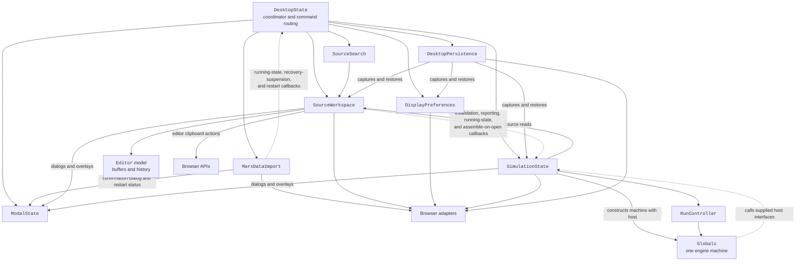

# Venus desktop state

This directory owns state and workflows whose lifetime spans several browser views. VenusUI creates one desktop coordinator during component initialization, installs it through [context](../context/README.md), and mounts its browser lifecycle. No module creates a global editor, machine, reactive store, or storage subscription. Components read live fields on the same owner instead of maintaining copies.

The diagram shows how the coordinator composes the owners and which models and adapters each one reaches; it is not an exhaustive import graph. Dashed arrows are calls through supplied callbacks or interfaces: the workspace never imports the simulation owner, and the engine never imports this directory. Every owner may also use the stateless [presentation utilities](../utils/README.md).

| Owner              | Models and adapters it uses                                                                                                                                                                                                                                  |
| ------------------ | ------------------------------------------------------------------------------------------------------------------------------------------------------------------------------------------------------------------------------------------------------------ |
| DesktopState       | The command and Settings catalogs; it constructs every other owner and routes commands to them                                                                                                                                                               |
| SourceWorkspace    | The [Editor](../../editor/README.md) model; the browser [source library and bundled references](../../browser/sources/README.md) and the [import plan](../../browser/transfers/README.md); the Clipboard API for Cut, Copy, and Paste                        |
| SimulationState    | The engine's `Globals` and the [RunController](../RunController.ts); the browser [cooperative scheduler and Web Audio tone host](../../browser/execution/README.md) and [engine-preference storage](../../browser/preferences/README.md); Web Crypto entropy |
| DisplayPreferences | Browser [pane-layout and display-settings storage](../../browser/preferences/README.md), and the [recovery record](../../browser/session/README.md)'s stored view, register-bank, and memory-range vocabularies                                              |
| DesktopPersistence | The browser [recovery record and its batched writer](../../browser/session/README.md)                                                                                                                                                                        |
| MarsDataImport     | The browser [data adapter](../../browser/data/README.md)'s reading type and storage replacement                                                                                                                                                              |
| SourceSearch       | None; it edits through the workspace                                                                                                                                                                                                                         |
| ModalState         | None; other owners request dialogs and overlays from it                                                                                                                                                                                                      |

Simulation state implements the engine's injected host when it constructs the machine. The [engine guide](../../engine/README.md#host-services-and-portability) defines what the engine expects of each service; the following backs it in the browser:

| Host service                        | Backed by                                                                                                                                                       |
| ----------------------------------- | --------------------------------------------------------------------------------------------------------------------------------------------------------------- |
| Source text and virtual path rules  | The workspace's read contract: a bundled reference, then the open buffer, then the committed library source; during recovery, the checkpoint's captured sources |
| Console output                      | Simulation's bounded Run I/O text                                                                                                                               |
| Console input                       | Simulation's pending request and one-shot resolver, typed inline in Run I/O or into a prompted-input overlay                                                    |
| Syscall dialogs                     | Simulation's dialog request and resolver, rendered by the dialog variants                                                                                       |
| Cooperative scheduling              | The browser scheduler adapter's MessageChannel tasks and timers                                                                                                 |
| Stop-triggered release              | Completes pending input and dialogs, releases tone waits, and wakes the scheduler                                                                               |
| MIDI tones                          | The browser Web Audio tone host                                                                                                                                 |
| Entropy for unseeded random streams | Web Crypto random values                                                                                                                                        |
| Preference reads and writes         | The browser engine-preference storage adapter                                                                                                                   |
| View refresh during timed execution | The run controller's revision publication                                                                                                                       |

The coordinator routes commands and composes source, simulation, display, search, and modal responsibilities, with desktop persistence coordinating recovery across them. The source workspace owns Editor buffers, selection, local-library operations, save/close/import confirmation, Auto Save, and recovery backups. Simulation state owns Globals, RunController, controller snapshots, breakpoints, the loaded program’s label selection, engine preferences, output, pending syscall resolution, and its cooperative browser scheduler. The scheduler uses MessageChannel tasks for zero-delay yields and timers for finite-speed waits; simulation teardown disposes it synchronously, settling waits and closing both ports. It also publishes derived facts that views read instead of recomputing them: the filename of the program loaded in the machine, independent of the Edit selection (`loadedFilename`), and whether a syscall waits for text typed into the Run I/O console rather than a popup (`consoleInputPending`). Its `refresh` publishes a revision after a manual machine edit, and its `stop` requests Stop of the running program and releases pending host input, so the debugger and dialogs do not reach the controller. Display preferences own tab selection, presentation choices, measured pane geometry, and validated layout persistence. Their selections are typed with the closed view, register-bank, and memory-range unions exported by the [browser session adapter](../../browser/README.md), and their defaults come from the adapter’s field schema. The persisted key list is derived from those fields, excluding Auto Save, which the workspace owns. The adapter also owns required-field compatibility and numeric bounds. They also convert an interactive register-sidebar or editor divider size into the stored width or fraction (`setRegisterWidth`, `setEditorHeight`). `resetDataView()` returns the Data Segment to the first page of the data range, as after assembly, Reset, or a memory-layout change, and `resetExecuteView()` also selects the general registers. Source search owns find/replace inputs and operates through the workspace's existing edit/history contract. The workspace publishes `tabSummaries` (the identity, name, and unsaved state of every open buffer, in tab order, which the source tabs render) and `unsavedNames`, derived from it, which the dirty-source unload guard and the deletion confirmation read instead of walking tabs themselves. It borrows the source textarea and a line-reveal capability through an identity-guarded registration released on editor removal or workspace disposal. The mounted editor measures its own line height for source navigation; the workspace owns source selection and the scroll offsets the editor reports. Library reload, tab lookup, and buffer close are shared private helpers of its save, close, import, and rename workflows.

The workspace receives explicit callbacks for assembly invalidation, error reporting, execution restrictions, and assemble-on-open. It does not construct or reach into machine internals. Simulation resolves source through the workspace's public read contract, preferring open buffers to committed sources. Its console output is appended through one path that keeps only the most recent characters of Run I/O up to the engine's message-buffer limit, so echoed input and the Reset and run-completion notes are bounded like program output. The text and tab changes after a settled Go or Step come from the [run-outcome rule](../utils/execution/README.md), which simulation applies, and when an engine setting changes simulation consults the Settings catalog for whether the loaded assembly is invalidated. The coordinator connects these capabilities, keeps Help selection, and publishes command availability and the shared toggles. It builds the toolbar and Settings display toggles, and the engine-setting checkboxes only the Settings menu offers, from the Settings catalog in the [command utilities](../utils/commands/README.md) rather than listing each one itself; both share one private builder of an engine setting's live value, execution-time disablement, and inversion request, and the [command context](../context/README.md) hands both lists to menus and toolbars. It also derives the footer content from the selected view, the loaded program, and the execution status (the root adds only the focus-dependent caret position), and `canEditTabs`, the single availability of source-tab rename and reorder, which is false while a program runs or a dialog owns interaction. The framework-free [RunController](../RunController.ts) and engine retain execution algorithms.

Inline source-tab renaming delegates to the same validation, collision handling, and atomic library write as Save As Rename. Rename targets need a nonempty assembly basename ending in `.asm` or `.s` (judged by the browser adapter's extension helpers, without regard to case), retain virtual-path validation, and cannot belong to another open buffer. Invalid proposals open a warning and restore the pending name to the latest valid buffer name; source text remains intact. Closed-library collisions require replacement confirmation. Only a successful write changes the editor's name and saved baseline, publishes fresh snapshots, and updates recovery persistence.

Native file selection and downloads belong to the [FileImporter and FileExporter components](../components/README.md). Those mounted behaviors register commands with the coordinator and return teardown that removes their own registrations. The importer reads the selection, including ZIP archives, into an import plan and passes it to the workspace, which keeps it as `importPlan`, always shows its summary, and commits only the plan's valid sources. The coordinator's `beginTransfer` acquires a transfer overlay from `ModalState`; `hasModal` reads that shared owner, so keyboard commands wait. The returned release removes only its own request, and a superseding transfer makes an older release inert. Export File obtains a snapshot from the workspace; the all variant merges committed sources with unsaved open-buffer contents before downloading. Clipboard transfer similarly delegates new-file creation through the workspace rather than owning another editor.

[ModalState](ModalState.svelte.ts) is the sole owner of dialog visibility: one primary workspace, Help, settings, dump, breakpoint, or MARS data import workflow, with temporary transfer and simulation-input overlays. `SourceWorkspace.modal` and `DesktopState.help` are projections of this state, not separate visibility stores. Workflow drafts and save/close queues stay with the workspace or dialog; input requests and one-shot resolvers stay with simulation. Overlays preserve underlying mounted dialogs and their drafts. Transitions use live request identity independently of reactive snapshots, so teardown and superseded completion cannot clear a replacement overlay. Desktop teardown flushes recovery first, then disposes and seals the modal owner before disposing the workspace and simulation.

Browser restoration runs after mounting. Display persistence effects and machine-display synchronization are scoped to the creating Svelte component. The returned mount cleanup cancels initialization and reveal frames, stops workspace persistence, removes the controller subscription, and initiates controller disposal. That disposal requests Stop, resolves pending input, and wakes scheduler waits; it retains the old machine until execution settles asynchronously. Svelte does not wait for disposal before removing the DOM. Unexpected cleanup rejection is consumed and reported through browser diagnostics instead of becoming an unhandled promise.

File readers ignore superseded selections and completions after disposal. Clipboard mutations recheck both their source snapshot and execution state after awaiting browser permission or I/O. New-file initialization, including Help examples, is synchronous; only focus waits for rendering, and it verifies that the same buffer remains current and the owner remains alive. Derived getters remain pure; raw machine and editor mutations are published through controller revisions and workspace snapshots.

These owners separate browser coordination previously combined in VenusUI; they do not replace the legacy algorithms. The [Venus module guide](../README.md) retains the legacy mapping and supported workflows. Add state here only when its ownership or lifetime crosses view boundaries; hover, native dialog focus, and pointer gestures remain with their components, while stateless presentation rules belong in [utilities](../utils/README.md).

Desktop persistence coordinates recovery across the existing owners without taking ownership of their machine or buffers. After source restoration and simulation startup, it reassembles captured source dependencies and applies a validated stable hardware checkpoint, restores independent Edit selection, matching editor history, source caret/scroll, view/register/message tabs, memory navigation, breakpoints, program-owned label selection, console buffers, and the tabbed Help browser's visibility and tab/article selection (exposed by the desktop through `HelpRecovery`), then enables recovery writes. Label selection uses the owning source (or global table), exact name, and address rather than transient engine object identity; reconstruction validates it against recovered symbols, and invalidation or a newly assembled program clears it. During execution it keeps the preceding checkpoint and corresponding consoles while saving presentation changes. It never restores pending input, active execution, confirmation dialogs, or single Help articles. Storage failures show a visible error while preserving in-memory work. [ADR 0007](../../../../docs/adrs/0007-desktop-session-recovery.md) defines the contract. Two requests reach it from the whole-application data workflow: `flush` captures and writes the current state at once, as page exit does, so Export MARS copies a current session record; and `suspend` stops recovery writes, dropping any queued snapshot, and returns the function that resumes them.

[MarsDataImport](MarsDataImport.svelte.ts) owns the Import MARS workflow. It holds the reading the importer hands it, a schema-conforming payload with its summary or the reasons a file was rejected, and shows it through the `importMars` primary modal; nothing is stored before confirmation, and dismissal releases the reading. Confirming rechecks that no program is running, suspends recovery writes through the desktop, and has the browser [data adapter](../../browser/data/README.md) replace every mirrored storage key. On success it covers the desktop with a Restarting MARS… status and reloads the page, so every owner restores from the imported records through its ordinary startup path and nothing has to be reconciled in place; the suspended writer leaves those records intact as the page exits. On a failed write the adapter has already restored the previous records, and the owner resumes recovery and keeps the dialog open with the error. It receives running state, recovery suspension, the blocking status, and the restart as callbacks, and never reaches into the workspace, machine, or writer. [ADR 0017](../../../../docs/adrs/0017-portable-mars-data.md) defines the workflow.

Display preferences also own the unchecked-by-default **Clear all outputs on Go** selection, persisted as `clearAllOutputsOnGo` in the existing display-settings record. Simulation reads the shared selection when Go starts a fresh program run after assembly or Reset and uses its existing Clear All operation before adding current run diagnostics. Resume preserves both outputs after Pause, a breakpoint, Step, or Backstep, including backstepping to the first instruction and restoring a started checkpoint; Step, Assemble, Reset, and Backstep retain their existing output behavior. This addition beyond the legacy/JAR Venus UI is defined in [ADR 0008](../../../../docs/adrs/0008-clear-outputs-on-go.md). The unchecked-by-default **Prompt to clear all breakpoints** selection, `promptClearBreakpoints` in the same record, makes the desktop coordinator open its confirmation before Clear all breakpoints from the toolbar, Run menu, or Ctrl+K; the confirmation's Keep showing this warning checkbox edits the same preference ([UI-0014](../../../../docs/deviations.md#ui-0014-live-breakpoint-controls-at-finite-speeds-locked-at-maximum-speed)).

DesktopState routes memory-dump visibility through ModalState and owns command availability. The dump dialog reads the successfully loaded machine while execution is idle; it owns only transient selections and a disposable browser save workflow. Dumping never mutates source buffers, saved records, or machine checkpoints.

SimulationState also commits Exception Handler drafts by persisting changed enablement and filename independently, without invalidating loaded code. Disabling inclusion never clears the selected file, and a filename selected before disabling can still be committed. A changed preference publishes a revision for checkpoint persistence. Loaded-handler metadata remains separate from future-assembly preferences, so restoring a paused kernel handler after disabling automatic inclusion reconstructs the original dependency and leaves the new preference intact. Recovery retains current persisted handler preferences even when restoring a checkpoint from before an active run during which the selection or enabled flag changed.

SourceWorkspace resolves reserved bundled identities before writable sources and opens them once as read-only references without invalidating or assembling loaded code. Recovery uses canonical asset text and restores protection, ignoring reference draft edits and history. Editor and workspace mutation guards complement the native textarea’s read-only state; search permits Find but blocks replacement. Copy to new file creates an ordinary editable buffer retaining the complete text and license. Protected references never enter user-library commits, Auto Save, Save All, or Export All Files. They remain individually exportable. When a reference is selected, setting-driven reassembly targets the loaded user lead instead.

Simulation also owns the service 50–59 dialog request, draft, and one-shot resolver independently of console reads. Stop/disposal releases both kinds of pending operation before the run settles. Simulation also constructs the machine's [Web Audio tone host](../../browser/README.md) with the machine: Go and Step call its `prepare()` synchronously before awaiting execution so the audio context starts within their user gesture, the stop listener's release ends any pending MidiOutSync wait without silencing started tones, a tone requested after a stop request does not suspend the stopping run, and teardown disposes the host, silencing its voices and closing its context. The browser supplies entropy only when an unseeded random stream is first used; the engine retains stream state and checkpoints preserve its sequence. Dialog Cancel resumes with the legacy status and does not request Stop.

Recovery uses detached editor-history snapshots shared until the workspace revision changes and execution snapshots shared until their checkpoint or label selection changes. A desktop-owned browser writer coalesces writes in a 200 ms window; page exit, document hiding, and desktop teardown flush pending presentation and release its timer, listeners, and serialization caches. Source draft backups and source undo granularity are unchanged. Save completion, cancellation, and disposal release the transient save target, including after Save and Close. Workspace command availability is shared by the desktop and the workspace dispatcher so read-only/running guards cannot drift between presentation and execution.
